<div align="center">

# A Marked-Width Reduction of Mandelbrot Local Connectivity

### A source-locked research program in one-dimensional complex dynamics

**Matthew Robert Wesney**  
Research direction, synthesis, authorship, and public stewardship

[](https://dovvnloading.github.io/loops-research-archive/#frontier)
[](./RESEARCH_MAP.md)
[](https://dovvnloading.github.io/loops-research-archive/#ledger)
[](./LICENSE)

[**Project page**](https://dovvnloading.github.io/loops-research-archive/) · [**Main manuscript**](./marked_width_mlc_manuscript.pdf) · [**Paper 1**](./papers/paper1_canonical_localization/paper1_forced_noninjectivity_sheet_kernel_v1.1_visual.pdf) · [**Paper 2**](./papers/paper2_rooted_end_compactification/paper2_direct_decoration_rooted_end_compactification_v1.1_visual.pdf) · [**Paper 3 — Draft III Visual Edition**](./papers/paper3_protected_carriers/paper3_draft3_visual.pdf) · [**Research map**](./RESEARCH_MAP.md) · [**Contribute**](./CONTRIBUTING.md)

</div>

> [!IMPORTANT]
> **The Mandelbrot Local Connectivity conjecture remains open.** The archive establishes unconditional finite and structural results, records imported theorems, and gives a conditional reduction whose remaining hypotheses are explicit. It does not claim an unconditional proof of MLC.

## Research thesis

The program asks whether the global MLC problem can be reduced to a controlled sequence of marked geometric transitions. The proposed state retains more than an unmarked continuum: it carries the ambient marked surface, a regularized carrier, critical and postcritical data, satellite or neutral access information, prime-end or sectorial boundary data, declared curve families, and—after the obstruction found in Paper 1—the sheet transport lost by canonical localization.

The central methodological commitment is exact status separation. A statement in this archive is classified as **imported**, **proved within the program**, **conditional**, or **open**. The machine-readable ledger records dependencies and evidence pointers for 465 obligations: **34 imported, 316 proved, and 115 open** at the 2026-07-27 source lock.

## The research spine

```mermaid
flowchart LR
    P1["Paper 1<br/>localization obstruction"] --> S["corrected marked state<br/>with sheet transport"]
    S --> P2["Paper 2<br/>rooted-end compactification"]
    P2 --> P3["Paper 3<br/>separation ledgers + protected routing<br/>(Draft III Visual Edition, QA audited)"]
    P3 --> H1["H1<br/>marked construction"]
    H1 --> H2["H2<br/>calibration"]
    H2 --> H3["H3<br/>coercivity"]
    H3 --> H4["H4<br/>rigidity"]
    H4 --> U["UPTCR"]
    U --> M["MLC"]

    classDef proved fill:#e8f5ed,stroke:#166534,color:#102a1a;
    classDef active fill:#fff4d6,stroke:#9a6700,color:#3f2a00;
    classDef open fill:#f7e8e8,stroke:#9f2d2d,color:#3f1111;
    class P1,P2 proved;
    class P3 active;
    class H1,H2,H3,H4,U,M open;
```



Papers 1–3 address successive finite or structural interfaces. They do not by themselves close the analytic transition, compactness, or rigidity gates. The [research map](./RESEARCH_MAP.md) gives the exact correspondence between this spine, the ledger, and the archive directories.

## Papers

| Work | Public state | Principal contribution | Boundary |
|---|---|---|---|
| **Paper 1 — [*Forced Noninjectivity and the Sheet Kernel at Primitive Canonical Localization Seeds*](./papers/paper1_canonical_localization/paper1_forced_noninjectivity_sheet_kernel_v1.1_visual.pdf)** | Version 1.1 Visual Edition · 41 pages | Proves forced noninjectivity at every ordinary primitive canonical seed of period $p>1$ in the stated class; constructs the canonical covering/embedding resolution; identifies an infinite sheet kernel with at least $2^p-2$ independent peripheral winding coordinates. | Does not prove MLC, rigidity, or a priori bounds; decoration-stage applications require a separate alignment theorem. |
| **Paper 2 — [*The Direct-Decoration Rooted-End Compactification*](./papers/paper2_rooted_end_compactification/paper2_direct_decoration_rooted_end_compactification_v1.1_visual.pdf)** | Version 1.1 Visual Edition · 21 pages | Realizes the binary rooted-end compactification at one direct-decoration scale, proves the exact component quotient and shift dynamics, and establishes stable replacement and protected-access results in the same planar model. | A one-scale theorem; it does not supply cross-scale transitions, self-renormalization of end fibers, or MLC. |
| **Paper 3 — [*Protected Planar Carriers: Separation Ledgers and Access-Preserving Routing*](./papers/paper3_protected_carriers/paper3_draft3_visual.pdf)** | **Draft III Visual Edition** · 2026-07-27 · 74 pages · QA audited | Gives finite realization and exact recognition criteria for full carriers preserving selected prime-end data and frozen obstacles; proves a cohomological attachment ledger, persistent packet audits, sharp Hausdorff-limit defect examples, and a stable decreasing-envelope theorem. | A finite planar-topology paper, not a virtual dynamical-carrier construction, quantitative width theorem, or MLC result. Independent specialist review remains appropriate before journal submission. |

A paper-level index with source files and version status is maintained in [`papers/README.md`](./papers/README.md).

### Paper 1: why the state had to change

For an ordinary primitive quadratic-like restriction of period $p>1$, the return $F=f^p$ has degree $2^p$ while the central component has degree $2$. The resulting $2^p-2$ excess pullback components create peripheral loops that survive in the source localization subgroup but die after target-side hole filling. Distinct lifted endpoints are therefore identified by the localized inclusion.

If $H_s$ and $H_t$ denote the source and target localization subgroups and $K=a_*^{-1}(H_t)$, Paper 1 identifies the based sheet fiber as $K/H_s$ and proves

$$
N_{\mathrm{fill}}=\ker(a_*),\qquad
K=N_{\mathrm{fill}}\rtimes H_s,\qquad
N_{\mathrm{fill}}\twoheadrightarrow \mathbb Z^{\,2^p-2}.
$$

The elementary degree budget is not the claimed novelty. The contribution is the dynamical subgroup defect, its canonical resolution, the kernel normal form, the winding quotient, and exact propagation through the complementary-cover locus. The result corrects an embedding-preservation route explored in this program; it does not contradict Kahn or Kahn–Lyubich, whose localization statements use immersions.

### Paper 2: the exact one-scale model

At a direct-decoration scale, two univalent inverse branches generate finite fibers $K_w$ and nested end fibers $E_\omega$. Their union $H_\partial$ is compact; these fibers are exactly its connected components; and the component projection

$$
\pi_\partial:H_\partial\longrightarrow\Omega_\partial
$$

is continuous and closed. Away from the root fiber, the return map descends to first-symbol deletion on the binary address compactification. The theorem also proves fullness, connected complement, stable replacement inside disjoint Jordan cells, and finite protected-access transport under its stated hypotheses.

The abstract compactification is classical. The paper’s contribution is its realization by direct-decoration inverse branches, puzzle pullbacks, and nested puzzle intersections in a single dynamical plane, with replacement and access theorems proved in that same model.

### Paper 3: the finite connector interface

Draft III Visual Edition isolates when a finite family of disjoint full continua can be joined by a full planar carrier without violating frozen obstacles or prescribed prime-end accesses. Its organizing criterion asks whether one frozen free-domain component presents simultaneous singleton ports to all selected atoms. It develops corrected slit and packet lemmas, order-independent fullification for fixed typed packets, persistent obstruction defects, and checkable cellwise criteria.

The new attachment exact sequence records precisely how disconnected traces create holes and separating traces fill existing ones. It yields a connected-trace criterion for full unions, arbitrarily large separation defects born under Hausdorff convergence, and a positive decreasing-envelope stability theorem. The [release QA](./papers/paper3_protected_carriers/QA_REPORT.md) records deterministic builds, proof and citation audits, strict PDF-integrity checks, and full visual inspection.

## Main manuscript and current frontier

The [225-page main manuscript](./marked_width_mlc_manuscript.pdf) integrates the marked-width program: finite root-pullback and inverse-tree reductions, critical-value and attachment formulae, finite routing, common-domain constructions, finite Wave-horizon closure under stated hypotheses, source-locked corrections, and no-go results.

At the source lock, the terminal implication **UPTCR ⇒ MLC** is recorded as proved *conditional on UPTCR*. The hypotheses that would activate it remain open:

| Gate | Ledger status | Required advance |
|---|---|---|
| `H1_MARKED_CONSTRUCTION` | Open | Construct the marked carrier/state with all required access, obstacle, sheet, and transition data. |
| `H2_CALIBRATION` | Open | Relate the marked observable quantitatively to the source extremal-width machinery. |
| `H3_COERCIVITY` | Open | Prevent analytic degeneration in the compactified state. |
| `H4_RIGIDITY` | Open | Convert the resulting limiting control into the rigidity conclusion needed by the reduction. |
| `UNIVERSAL_PROTECTED_TOWER_CLOSURE` | Open | Close the protected tower uniformly across the admitted combinatorial regimes. |
| `UPTCR_IMPLIES_MLC` | Proved conditional implication | Deduce MLC once the universal compactness-and-rigidity proposition is available. |

The stationary-Wave repair has one proved gate—relative continuation—and three open interfaces: pointwise two-path breaking, measurable final fixed-component exit, and typed bounded-degree pushforward. Exact identifiers, dependencies, and evidence links are available in the [interactive ledger](https://dovvnloading.github.io/loops-research-archive/#ledger) and [`ledger.json`](./ledger.json).

### November 2026 — certified two-scale complex return model

A new [independently reproducible exact certificate](./research/independent_audits/complex_two_scale_quadratic_like_certificate_20261105.md) constructs **proper degree-two quadratic-like return maps of periods 3 and 9 in the same actual quadratic dynamical plane**, uniformly for every complex parameter within (2^{-32}) of the explicit period-27 center. The target disks are (U_3=D(0,1/4)) and (U_9=D(0,1/32)); their critical preimage components are compactly nested, with connected little filled Julia sets, pairwise disjoint phase images, and a physically realized 9-to-3 phase inclusion. [Exact outward integer checks](./research/independent_audits/verify_complex_quadratic_like_3_9.py) run in research CI.

**Boundary:** This is a finite attracting-window complex renormalization example—not a source-compatible Kahn–Lyubich ray/prime-end/sheet atlas. Every parameter in the certified window fails Paper 2's (K(f)=J(f)) assumption. It does not close the global marked-construction or MLC analytic gates. The earlier [parameter-window and naive-stadium first-failure certificate](./research/independent_audits/two_scale_complex_window_obstructions_20261105.md) remains applicable and explains why different, larger complex return domains were required.


### November 2026 — exact three-scale symbolic marking candidate

A new [source-audited candidate-angle certificate](./research/independent_audits/period27_three_scale_symbolic_marking_20261105.md) takes the explicit period-27 center and independently verifies an exact 3/9/27 external-angle **kneading-word** match to the airplane tuning substitution \(0\mapsto011,\ 1\mapsto100\). It tests the correct orientation signs for the physical return maps \(f\), \(f^3\) and \(f^9\); certifies all six rational angle periods and the three un-angled internal addresses; and produces a reproducible [26-edge real Markov graph](./results/period27_symbolic_marking.json), checked against outward dyadic orbit enclosures in [research CI](./.github/workflows/lean-proofs.yml).

**Important distinction:** the angle pairs are **candidate source markings**. Equality of rational angular kneading and real critical-orbit kneading does **not** by itself identify actual parameter-ray landing, KL puzzle accesses or peripheral localization sheets. A sourced parameter-identification and landing argument is the next theorem; the attracting-window result still fails Paper 2's \(K(f)=J(f)\) assumption. No MLC gate status changes.

## Navigate the archive

| Layer | Entry point | Use it for |
|---|---|---|
| Scholarly overview | [Project page](https://dovvnloading.github.io/loops-research-archive/) | Results, frontier, paper sequence, atlas, references, and searchable ledger |
| Program map | [`RESEARCH_MAP.md`](./RESEARCH_MAP.md) | Dependency spine, canonical directories, historical layers, and reading routes |
| Main synthesis | [`marked_width_mlc_manuscript.pdf`](./marked_width_mlc_manuscript.pdf) | Full definitions, reduction, theorem boundaries, and open gates |
| Companion papers | [`papers/`](./papers/) | Paper PDFs, LaTeX sources, theorem packets, and assembly records |
| Claim status | [`ledger.json`](./ledger.json) | Machine-readable obligations, statuses, dependencies, and evidence pointers |
| Canonical research record | [`research/mlc_unified/`](./research/mlc_unified/) | Source ledger, adversarial audits, proof obligations, validations, and research log |
| Historical development | [`research/mlc_research_push_*`](./research/) | Dated research increments retained for provenance and ledger links |
| Computation | [`code/`](./code/) · [`results/`](./results/) · [`figs/`](./figs/) | Reproducible diagnostics and visual evidence; not substitutes for proof |
| Synthesis dossier | [`dossier.html`](./dossier.html) | Literature-facing context and computational atlas |
| Contribution protocol | [`CONTRIBUTING.md`](./CONTRIBUTING.md) | Standards for proof, counterexample, source, computation, and exposition contributions |

## How to audit a claim

1. Locate the theorem, proposition, definition, or gate in the relevant manuscript.
2. Find its ledger identifier in the [web ledger](https://dovvnloading.github.io/loops-research-archive/#ledger) or [`ledger.json`](./ledger.json).
3. Follow dependencies until each terminus is imported, proved, or explicitly open.
4. Inspect the cited source or internal evidence artifact; check that its hypotheses match the use.
5. Treat computations as diagnostics unless a manuscript supplies a proof promoting the observation to a theorem.

Corrections are welcome. A challenge is most useful when it names the exact statement or ledger ID, identifies the first unsupported inference, and supplies either a proof repair, a counterexample, or a precise source mismatch. See [`CONTRIBUTING.md`](./CONTRIBUTING.md).

## Mathematical lineage and attribution

The program builds on the established complex-dynamics literature. Foundational and frontier credit remains with the original authors of every imported result.

| Area | Original authors and representative sources |
|---|---|
| Polynomial-like mappings and local connectivity | **Adrien Douady and John H. Hubbard**, [polynomial-like mappings](http://www.numdam.org/item/ASENS_1985_4_18_2_287_0/); **Jean-Christophe Yoccoz**, with Hubbard’s exposition of the local-connectivity theory |
| Renormalization, rigidity, and a priori bounds | **Mikhail Lyubich**; **Jeremy Kahn**, [bounded primitive combinatorics](https://arxiv.org/abs/math/0609045); **Kahn and Lyubich**, [decorations](https://arxiv.org/abs/math/0609046) and [unicritical local connectivity](https://arxiv.org/abs/math/0505194) |
| Satellite and neutral regimes | **Davoud Cheraghi and Mitsuhiro Shishikura**, [satellite renormalization](https://arxiv.org/abs/1509.07843); **Dzmitry Dudko and Lyubich**, [neutral bounds](https://arxiv.org/abs/2210.09280) and [Feigenbaum points](https://arxiv.org/abs/2309.02107); **Dudko, Yusheng Luo, and Lyubich**, neutral renormalization |
| Bounds and obstruction theory | **Alexander Blokh, Genadi Levin, Lex Oversteegen, and Vladlen Timorin**, [maps with no a priori bounds](https://arxiv.org/abs/2205.03157); **Levin**, [rigidity and non-local connectivity](https://arxiv.org/abs/0710.4406); **Kahn, Ilya Kapiamba, and Lyubich**, parabolically bounded primitive renormalization |

The project page and manuscripts carry the source-locked bibliography and theorem-level citations. Prior authors are not represented as collaborators on this repository, and no affiliation or endorsement is implied.

## Project authorship and stewardship

**Matthew Robert Wesney** is the human author, research director, and archive steward. He established the agenda, selected and locked the source corpus, framed and sequenced the investigations, adjudicated competing outputs, maintained the proof-obligation and adversarial-audit record, integrated the retained results, and authorized the public release. He retains responsibility for the mathematical claims, status designations, citations, disclosures, and publication decisions.

This work was developed through sustained human–AI research collaboration. **Anthropic (Fable 5 / Opus 5)** and **OpenAI (GPT-5.6 Sol)** provided substantial assistance across the research lifecycle, including adversarial testing of definitions and proofs, counterexample search, proof-obligation analysis, source comparison, computational design, code generation and review, numerical experimentation, synthesis, manuscript development, technical editing, quality assurance, and archive preparation. Their contribution was integral to the iterative construction and stress-testing of the program.

The collaboration was directed and orchestrated by Matthew Robert Wesney: he defined objectives, supplied context, assigned and sequenced investigations, evaluated and reconciled model outputs, and selected what entered the research record. The systems are acknowledged as substantial computational research collaborators, not human authors. This acknowledgment does not imply review or endorsement by Anthropic or OpenAI.

Imported mathematics remains attributable to its original authors. New arguments, syntheses, corrections, status judgments, and any errors in this archive remain the responsibility of Matthew Robert Wesney.

## Citation and reuse

Citation metadata is available in [`CITATION.cff`](./CITATION.cff). Please cite Wesney for this archive and its manuscripts, and separately cite the original literature for every imported theorem used in derivative work.

```bibtex
@misc{wesney2026markedwidth,
  author       = {Wesney, Matthew Robert},
  title        = {A Marked-Width Reduction of Mandelbrot Local Connectivity},
  year         = {2026},
  howpublished = {Public research archive},
  url          = {https://github.com/dovvnloading/loops-research-archive},
  note         = {Source lock 2026-07-27; MLC remains open}
}
```

Original contributions are released under [CC0 1.0 Universal](./LICENSE). Citations and attribution remain essential scholarly practice even where the license does not require them; third-party materials remain subject to their original rights and terms.

## Recommended reading path

1. [Project page](https://dovvnloading.github.io/loops-research-archive/) — orientation and result boundary.
2. [Paper 1](./papers/paper1_canonical_localization/paper1_forced_noninjectivity_sheet_kernel_v1.1_visual.pdf) — the localization obstruction and corrected state.
3. [Paper 2](./papers/paper2_rooted_end_compactification/paper2_direct_decoration_rooted_end_compactification_v1.1_visual.pdf) — the exact rooted-end model.
4. [Paper 3](./papers/paper3_protected_carriers/paper3_draft3_visual.pdf) — the QA-audited Draft III Visual Edition finite protected-carrier theory.
5. [Main manuscript](./marked_width_mlc_manuscript.pdf) — the global reduction and remaining gates.
6. [Interactive ledger](https://dovvnloading.github.io/loops-research-archive/#ledger) — dependency-level audit.
7. [`research/mlc_unified`](./research/mlc_unified/) — detailed source, proof, adversarial, and validation record.

---

<div align="center">
<sub>Independent research program · math.DS · source lock 2026-07-27 · MLC remains open</sub>
</div>
