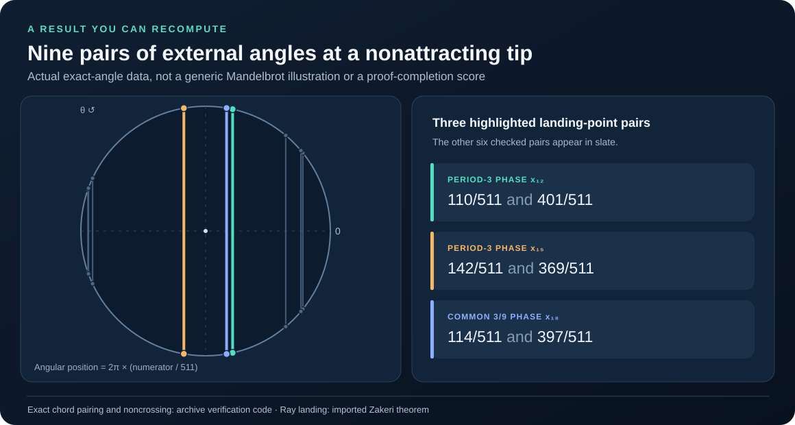
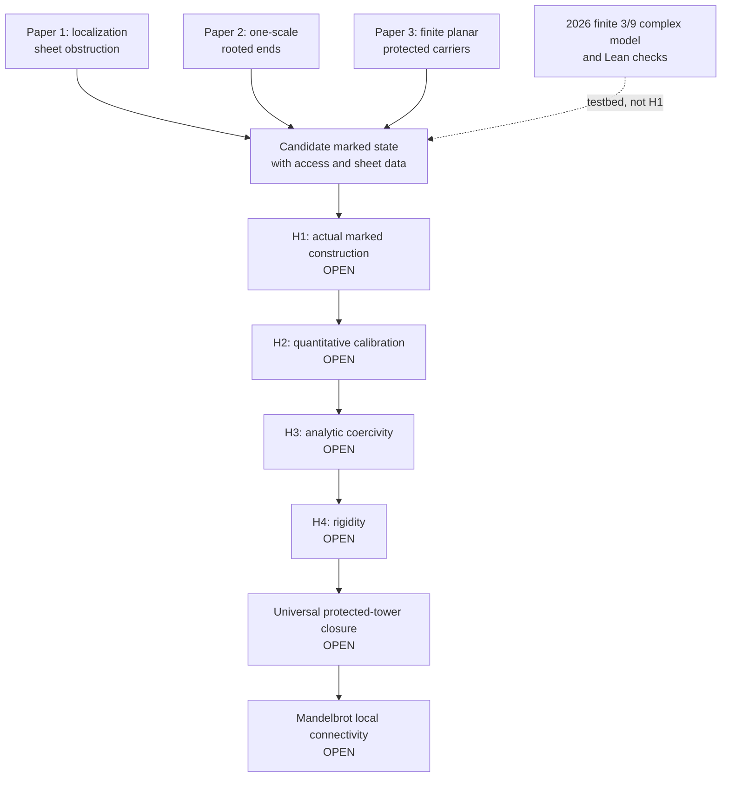
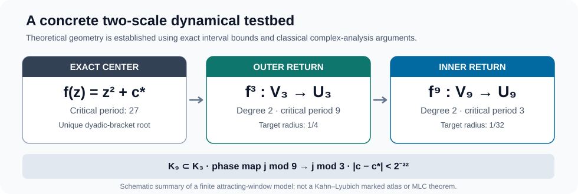
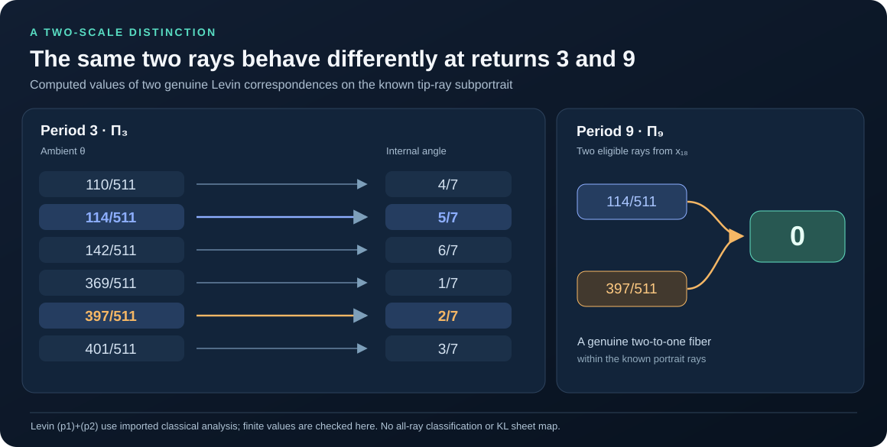
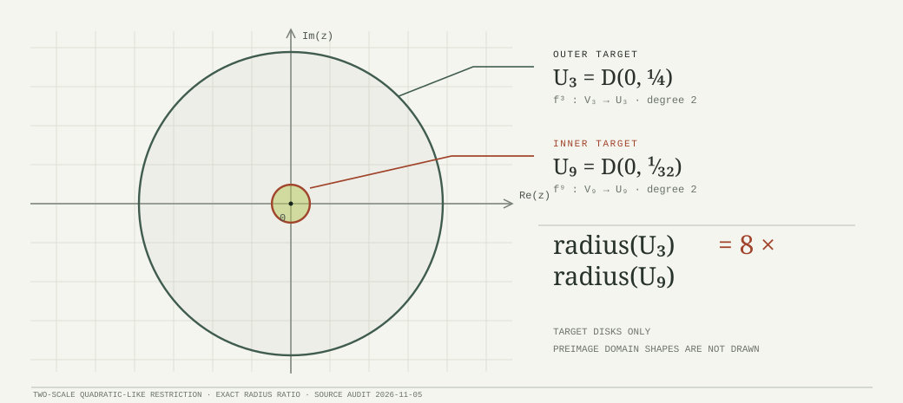

<div align="center">

# A Marked-Width Reduction of Mandelbrot Local Connectivity

### A research archive of exact dynamics, planar topology, and marked-width obstructions

**Matthew Robert Wesney**  
Research direction, synthesis, authorship, and public stewardship

[](https://github.com/dovvnloading/loops-research-archive/actions/workflows/lean-proofs.yml)
[](./LICENSE)

[**Explore the research**](https://dovvnloading.github.io/loops-research-archive/) ·
[**Read the manuscript**](./marked_width_mlc_manuscript.pdf) ·
[**Three papers**](./papers/README.md) ·
[**Evidence map**](./RESEARCH_MAP.md) ·
[**Reproduce results**](#reproduce-the-central-results) ·
[**Contribute / review**](./CONTRIBUTING.md)

**README updated 2026-11-06** · **Manuscript and ledger source lock 2026-07-27**

</div>

> [!IMPORTANT]
> **The Mandelbrot Local Connectivity conjecture (MLC) remains open.** This repository contains finite and structural theorems, source audits, computational certificates, a conditional marked-width reduction, and open proof obligations. The November 2026 two-scale examples and Lean checks do **not** constitute a proof of MLC or a completed Kahn–Lyubich marked construction.

**On this page:** [Results and original figures](#research-results-you-can-inspect) · [Mathematical program](#the-mathematical-program) · [Companion papers](#three-companion-papers) · [3/9 testbed](#the-november-2026-two-scale-testbed) · [Reproduce](#reproduce-the-central-results) · [Evidence ledger](#source-locked-evidence-ledger) · [Open problems](#the-open-frontier)

## Research results you can inspect

These visuals come from **this archive's own computations, certificates, and finite constructions**. They show concrete angles, pairings, and return geometry—not a percentage of a conjecture solved, stock fractal art, or a diagram attributed to someone else.



*Figure 1 — An actual output of the project.* The nine chords join **18 exact periodic angles** at their correct positions on the angle circle. The pairing and noncrossing arithmetic are reproduced by the [portrait verifier](./research/independent_audits/verify_tip_ray_portrait.py) from the [machine-readable manifest](./results/period27_tip_ray_portrait.json). Straight chords encode combinatorial pairings; they are **not** drawn physical rays. The underlying **ray-landing theorem is imported from Zakeri**, not claimed as a new theorem of this project.

### What was contributed here

| Archive result | Inspect the evidence | Precise boundary |
|---|---|---|
| **Exact nonattracting 3/9 tip** with critically preperiodic dynamics and nested real return intervals | [Tip certificate](./research/independent_audits/period27_misiurewicz_tip_ray_access_20261106.md) · [exact manifest](./results/period27_misiurewicz_tip.json) | Exact algebraic and interval checks; ray landing uses cited classical results. |
| **Period-nine ray subportrait:** nine landed pairs, 18 distinct rational angles and no crossed chords | [Portrait manifest](./results/period27_tip_ray_portrait.json) · [Lean checks](./TipRayPortrait.lean) | A certified *subportrait*, not an exhaustive ray automaton. |
| **Two nonattracting complex returns**, at periods 3 and 9, with certified Rouché margins and physical phase refinement | [Complex-domain audit](./research/independent_audits/nonattracting_tip_complex_two_scale_20261106.md) · [Lean margins](./TipComplexMargins.lean) | Holomorphic topology invokes Rouché/Riemann–Hurwitz; no Kahn–Lyubich puzzle is supplied. |
| **Two-scale Levin ray correspondences** and the explicit distinction between their internal angle fibers | [Carathéodory (p2) argument](./research/independent_audits/levin_tip_p2_carathéodory_two_scale_20261106.md) · [exact angle checker](./research/independent_audits/verify_tip_levin_transport.py) | Analytic theorem imports are identified; no localization-sheet functor or MLC conclusion. |
| **Three structural papers** on localization sheets, rooted ends and protected planar carriers | [Paper index and versions](./papers/README.md) | Finite/conditional results, not global analytic closure. |

The **ray portrait and two-scale angle-map figures** are generated from the exact portrait manifest by [our reproducible SVG generator](./code/generate_readme_research_figures.mjs). The return and target-disk figures are explicitly labeled schematics of the archive's certificates. No external illustration is presented as an original research result.

## The mathematical program

The central question is whether a **marked geometric state** can carry enough dynamical, topological, and analytic information across successive renormalization scales to support a uniform compactness-and-rigidity argument.

An unmarked continuum is not sufficient for this program. The proposed state must retain the ambient marked surface, critical/postcritical data, protected obstacles, relevant curve families, prime-end or sectorial accesses, and localization **sheet transport**. Paper 1 explains why dropping the last item can force noninjectivity.



The diagram is a **research dependency map**, not an established chain of completed implications. The source-locked manuscript records the implication from a universal protected compactness-and-rigidity proposition to MLC; it does **not** establish that proposition. See [RESEARCH_MAP.md](./RESEARCH_MAP.md) and the [interactive ledger](https://dovvnloading.github.io/loops-research-archive/#ledger) for exact claim IDs and dependencies.

## Three companion papers

These papers provide the program's core finite and structural foundations. The PDF releases below are unchanged by the November research increments.

| Work | Released state | Core contribution | Boundary |
|---|---|---|---|
| **[Paper 1 — Forced Noninjectivity and the Sheet Kernel at Primitive Canonical Localization Seeds](./papers/paper1_canonical_localization/paper1_forced_noninjectivity_sheet_kernel_v1.1_visual.pdf)** | v1.1 Visual Edition · 41 pp. | Forced noninjectivity for the stated primitive seeds; canonical covering/embedding resolution, infinite sheet kernel and peripheral winding quotient. | No general KL decoration-stage alignment, a priori bound, rigidity or MLC proof. |
| **[Paper 2 — The Direct-Decoration Rooted-End Compactification](./papers/paper2_rooted_end_compactification/paper2_direct_decoration_rooted_end_compactification_v1.1_visual.pdf)** | v1.1 Visual Edition · 21 pp. | One-scale binary rooted-end model, exact component quotient, shift dynamics, stable replacement and protected accesses under stated hypotheses. | No self-return or cross-scale theorem for end fibers; no MLC proof. |
| **[Paper 3 — Protected Planar Carriers: Separation Ledgers and Access-Preserving Routing](./papers/paper3_protected_carriers/paper3_draft3_visual.pdf)** | Draft III Visual Edition · 74 pp. · QA audited | Finite full-carrier recognition and routing with protected accesses, attachment separation ledger, Hausdorff-limit failures and stable decreasing envelopes. | Finite planar topology—not an actual virtual carrier, quantitative width estimate or rigidity theorem. |

### The three structural lessons

**Paper 1 — localization cannot silently forget sheets.** At an ordinary primitive quadratic-like restriction of period $p>1$, the overall return has degree $2^p$, whereas the central component has degree two. The excess $2^p-2$ pullback components create peripheral sheet information. The paper identifies a based fiber $K/H_s$ and proves, under its stated hypotheses,

$$
N_{\mathrm{fill}}=\ker(a_*),\qquad K=N_{\mathrm{fill}}\rtimes H_s,\qquad N_{\mathrm{fill}}\twoheadrightarrow\mathbb Z^{\,2^p-2}.
$

This concerns the program's canonical **embedding** failure; it does not contradict the **immersion** statements used by Kahn and Kahn–Lyubich.

**Paper 2 — a one-scale symbolic compactification has an actual planar realization.** Its binary end fibers, component quotient and protected-access results are proved at the stated decoration scale. A symbolic shift or quotient alone does not construct a second analytic renormalization scale.

**Paper 3 — protected planar routing has exact finite criteria, but limits can fail.** The separation ledger explains how attachments can create or remove holes, while examples show why Hausdorff convergence alone cannot guarantee preservation of access or fullness. A dynamical marked carrier remains an additional construction problem.

See the [paper index](./papers/README.md) and [Paper 3 QA report](./papers/paper3_protected_carriers/QA_REPORT.md) for original versions, sources and audit methods.

## The November 2026 two-scale testbed

The most recent research builds an **explicit, finite real-and-complex model** that can be checked independently of the global MLC reduction. It is useful precisely because the theorem boundaries are explicit.



For $f_c(z)=z^2+c$, the [exact real certificate](./research/independent_audits/real_quadratic_3_9_restrictive_certificate_20261105.md) isolates a unique real parameter $c_*\approx-1.786429858055761$ in a specified $2^{-128}$ rational bracket with **exact critical period 27**. It constructs nested restrictive intervals $I_9\subset\operatorname{int}I_3$ with return times 9 and 3.

The [complex-domain certificate](./research/independent_audits/complex_two_scale_quadratic_like_certificate_20261105.md) then gives explicit target disks

$$
U_3=D(0,1/4),\qquad U_9=D(0,1/32),
$

and, for every $\lvert c-c_*\rvert<2^{-32}$, proper degree-two quadratic-like restrictions

$$
f_c^3:V_{3,c}\longrightarrow U_3,
\qquad
f_c^9:V_{9,c}\longrightarrow U_9.
$

The construction establishes connected little filled Julia sets and $K_{9,c}\subset K_{3,c}$, with the nine inner physical phase images refining the three outer phases. These are **finite attracting-window results**, supported by exact outward-integer bounds and written Rouché/Riemann–Hurwitz arguments—not by a Lean proof of complex analysis.

### Three-scale symbolic correspondence

The [symbolic atlas](./research/independent_audits/period27_three_scale_symbolic_marking_20261105.md) and [kneading source audit](./research/independent_audits/period27_kneading_angle_permutation_source_audit_20261105.md) compare these physical returns with the classical airplane substitution $0\mapsto011,\ 1\mapsto100$:

| Physical map | Critical period under that map | Angular period | Candidate characteristic-angle pair |
|---|---:|---:|---|
| $f_c^9$ | 3 | 3 | $3/7,\;4/7$ |
| $f_c^3$ | 9 | 9 | $228/511,\;283/511$ |
| $f_c$ | 27 | 27 | $59914011/134217727,\;74303716/134217727$ |

The exact real kneading-angle invariant of $c_*$ is

$$
\theta_{\mathrm{knead}}(c_*)=\frac{59914011}{2^{27}-1},
$

and the twisted-shift calculation reproduces **all 27** real critical-orbit ranks. The [machine-readable 26-edge real Markov graph](./results/period27_symbolic_marking.json) is an interval graph, **not** the full external-ray Hubbard-tree automaton.

> [!CAUTION]
> **Parameter rays do not land at the interior superattracting center $c_*$.** Classical tuning associates the candidate ray pair with the **parabolic root of a specified twice-tuned airplane component**. Identifying that component as the one containing $c_*$, and proving the required dynamical-plane landing/access/sheet transport, remain open in [Issue #12](https://github.com/dovvnloading/loops-research-archive/issues/12).

### The critical analytic boundary

The center, and a certified surrounding parameter disk, are **attracting**: the ambient filled Julia set has nonempty interior. Therefore the example fails **Paper 2's hypothesis H3: $K(f)=J(f)$**. This is **different from** the global ledger gate named `H3_COERCIVITY`. The [complex-window obstruction audit](./research/independent_audits/two_scale_complex_window_obstructions_20261105.md) also rules out the naive equal-width stadium/preimage construction at both scales. Alternative domains make the finite complex result possible, but neither result supplies a source-compatible KL puzzle atlas or proves a new MLC case.

### Physical exterior 9-to-3 inverse-ray test

The [November 6 exterior pullback theorem](./research/independent_audits/period27_exterior_ray_pullback_20261106.md) uses the **actual period-27 polynomial** and its global dynamical-plane Böttcher coordinate: 512 distinct escaping inverse-ray points at depth nine project under \(f_{c_*}^6\) to eight depth-three points, with **64 points per fiber**. Six additional binary branch bits are necessary and sufficient to retain these particular finer ray addresses; a separate sectorwise \(\dot H^{1/2}\) calculation gives a normalized 64-branch direct-sum lift. The [exact regression script](./research/independent_audits/verify_period27_exterior_pullback.py) verifies the finite addresses and trace-scaling arithmetic. **These are escaping-basin results, not identified KL puzzle sheets, ray landings, or a proof of any MLC gate.**

### A nonattracting 3/9 tip with landed rays

The [November 6 Misiurewicz-tip certificate](./research/independent_audits/period27_misiurewicz_tip_ray_access_20261106.md) isolates **a different, nonattracting real quadratic parameter** near the period-27 center. Exact outward-integer tests prove its critical point has preperiod 10 and a repelling period-9 cycle, and certify nested real return intervals of periods 3 and 9. Zakeri's real-parameter ray theorem then identifies the **actual parameter-ray and critical-value dynamical-ray pair** at angles \(116791/261632\) and \(144841/261632\), with four explicitly identified rays landing at the critical point. The physical \(f^6\) ray map merges two distinct accesses. [Reproduce the exact finite certificate and manifest](./research/independent_audits/verify_period27_misiurewicz_tip.py). Unlike the superattracting center, this Misiurewicz example has \(K=J\). **This still does not construct a full source-defined KL prime-end/puzzle or localization-sheet functor, nor close any global MLC proof gate.**

### Landed nine-cycle rays and a source-defined renormalization interface

The [Levin ray-correspondence audit](./research/independent_audits/levin_tip_ray_correspondence_20261106.md) traces a previously missing path from actual dynamical ray landing to degree-two polynomial-like ray angles at the **nonattracting Misiurewicz tip**. Nine pairs of genuine rays land along its repelling period-nine cycle; [Lean](./TipRayPortrait.lean) and a [reproducible exact manifest](./results/period27_tip_ray_portrait.json) certify 18 distinct primitive period-nine angles and nine unlinked chords.

**Update (November 6):** The [new source-level (p2) audit](./research/independent_audits/levin_tip_p2_carathéodory_two_scale_20261106.md) uses the tip's **subhyperbolic local connectivity** and Carathéodory's uniform ray landing, together with the existing compact 3/9 polynomial-like domains, to produce genuine positive (though not numerically evaluated) ambient Green-level margins. Under the separately cited classical analytic theorems, both Levin angular maps now exist: **Π₉(114/511)=Π₉(397/511)=0**, while **Π₃(114/511)=5/7** and **Π₃(397/511)=2/7**. A new [Lean finite lemma](./TipRayPortrait.lean) and [Python exact check](./research/independent_audits/verify_tip_levin_transport.py) certify the six period-three angle residues. This is not a KL prime-end or localization-sheet map, nor a closure of H1–H4, UPTCR, or MLC.



*Figure 2 — A calculated two-scale distinction.* Among the **18 recorded portrait rays**, the six eligible at period 3 have internal images \(4/7,5/7,6/7,1/7,2/7,3/7\) in ascending ambient-angle order. At period 9, the two eligible rays \(114/511\) and \(397/511\) both map to internal angle **0**, even though their period-3 images differ. This is about **two separate internal circles**, not a claimed map between them. [Derivation and imported analytic hypotheses](./research/independent_audits/levin_tip_p2_carathéodory_two_scale_20261106.md) · [exact finite verification](./research/independent_audits/verify_tip_levin_transport.py).

### Genuine complex 3/9 renormalizations at the nonattracting tip

The [new two-scale complex-domain audit](./research/independent_audits/nonattracting_tip_complex_two_scale_20261106.md) finds actual nested degree-two **quadratic-like** periods 3 and 9 at the *nonattracting Misiurewicz parameter*, not just at the earlier attracting center. The [Lean integer certificate](./TipComplexMargins.lean) recomputes strict Rouché boundary inequalities, critical-preimage exclusion, complex phase separation and physical 9-to-3 routing. The independent [signed-integer regression](./research/independent_audits/verify_tip_complex_domains.py) checks a source-locked [JSON manifest](./results/tip_complex_domains.json); classical Rouché/Riemann–Hurwitz arguments supply the holomorphic interpretation and are **not Lean-proved** here.

The inner domain requires a **27/1024** rational shrink for its certified Rouché inequality (the old 13/512 *bound*, not necessarily the domain, fails at this parameter). Both little filled Julia sets are connected and nested under the documented analytic deductions, supplying **Levin (p1)**. The [follow-up Carathéodory argument](./research/independent_audits/levin_tip_p2_carathéodory_two_scale_20261106.md) supplies his independent **(p2)** condition and concrete two-scale ray-map values; the source-faithful KL primitive puzzle, prime-end sides and localization-sheet/coset transport remain open in [Issue #29](https://github.com/dovvnloading/loops-research-archive/issues/29). No MLC ledger gate is promoted.



*Figure 3 — Certified target geometry, drawn to scale.* At the nonattracting tip, \(U_3=D(0,1/4)\) and \(U_9=D(0,1/32)\); the drawn radius ratio is exactly eight. These are **target disks only**, not sketches of the preimage domains \(V_3,V_9\), filled Julia sets or KL puzzle pieces. See the [signed-integer margin manifest](./results/tip_complex_domains.json) and [full complex proof audit](./research/independent_audits/nonattracting_tip_complex_two_scale_20261106.md).


## Proof evidence, Lean and reproducibility

The archive deliberately separates **checked finite arithmetic**, **paper-level mathematical interpretation**, **imported theory**, and **genuinely open geometry**.

| Evidence layer | What is checked | What is *not* checked |
|---|---|---|
| **Lean 4.32.0** | [Period27Dyadic.lean](./Period27Dyadic.lean) and [Period27Kneading.lean](./Period27Kneading.lean) check the period-27 integer bracket, signs, order and twisted ranks. **New:** [Period27IntervalSound.lean](./Period27IntervalSound.lean) proves signed outward arithmetic for *arbitrary rational inputs*; [Period27RationalTrace.lean](./Period27RationalTrace.lean) verifies the genuine 27th rational critical-iterate signs using an all-horizons enclosure induction; [Period27RationalDerivative.lean](./Period27RationalDerivative.lean) proves the algebraic derivative recurrence is negative for every rational parameter in the bracket. The **mathlib-backed analytic bridge** ([proof audit](./research/independent_audits/lean_period27_real_center_20261105.md)) also proves the true real derivative identity, IVT existence, strict derivative bound, uniqueness in the dyadic bracket, and **exact minimal critical period 27**. | The source's full real restrictive-interval geometry, complex quadratic-like domains, ray landing, KL access/sheet transport, and all global MLC gates are still not Lean-proved. Note that the superattracting center fails Paper 2's K(f)=J(f) hypothesis. |
| **Exact Python certificates** | Independent $2^{-224}$ outward integer arithmetic for the parameter, real restrictions, complex bound margins, candidate angles and finite graphs. | Numerical/algorithmic checks alone do not prove the full analytic bridge. |
| **Written analytic arguments** | Rouché and Riemann–Hurwitz are used to interpret the complex domain bounds, with hypotheses and scope recorded in the [two-scale note](./research/independent_audits/complex_two_scale_quadratic_like_certificate_20261105.md). | These analytic deductions are not yet Lean-kernel-formalized. |
| **Source-locked papers and ledger** | Precise claims, evidence links, dependencies, counterexamples and imported hypotheses. | Universal analytic construction, calibration, coercivity, rigidity and MLC remain open. |

The [Lean arithmetic note](./research/independent_audits/lean_period27_kernel_arithmetic_20261105.md) explains the proof boundary, including why $2^{-128}$ arithmetic was too coarse to certify the period-27 **endpoint** signs and why the Lean computation uses $2^{-144}$. Kernel-reduced finite proofs use `decide +kernel`, not `native_decide` or proof holes; foundational Lean axioms can still appear in the declared imports.

The [rational interval soundness proof note](./research/independent_audits/period27_rational_interval_soundness_20261105.md) closes a previous **arithmetic trust gap**: Lean now proves the interval operations are sound for general rational values, not just that one particular computed interval has favorable endpoints. This does not by itself prove a real root exists in Lean.

### Reproduce the central results

Install the repository-pinned Lean toolchain (see [lean-toolchain](./lean-toolchain)) and run from the repository root:

```bash
git clone https://github.com/dovvnloading/loops-research-archive.git
cd loops-research-archive

# Exact real and complex research certificates (standard library only):
python research/independent_audits/verify_real_nested_3_9.py
python research/independent_audits/verify_complex_window_obstructions.py
python research/independent_audits/verify_complex_quadratic_like_3_9.py

# Angle, orbit-permutation and source-marking arithmetic:
python research/independent_audits/verify_period27_symbolic_atlas.py --check-manifest
python research/independent_audits/verify_period27_kneading_angle_permutation.py

# Exact nonattracting tip, ray portrait and two different Levin maps:
python research/independent_audits/verify_period27_misiurewicz_tip.py --check-manifest
python research/independent_audits/verify_tip_ray_portrait.py --check-manifest
python research/independent_audits/verify_tip_complex_domains.py --check-manifest
python research/independent_audits/verify_tip_levin_transport.py

# Kernel-check the key formal modules and all default targets:
lake build Period27Kneading Period27Dyadic Period27IntervalSound Period27RationalTrace Period27RationalDerivative TipRayPortrait TipComplexMargins
lake build

# Check README links, source provenance, and exact SVG figure data:
python code/verify_readme_integrity.py
node code/generate_readme_research_figures.mjs --check
```

The [Research validation workflow](./.github/workflows/lean-proofs.yml) runs the modules and research regressions on GitHub Actions. The separate [independent-audits index](./research/independent_audits/README.md) describes individual certificates and their limitations. A green CI result verifies code and Lean proofs **as written**; it is not independent mathematical peer review.

## Source-locked evidence ledger

The [465-entry source-locked ledger](./ledger.json) (snapshot **2026-07-27**) records **34** imported results, **316** archive-internal proofs of their stated claims, and **115** open obligations. These categories are an **inventory, not progress percentages or evidence that MLC is nearly solved**. Newer November certificates are documented in their own audits; they do not automatically promote the global ledger gates.

Imported theory, finite machine-checked steps, conditional implications and still-open geometric constructions must be read separately. Consult the [dependency map](./RESEARCH_MAP.md) and [interactive ledger](https://dovvnloading.github.io/loops-research-archive/#ledger) for exact claim IDs.

## The open frontier

The [main synthesis manuscript](./marked_width_mlc_manuscript.pdf) contains the source-locked conditional reduction. Its major unresolved analytic gates are:

| Ledger gate | State | Missing research |
|---|---|---|
| `H1_MARKED_CONSTRUCTION` | **Open** | Produce the *actual* marked dynamical carrier, access/sheet data and compatible all-scale transitions. |
| `H2_CALIBRATION` | **Open** | Prove quantitative comparison with source extremal widths, with controlled losses. |
| `H3_COERCIVITY` | **Open** | Rule out unwanted analytic degeneration in the compactified marked state. |
| `H4_RIGIDITY` | **Open** | Derive the needed rigidity conclusion from the resulting analytic control. |
| `UNIVERSAL_PROTECTED_TOWER_CLOSURE` | **Open** | Close the protected tower across the admitted combinatorial regimes. |
| `UPTCR_IMPLIES_MLC` | **Proved conditional implication** | Applies **only if** universal tower compactness and rigidity have already been proved. |

**Most immediate tracked problems:** [Issue #29](https://github.com/dovvnloading/loops-research-archive/issues/29) seeks a genuine Kahn–Lyubich primitive puzzle, marked prime-end sides, localization-sheet/coset transport and compatible cross-scale naturality at the nonattracting tip. [Issue #12](https://github.com/dovvnloading/loops-research-archive/issues/12) tracks the separate period-27 component-root-ray identity. [Issue #15](https://github.com/dovvnloading/loops-research-archive/issues/15) and the [latest real-center Lean audit](./research/independent_audits/lean_period27_real_center_20261105.md) record the precise formal real-analysis state.

The stationary-Wave research has proved relative continuation in the archived setting, but its two-path breaking, measurable fixed-component exit, and typed bounded-degree pushforward interfaces remain open. The [novelty/value audit](./research/mlc_unified/novelty_and_value_audit_20260725.md) cautions against treating the number of compiled proofs or conditional reductions as a measure of proximity to MLC.

## Navigate the archive

| What you need | Start here |
|---|---|
| A visual overview, mathematical atlas and searchable status ledger | [Project website](https://dovvnloading.github.io/loops-research-archive/) |
| Dependency structure, scope and reading routes | [Research map](./RESEARCH_MAP.md) |
| Full marked-width synthesis and universal conditional target | [Main manuscript](./marked_width_mlc_manuscript.pdf) |
| Published paper versions, source and build records | [Papers directory](./papers/README.md) |
| Exact November computations and mathematical audit notes | [Independent research audits](./research/independent_audits/README.md) |
| Latest machine-readable graph and reproducible diagnostic data | [results/](./results/) and [code/](./code/) |
| Full historical source and adversarial audit record | [research/mlc_unified/](./research/mlc_unified/) |
| Contribution and independent review protocol | [CONTRIBUTING.md](./CONTRIBUTING.md) |

### Auditing a mathematical claim

1. Locate the exact theorem or ledger ID, not just a nearby summary.
2. Check whether its status is imported, internally proved, conditional or open.
3. Read the complete dependency chain and verify imported hypotheses in the cited primary source.
4. Separate finite computation from the analytic theorem used to interpret it.
5. Inspect later independent audits for first-failure certificates or narrowed conclusions.

Contributions are most useful when they identify the **first unsupported implication**, give a proof repair or counterexample, and state the precise scope of the change. See [CONTRIBUTING.md](./CONTRIBUTING.md).

---


## Mathematical lineage and attribution

The program builds on the established complex-dynamics literature. Foundational and frontier credit remains with the original authors of every imported result.

| Area | Original authors and representative sources |
|---|---|
| Polynomial-like mappings and local connectivity | **Adrien Douady and John H. Hubbard**, [polynomial-like mappings](http://www.numdam.org/item/ASENS_1985_4_18_2_287_0/); **Jean-Christophe Yoccoz**, with Hubbard’s exposition of the local-connectivity theory |
| Renormalization, rigidity, and a priori bounds | **Mikhail Lyubich**; **Jeremy Kahn**, [bounded primitive combinatorics](https://arxiv.org/abs/math/0609045); **Kahn and Lyubich**, [decorations](https://arxiv.org/abs/math/0609046) and [unicritical local connectivity](https://arxiv.org/abs/math/0505194) |
| Satellite and neutral regimes | **Davoud Cheraghi and Mitsuhiro Shishikura**, [satellite renormalization](https://arxiv.org/abs/1509.07843); **Dzmitry Dudko and Lyubich**, [neutral bounds](https://arxiv.org/abs/2210.09280) and [Feigenbaum points](https://arxiv.org/abs/2309.02107); **Dudko, Yusheng Luo, and Lyubich**, neutral renormalization |
| Bounds and obstruction theory | **Alexander Blokh, Genadi Levin, Lex Oversteegen, and Vladlen Timorin**, [maps with no a priori bounds](https://arxiv.org/abs/2205.03157); **Levin**, [rigidity and non-local connectivity](https://arxiv.org/abs/0710.4406); **Kahn, Ilya Kapiamba, and Lyubich**, parabolically bounded primitive renormalization |

The project page and manuscripts carry the source-locked bibliography and theorem-level citations. Prior authors are not represented as collaborators on this repository, and no affiliation or endorsement is implied.

## Project authorship and stewardship

**Matthew Robert Wesney** is the human author, research director, and archive steward. He established the agenda, selected and locked the source corpus, framed and sequenced the investigations, adjudicated competing outputs, maintained the proof-obligation and adversarial-audit record, integrated the retained results, and authorized the public release. He retains responsibility for the mathematical claims, status designations, citations, disclosures, and publication decisions.

This work was developed through sustained human–AI research collaboration. **Anthropic (Fable 5 / Opus 5)** and **OpenAI (GPT-5.6 Sol)** provided substantial assistance across the research lifecycle, including adversarial testing of definitions and proofs, counterexample search, proof-obligation analysis, source comparison, computational design, code generation and review, numerical experimentation, synthesis, manuscript development, technical editing, quality assurance, and archive preparation. Their contribution was integral to the iterative construction and stress-testing of the program.

The collaboration was directed and orchestrated by Matthew Robert Wesney: he defined objectives, supplied context, assigned and sequenced investigations, evaluated and reconciled model outputs, and selected what entered the research record. The systems are acknowledged as substantial computational research collaborators, not human authors. This acknowledgment does not imply review or endorsement by Anthropic or OpenAI.

Imported mathematics remains attributable to its original authors. New arguments, syntheses, corrections, status judgments, and any errors in this archive remain the responsibility of Matthew Robert Wesney.

## Citation and reuse

Citation metadata is available in [`CITATION.cff`](./CITATION.cff). Please cite Wesney for this archive and its manuscripts, and separately cite the original literature for every imported theorem used in derivative work.

```bibtex
@misc{wesney2026markedwidth,
  author       = {Wesney, Matthew Robert},
  title        = {A Marked-Width Reduction of Mandelbrot Local Connectivity},
  year         = {2026},
  howpublished = {Public research archive},
  url          = {https://github.com/dovvnloading/loops-research-archive},
  note         = {Source lock 2026-07-27; MLC remains open}
}
```

Original contributions are released under [CC0 1.0 Universal](./LICENSE). Citations and attribution remain essential scholarly practice even where the license does not require them; third-party materials remain subject to their original rights and terms.

## Recommended reading paths

**For the research frontier:** [Nonattracting 3/9 complex audit](./research/independent_audits/nonattracting_tip_complex_two_scale_20261106.md) → [Levin (p2) and two-scale angle maps](./research/independent_audits/levin_tip_p2_carathéodory_two_scale_20261106.md) → [Tip ray portrait manifest](./results/period27_tip_ray_portrait.json) → [open KL interface, Issue #29](https://github.com/dovvnloading/loops-research-archive/issues/29).

**For the foundational mathematics:** [Paper 1](./papers/paper1_canonical_localization/paper1_forced_noninjectivity_sheet_kernel_v1.1_visual.pdf) → [Paper 2](./papers/paper2_rooted_end_compactification/paper2_direct_decoration_rooted_end_compactification_v1.1_visual.pdf) → [Paper 3](./papers/paper3_protected_carriers/paper3_draft3_visual.pdf) → [main synthesis](./marked_width_mlc_manuscript.pdf) → [claim ledger](./ledger.json).

The November 2026 code and audit notes disclose OpenAI GPT-6 assistance separately. Their machine checks do not imply review, affiliation or endorsement by any cited researcher.

---

<div align="center">
<sub>Independent research archive · math.DS · manuscripts/ledger source-locked 2026-07-27 · overview 2026-11-06 · MLC remains open</sub>
</div>
