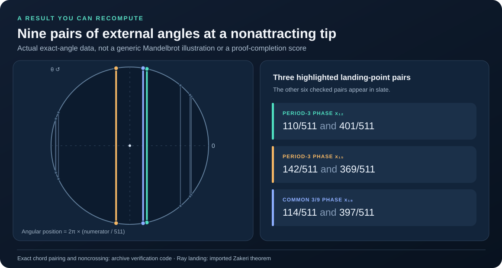
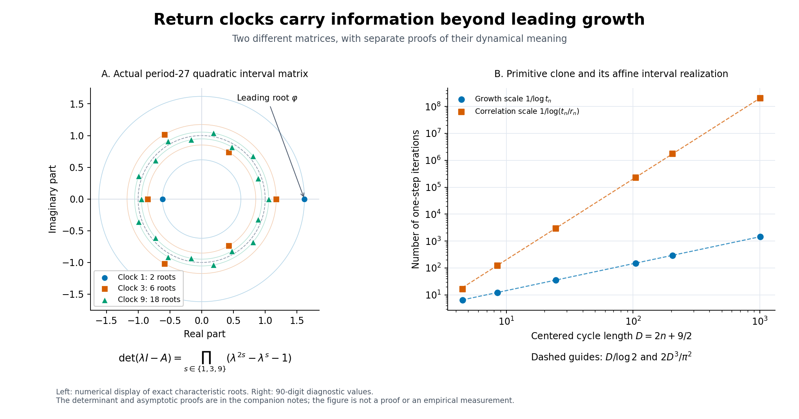
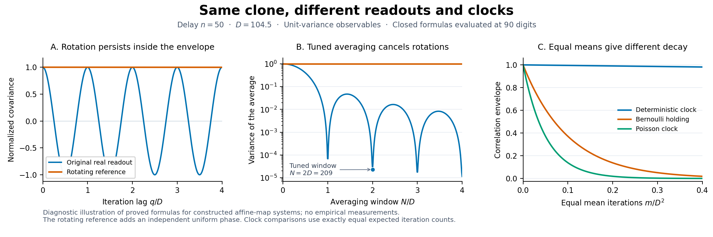
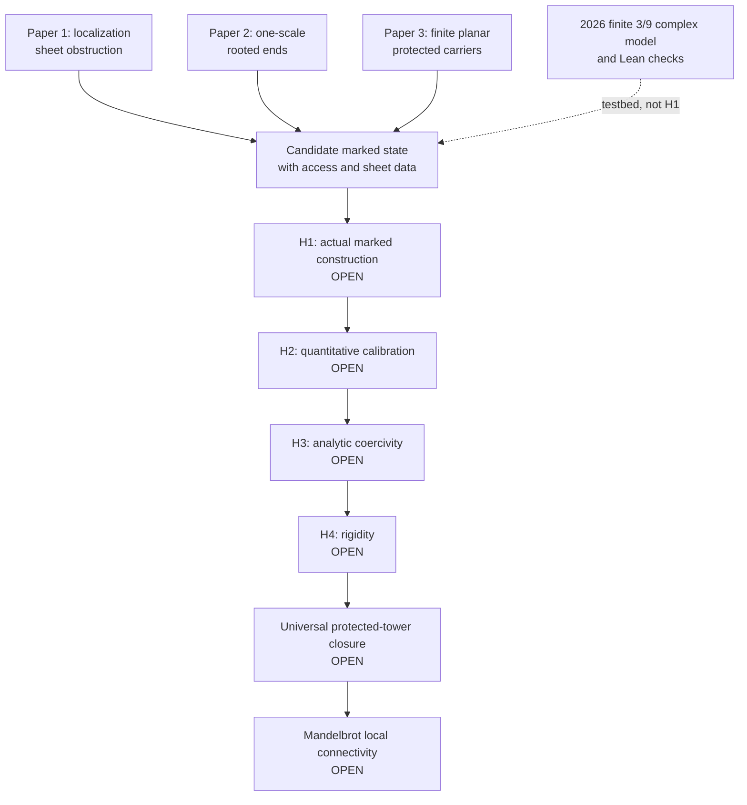
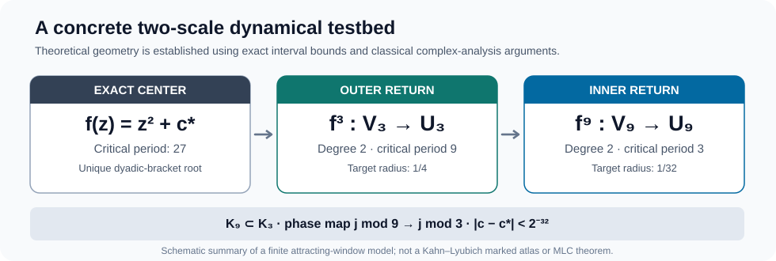
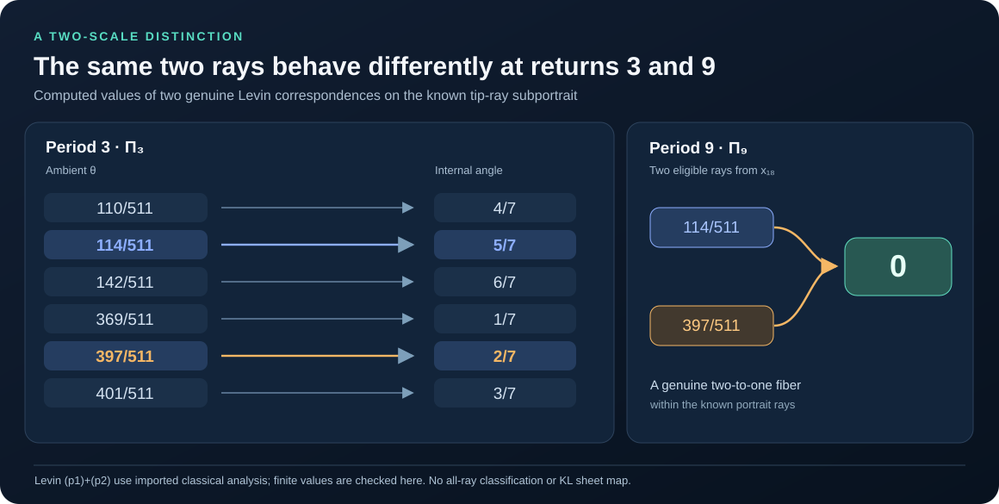
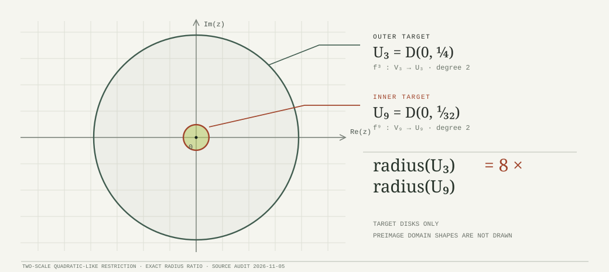

<div align="center">

# A Marked-Width Reduction of Mandelbrot Local Connectivity

### A research archive of exact dynamics, planar topology, and marked-width obstructions

**Matthew Robert Wesney**  
Research direction, synthesis, authorship, and public stewardship

[](https://github.com/dovvnloading/loops-research-archive/actions/workflows/lean-proofs.yml)
[](./LICENSE)

[**Explore the research**](https://dovvnloading.github.io/loops-research-archive/) ·
[**Read the manuscript**](./marked_width_mlc_manuscript.pdf) ·
[**Three papers**](./papers/README.md) ·
[**Evidence map**](./RESEARCH_MAP.md) ·
[**Model-to-physical proofs**](./formalization/PHYSICAL_BRIDGES.md) ·
[**Reproduce results**](#reproduce-the-central-results) ·
[**Contribute / review**](./CONTRIBUTING.md)

**README updated 2026-11-24** · **Manuscript and ledger source lock 2026-07-27**

</div>

> [!IMPORTANT]
> **The Mandelbrot Local Connectivity conjecture (MLC) remains open.** This repository contains finite and structural theorems, source audits, computational certificates, a conditional marked-width reduction, and open proof obligations. The November 2026 two-scale examples and Lean checks do **not** constitute a proof of MLC or a compatible all-scale Kahn–Lyubich marked construction.

**On this page:** [November research](#november-1516-2026-research-integration-merged-prs-72100) · [Results and original figures](#research-results-you-can-inspect) · [Mathematical program](#the-mathematical-program) · [Companion papers](#three-companion-papers) · [3/9 testbed](#the-november-2026-two-scale-testbed) · [Reproduce](#reproduce-the-central-results) · [Evidence ledger](#source-locked-evidence-ledger) · [Open problems](#the-open-frontier)

## November 24: complete buffered support and sharper transport results

The [new proof packet](./research/independent_audits/native_resolution_20261124.md)
determines the entire canonical buffered diagram on the selected
four-boundary surface, with its whole-component ideal marking:

$$
q_\alpha<1999/1000<2,\qquad W_{\rm can}(Y_p)=0
\quad\text{for every selected }p\ge10\text{ and every eligible arc class }\alpha.
$$

The [all-class proof and exact certificate](./research/independent_audits/canonical_width_attack_20261124/NOTE.md)
use physical slit-and-cut annuli, peripheral shadow packing, and the
hyperbolic collar lemma. They cover every winding and essential returning
class, with no deck-word cutoff. The finite roots p=10…16 and a uniform
analytic box for all p≥17 supply the arithmetic. This closes the previous
large-period inner-support question. It also proves that the positive
independent **unbuffered** defect cannot give a positive lower bound for
this particular buffered diagram. The theorem does not cover arbitrary
refinements of the marking or selected p≤9.

The [path proof](./research/independent_audits/native_mark_attack_20261124/NOTE.md)
shows that forgetting repeated maximal-component occurrences preserves
the ideal-set pullback, and that simple parent leaves acquire no extra
nontrivial arc classes from trace-contained paths. A separate application
of explicitly imported KKL Propositions 6.5–6.6 and A.14 gives the native
finite action and an obstruction to five successive nonempty unbreakable
lamination descendants when the starting crest contains an original
marked interval. Full independent MARK remains open.

The [stationary transfer theorem](./research/independent_audits/stationary_transport_attack_20261124/VARIABLE_END_EXIT_TRANSFER.md)
allows different actual exit ends for different leaves. A fractional
endpoint-cover estimate controls their total width; a bank of r actual
degree-two predecessor ends gives the bound 2r W(RF), once each selected
proper exit joins distinct ideal components and is incident to that bank.
This bank construction requires 2≤r<P for native primitive cycle period P.
The required exits remain the geometric obligation.

These are written analytic results with exact finite checks and explicit
classical inputs, awaiting human specialist review. H1–H4, UPTCR, MLC,
and the 465 canonical July obligations retain their existing statuses.

## November 24: reconciled native-interface proofs and arithmetic

The [native-interface review packet](./research/independent_audits/native_frontier_20261123.md)
adds the selected real family's analytic source-boundary proof and intrinsic
ideal atlas, full-path width comparisons, stationary exit estimates, and
connector and rigidity repairs. These written arguments use the cited
physical restriction and signed-chart estimates. Human specialist review
remains outstanding.

**Full immersion MARK remains open.** Proper temporal intersection components
do not establish uniqueness among all proper paths in the geometric inverse
trace. The selected five-step and positive-subarc saturation results apply
to the explicit contour-code action; an independent native proof still
requires the missing identification. The source-imported finite action
above covers the original marked intervals. Independent parent and child widths use the
intrinsic classes and do not consume that open premise.

Both repairs of the misplaced division by three are retained:

| Corrected certificate for p≥13 | Parent lower bound | Independent defect |
|---|---|---|
| One uniform widest box, including p=13 | P_p > 13/20 | D_p > 40/819 > 1/100 |
| Actual p=13 isolation, then uniform boxes from p=14 | P_p > 2/3 | D_p > 11/126 > 1/100 |

The child bound is C_p < 63/50 in both routes. The original erroneous
certificate is superseded; the stronger numerical conclusion is recovered
by the separate split proof. The finite-period and limiting-model bounds
are unchanged, and the all-period D_p > 1/100 conclusion survives.
[Widest-box proof](./research/independent_audits/maximal_native_wave_20261123/H3_WIDTH.md)
· [Sharper split certificate](./research/independent_audits/tip_family_wave_gain_correction_20261123/NOTE.md)

The [matched outer-buffer proof](./research/independent_audits/maximal_native_wave_20261123/OUTER_BUFFER_EXCLUSION.md)
gives zero for every outer-incident canonical buffered coefficient on the
selected four-boundary surface for p≥11, including essential outer
self-classes. The complete exclusion above now covers the inner classes
as well for p≥10 in the whole-component marking. The stationary work
also gives [ideal properness of maximal annular restrictions](./research/independent_audits/maximal_global_closure_20261123/ANNULAR_RESTRICTION_PROPERNESS.md)
under its full-carrier hypotheses and [conditional noncollision](./research/independent_audits/maximal_global_closure_20261123/CONNECTED_CARRIER_NONCOLLISION.md).

Actual pass-through at the two valid final stationary indices implies
W(A_(b+2)) ≤ 2 W(RF); proving that pass-through for native retained Waves
remains open. The general construction, calibration, compactness and
rigidity gates retain their open status. The 465 source-locked July
obligations are unchanged.

## Research results you can inspect

These visuals come from **this archive's own computations, certificates, and finite constructions**. They show concrete angles, pairings, and return geometry—not a percentage of a conjecture solved, stock fractal art, or a diagram attributed to someone else.



*Figure 1 — An actual output of the project.* The nine chords join **18 exact periodic angles** at their correct positions on the angle circle. The pairing and noncrossing arithmetic are reproduced by the [portrait verifier](./research/independent_audits/verify_tip_ray_portrait.py) from the [machine-readable manifest](./results/period27_tip_ray_portrait.json). Straight chords encode combinatorial pairings; they are **not** drawn physical rays. The underlying **ray-landing theorem is imported from Zakeri**, not claimed as a new theorem of this project.

### What was contributed here

| Archive result | Inspect the evidence | Precise boundary |
|---|---|---|
| **Exact nonattracting 3/9 tip** with critically preperiodic dynamics and nested real return intervals | [Tip certificate](./research/independent_audits/period27_misiurewicz_tip_ray_access_20261106.md) · [exact manifest](./results/period27_misiurewicz_tip.json) | Exact algebraic and interval checks; ray landing uses cited classical results. |
| **Period-nine ray subportrait:** nine landed pairs, 18 distinct rational angles and no crossed chords | [Portrait manifest](./results/period27_tip_ray_portrait.json) · [Lean checks](./TipRayPortrait.lean) | A certified *subportrait*, not an exhaustive ray automaton. |
| **Two nonattracting complex returns**, at periods 3 and 9, with certified Rouché margins and physical phase refinement | [Complex-domain audit](./research/independent_audits/nonattracting_tip_complex_two_scale_20261106.md) · [Lean margins](./TipComplexMargins.lean) | Holomorphic topology invokes Rouché/Riemann–Hurwitz; no Kahn–Lyubich puzzle is supplied. |
| **Two-scale Levin ray correspondences** and the explicit distinction between their internal angle fibers | [Carathéodory (p2) argument](./research/independent_audits/levin_tip_p2_carathéodory_two_scale_20261106.md) · [exact angle checker](./research/independent_audits/verify_tip_levin_transport.py) | Analytic theorem imports are identified; no localization-sheet functor or MLC conclusion. |
| **Actual canonical fine-sheet collision** and failure at native KL outer/Julia-side joints | [Issue #29 resolution and evidence](./research/independent_audits/issue29_source_defined_collision_resolution_20261106.md) · [canonical comparison proof](./research/independent_audits/tip_iterated_direct_canonical_localization_embedding_20261106.md) | The specified same-root projection fails the whole-mark extension. Protected restrictions and global MLC gates remain open. |
| **Exact interval fine root and a full-root morphism obstruction** | [Root-topology proof](./research/independent_audits/tip_interval_root_and_marked_morphism_obstruction_20261106.md) · [nine interval phases](./results/tip_root_interval_geometry.json) | No holomorphic Kahn morphism can have full source root K₉ and full target root K₃; this does not forbid the canonical map marking K₉ on both sides. |
| **Three structural papers** on localization sheets, rooted ends and protected planar carriers | [Paper index and versions](./papers/README.md) | Finite/conditional results, not global analytic closure. |

The **ray portrait and two-scale angle-map figures** are generated from the exact portrait manifest by [our reproducible SVG generator](./code/generate_readme_research_figures.mjs). The return and target-disk figures are explicitly labeled schematics of the archive's certificates. No external illustration is presented as an original research result.

## November 23: exact landing sets and actual connector words

At the selected nonattracting 3/9 tip, the
[octal reconstruction theorem](./research/independent_audits/issue62_octal_reconstruction_20261123/README.md)
determines the complete physical fine-landing sets, including every irrational
angle. In the actual G=f³ external coordinate, put

$$
\mathcal C=\left\{\sum_{k\ge1}a_k8^{-k}:a_k\in\{3,4\}\right\}.
$$

The three phase sets are $E_1=\mathcal C$,
$E_0=\mathcal C/2\cup(\mathcal C+1)/2$, and
$E_2=\mathcal C/4\cup(\mathcal C+3)/4$. The four original W seam root
sets are **exactly** $A_i=(\mathcal C+u_i)/16$, with
$(u_0,u_1,u_2,u_3)=(3,4,11,12)$. This strengthens the
[dimension-1/3 theorem](./research/independent_audits/issue62_landing_angle_bound_20261123/EXACT_DIMENSION.md)
to a complete description of the actual Cantor sets and their gaps.

The [physical connector construction](./research/independent_audits/issue62_physical_connector_reconstruction_20261123/NOTE.md)
now computes the full ordered F9 word for **every** $\theta\in A_i$,
every original source tile j, and every integer n:

$$
g_{j,\theta,n}=\operatorname{red}\!\left(P_j^{-1}
(b_{00}b_{01}b_{02})^nQ(\theta)\right),\qquad
(P_0,P_1,P_2,P_3)=(1,b_{00},b_{00}b_{01},b_{00}b_{01}).
$$

Here Q is 1 on A0 and the first-octal-digit-3 part of A1, b00 on the
first-digit-4 part of A1, and b00b01 on A2 and A3. The original integer
coordinate remains unbounded. The [88-row certificate](./research/independent_audits/issue62_physical_connector_reconstruction_20261123/certificate.json)
contains actual signed cut intersections and reduced words: **8 rooted,
80 nonroot**, with a second representative and a source-admissible homotopy.
The construction uses the original KL allowance for a prefix inside W;
the older additional requirement of an entirely coarse-exterior prefix
cannot realize all those rooted source tiles. It fixes **one compatible
physical meridian basis**, rather than claiming unique historical whiskers
that were never specified. Root convergence and proper nonroot ends are
proved on this complete root-landing domain; general KKL MARK remains open.

### Exact measure, positive capacity, and physical Perron contraction

The [measure and trace theorem](./research/independent_audits/issue62_octal_reconstruction_20261123/MEASURE_AND_TRACE.md)
gives, in its real angular and diameter-power normalization,

$$
\mathcal H^{1/3}(\mathcal C)=7^{-1/3},\qquad
\mathcal H^{1/3}(A_i)=112^{-1/3},\qquad
\frac3{3584}\le\operatorname{cap}(A_i)\le\frac1{896}.
$$

The note also supplies sharper capacity bounds and explicit Ahlfors
regularity. These zero-length root sets therefore cannot be discarded as
zero-capacity exceptions. The two-branch average descends through the
actual landing map L to the **physical G³ interval Perron operator**
$\mathcal P$, with
$\mathfrak E(\mathcal P v)\le\tfrac12\mathfrak E(v)$ in the stated
pullback energy $\mathfrak E(v)=\mathcal E_{\mathcal C}(v\circ L)$.
The actual quasiconformal exterior collar proves that every Lipschitz
observable on the physical interval has finite energy, including the
coordinate function; this class is dense in $L^2(\nu)$. The Perron iterates
converge strongly to the mean for every $L^2(\nu)$ observable, while their
operator norm on the entire mean-zero $L^2$ subspace stays one at every
finite iterate. The quantitative decay bound uses the pullback energy.
The actual reference probability is the pullback of arcsine measure under
the Chebyshev conjugacy, and the proof shows that it differs from ordinary
logarithmic equilibrium of the physical interval. Comparison with planar
Dirichlet energy, canonical Wave width, or parameter equilibrium charge
remains a separate problem. A continuous quotient counterexample
in the same note shows why a generic interval-energy comparison cannot be
assumed.

## November 23: a separate parameter-capacity criterion

The [parameter-capacity argument](./research/independent_audits/parameter_capacity_increment_20261123/NOTE.md)
works directly with actual parameter compacts in one fixed Green domain.
For nested nonpolar continua, their probability equilibrium measures have
orthogonal increments and Robin energies satisfy
$V_N=V_0+\sum_{n<N}I_D(\mu_{n+1}-\mu_n)$.
For continua inside the Mandelbrot set with ground $D_1$, the explicit
bound is $\operatorname{diam}F_N\le20e^{-V_N}$. A divergent sequence of
certified physical increments would therefore force a singleton;
local connectivity additionally requires connected **relative parameter
neighborhoods**, not arbitrary subsets containing the parameter.

The [exact finite calibration](./research/independent_audits/parameter_capacity_increment_20261123/certificate.json)
uses $F_0=\mathcal M$ and $F_1=\overline{B(-1,3/32)}$ and certifies
$V_{D_1}(F_1)-V_{D_1}(\mathcal M)>\frac{1}{3\,686\,400}$.
It supplies a physical parameter example, **not an infinite divergent
certificate sequence**. Angular trace contraction and parameter equilibrium
energy remain distinct quantities. The needed all-scale parameter
certificates and global MLC conclusion remain open.

## November 23: corrected slit widths and the remaining marking boundary

The [selected-slit proof packet](./research/independent_audits/marked_slit_path_bridge_20261123/README.md)
identifies every intrinsic A.1 path class on the actual finite slit surfaces,
retains its winding, and supplies the embedded lower foliations and universal
upper metrics for the independent unbuffered defect. For every selected
period p≥3, the written argument gives **D_p>1/100**. Its dependency chain
uses the intrinsic target and covering-pulled source markings. The complete
immersion-pulled marking remains open because temporal excursions do not
exhaust the archive's geometric inverse-trace restrictions.

This work also repairs an actual error in the limiting-gain verifier: the
parameter-error term was divided by three incorrectly. With the correct
interval, the old broad p=13 box does not certify its stated 2/3 floor.
An exact certificate for the actual p=13 parameter, followed by the corrected
uniform box from p=14 onward, preserves the claimed bound. New regressions
check those inputs against the independently implemented upstream estimates.
The original November 16 revision remains in Git history. Its dated
executable is now repaired to the weaker uniform 40/819 margin, while the
stronger 11/126 margin is supplied by the [versioned correction and all-period runner](./research/independent_audits/tip_family_wave_gain_correction_20261123/NOTE.md).

The packet also [repairs the H4 endgame](./research/independent_audits/marked_slit_path_bridge_20261123/RIGIDITY_AND_REMAINING_GAP.md)
using hybrid uniqueness and checks the scope of current area theorems.
These are written local results with exact arithmetic and explicit classical
inputs. Human specialist review, full independent immersion KKL MARK,
iterated transport, and the global H1–H4, UPTCR and MLC gates remain open.
The November 24 result above determines every minimally marked canonical
coefficient for selected p≥10: all are zero. Smaller periods and refined
markings remain separate questions.

## November 23: actual interval rows and two different spectral clocks

The [period-27 real Markov bridge](./research/independent_audits/period27_real_markov_bridge_20261123.md)
connects the finite 26-edge table to the **actual quadratic**: every listed
target interior point has exactly one preimage on its source edge, and an
omitted target has none. [Lean](./formalization/weighted/Period27RealMarkov.lean)
proves the whole-interval images, both row implications, and existence of the
same certified center. The new
[all-horizon Lean theorem](./formalization/weighted/Period27FiniteFibers.lean)
proves that every matrix-power entry counts distinct actual preimages in
its source interval; the column sum counts all preimages in the closed orbit
core. Its parameter existence and endpoint exclusions are included.
A separate written cycle proof and exact integer check give

$$
\det(\lambda I-A)=(\lambda^2-\lambda-1)(\lambda^6-\lambda^3-1)
(\lambda^{18}-\lambda^9-1).
$$

The three return clocks remain visible in the full spectrum, even though the
leading eigenvalue is the golden ratio. The formal inverse-fiber equivalence
and written cycle enumeration give exact Fibonacci preimage counts at clocks 1, 3 and 9.
[Spectrum certificate](./research/independent_audits/verify_period27_markov_spectrum.py)
The [earlier Markov observability study](./research/independent_audits/airplane_inverse_problems_20261114/markov/RESEARCH.md)
already identified the three symbolic components, return clocks and weighted
growth polynomials. The additions here are the kernel-checked physical
realization, a full characteristic-polynomial certificate, and the explicit
transfer to actual inverse fibers at every finite time.

For the **different, primitive delayed clone graph**, the
[renewal-clock proof](./research/independent_audits/clone_renewal_clock_20261123.md)
sharpens the old gap-collapse bound to

$$
(2n+9/2)^3(1-r_n/t_n)\longrightarrow\pi^2/2.
$$

[Lean](./formalization/weighted/FullCloneRenewal.lean) constructs its stochastic
normalization and proves both directions needed to turn polynomial roots into
actual matrix modes. The root-ordering and asymptotic proof are **written**.
An explicitly constructed piecewise affine interval map, invariant density,
and all-finite-cylinder law realize the exact correlation
$(z_1/t_n)^q\|G\|_2^2$. Thus $t_n^n\to\sqrt2$ coexists with
$(r_n/t_n)^n\to1$: expansion over a delay block does not ensure uniform
decay of correlations over that block. The note includes a fixed-graph,
variable-probability counterexample to transferring a mixing rate from
adjacency alone.

These are specific additions to the archive, with classical predecessors
credited. The affine map is distinct from the quadratic example. Native KL
probability, marking, width and global MLC identifications remain separate
obligations. The [bridge register](./formalization/PHYSICAL_BRIDGES.md) records
the evidence at each step; its validator now rejects unresolved prerequisites
even when they are hidden behind intermediate model rows.



The figure is a numerical illustration of the exact determinant and written
asymptotic proofs, generated from declared sources by
[this script](./code/generate_spectral_clock_figure.py).

### Continuation: the readout and the clock change the conclusion

The [readout proof](./research/independent_audits/clone_resonant_readout_20261123.md)
connects the same explicitly realized clone mode to its temporal spectrum,
real observable, finite-window variance, and independent random clocks.
Writing $D=2n+9/2$ and $\lambda=\rho e^{i\theta}$, it proves

$$
S(0)\sim\frac1{4D},\qquad
S(\theta)\sim\frac{4D^3}{\pi^2},\qquad
\frac{S(\theta)}{S(0)}\sim\frac{16D^4}{\pi^2}.
$$

Thus a cubic correlation envelope coexists with a decreasing ordinary
averaging variance. At the exactly integral window $N=2D=4n+9$, a specified
real observable has average variance asymptotic to $1/(4D^2)$ while its
envelope tends to one. An actual circle-reference product realizes a
phase-tracking readout whose average variance tends to one on that same
window. These are covariance measurements, with their measure and observable
specified; no causal response or native width is identified by the formulas.

Independent Bernoulli or Poisson observation clocks give quadratic envelope
decay even at the same expected number of original iterations. A vanishing
holding probability $c/D$ already changes the cubic gap constant to
$\pi^2/2+2\pi^2c$. This gives an explicit test for a missing clock-law premise.
The Fourier and clock-asymptotic proofs are written; classical Poisson-kernel,
nonreversible-variance, and Markov-clock methods are credited.

[FiniteMarkovCorrelation](./formalization/weighted/FiniteMarkovCorrelation.lean)
proves normalized two-time probability laws, centering, positive variance,
exact mode correlations and the finite lazy-clock transformation in Lean.
[FullCloneCorrelation](./formalization/weighted/FullCloneCorrelation.lean)
applies them to the actual clone matrix with the stationary-distribution
premises displayed. The explicit stationary formula and physical
invariant-measure/cylinder realization remain written proofs.
[Exact finite regression](./research/independent_audits/verify_clone_resonant_readout.py)
checks independently propagated path moments and rejects the uncorrected
real-part readout and reversed complex phase.



At delay 50, closed formulas illustrate the specified real readouts and
three clock laws. The blue average cancels near complete rotations while
the rotating-reference average retains its variance. The clock comparison
uses exactly equal expected iteration counts. These are numerical
illustrations of the written proofs, generated by
[this script](./code/generate_clone_readout_figure.py).

## November 15–16, 2026 research integration (merged PRs #72–#100)

**Current reading, November 23.** The dated inventory below preserves its
original rows. The exact octal sets, physical connector words, specified
trace-energy contraction, separate parameter-capacity criterion, and
corrected slit-width result are described above and in their linked proofs.
These scoped updates do not change the source-locked July ledger or close
general KKL MARK and the global MLC gates.

The [model-to-physical proof register](./formalization/PHYSICAL_BRIDGES.md) records the current scope. The [referee-controlled v2](./papers/tip_family_preprint_v2_20261116/sections/referee_scope.tex) states which nesting, ideal-boundary and path-class hypotheses a physical width claim consumes. The following rows retain their November provenance. The July manuscript and 465 source-locked obligations have their original status.

### Native Wave Transfer Lab and canonical WAD audits

| Merged PR / result | Status and precise scope | Note and verifier |
|---|---|---|
| [#73](https://github.com/dovvnloading/loops-research-archive/pull/73) PR #68 physical native Wave lab | **Conditional on KKL physical marking** — 10/20 atoms, distinct G_* and iota*, two crossing versus one avoiding path, and chosen round Wave equality; no unrestricted gain. | [Note](./research/native_wave_transfer/SPECIFICATION.md) · [Verifier](./research/native_wave_transfer/regenerate.py) |
| [#77](https://github.com/dovvnloading/loops-research-archive/pull/77) Native primitive period-four tip | **Finite certificate, conditional Wave reading** — A separate degree-two period-12 tip and p=4 round Wave are reproduced; its equality is not a canonical extremal-width theorem. | [Note](./research/native_wave_transfer/RESULTS.md) · [Verifier](./research/native_wave_transfer/regenerate_period4.py) |
| [#72](https://github.com/dovvnloading/loops-research-archive/pull/72) Wave versus free annular Dirichlet response | **Conditional comparison; finite certificate** — Common-surface/electrode monotonicity and exact response brackets do not equate a marked Wave to a free outer Neumann condenser. | [Note](./research/independent_audits/wave_vs_dirichlet_contact_transfer_20261115/NOTE.md) · [Verifier](./research/independent_audits/wave_vs_dirichlet_contact_transfer_20261115/verify.py) |
| [#75](https://github.com/dovvnloading/loops-research-archive/pull/75) Canonical WAD electrode obstruction | **Proved negative identification** — Buffered canonical WAD, an admissible A.1 Wave and the free annular condenser live on different typed objects; the literal electrode match fails. | [Note](./research/independent_audits/canonical_wad_electrode_incidence_20261116/NOTE.md) · [Verifier](./research/independent_audits/canonical_wad_electrode_incidence_20261116/verify.py) |
| [#81](https://github.com/dovvnloading/loops-research-archive/pull/81) Auxiliary conformal-weight audit | **Finite certificate; canonical weights open** — Exact auxiliary annular capacity bounds do not compute individual q-gamma, canonical support, WAD total weight or a repaired scalar transfer. | [Note](./research/independent_audits/canonical_wad_conformal_weights_20261116/NOTE.md) · [Verifier](./research/independent_audits/canonical_wad_conformal_weights_20261116/verify.py) |
| [#76](https://github.com/dovvnloading/loops-research-archive/pull/76) Canonical quadrilateral-moduli bounds | **Finite certificate; individual moduli open** — Peripheral cyclic-cover collars, coarse endpoint-type bounds and a canonical norm upper bound do not certify any individual q-gamma or support list. | [Note](./research/independent_audits/canonical_wad_quadrilateral_moduli_20261116/NOTE.md) · [Verifier](./research/independent_audits/canonical_wad_quadrilateral_moduli_20261116/verify.py) |

### Real primitive tip family theorem and dependency chain

| Merged PR / result | Status and precise scope | Note and verifier |
|---|---|---|
| [#80](https://github.com/dovvnloading/loops-research-archive/pull/80) Uniform real-tip combinatorial implication | **Conditional; six finite certificates** — A uniform result from explicit physical geometry, plus p=3..8 interval packets; the older 3/3/3 source-path assertion is corrected by later audits. | [Note](./research/independent_audits/real_primitive_tip_family_uniform_20261116/NOTE.md) · [Verifier](./research/independent_audits/real_primitive_tip_family_uniform_20261116/verify.py) |
| [#83](https://github.com/dovvnloading/loops-research-archive/pull/83) Selected real tips p=3..12 | **Finite certificate** — Ten locally unique seed-bracket roots, signed cuts and direct degree-two Rouche disks, with a noncanonical radial witness; not global uniqueness. | [Note](./research/independent_audits/real_primitive_tip_family_unconditional_20261116/NOTE.md) · [Verifier](./research/independent_audits/real_primitive_tip_family_unconditional_20261116/verify.py) |
| [#87](https://github.com/dovvnloading/loops-research-archive/pull/87) Selected real tips p>=13 | **Written signed-chart argument** — For p>=13, local uniqueness, the degree-two return disks and c_p+2=(3 pi^2/2)4^-p+O(p16^-p) use uniform analytic estimates on the selected chart. The verifier checks their rational inputs. | [Note](./research/independent_audits/real_primitive_tip_family_all_p_20261116/NOTE.md) · [Verifier](./research/independent_audits/real_primitive_tip_family_all_p_20261116/verify.py) |
| [#91](https://github.com/dovvnloading/loops-research-archive/pull/91) All-period physical prime-end marking | **Conditional on v2 H1 and H2** — The 10/20 model distinguishes the covering and immersion tables. Identifying all physical accesses and the proper-path relation needs the nesting and ideal-marking proofs. | [Note](./research/independent_audits/real_primitive_tip_family_prime_end_identification_20261116/NOTE.md) · [Verifier](./research/independent_audits/real_primitive_tip_family_prime_end_identification_20261116/verify.py) |
| [#93](https://github.com/dovvnloading/loops-research-archive/pull/93) Typed all-period primitive-tip synthesis | **Finite incidence and conditional Wave interpretation** — The tabulated source and cover arc spans are 3/3/7 and 3/3/5. Their KKL interpretation requires v2 H1 and H2. The selected round equality also requires the marked conformal foliation. | [Note](./research/tip_family_theorem/THEOREM.md) · [Verifier](./research/tip_family_theorem/verify_chain.py) |
| [#90](https://github.com/dovvnloading/loops-research-archive/pull/90) Canonical-width gap and round witness | **Finite witness; canonical optimum open** — Orbit-centred round-witness limit and full-lift upper envelope are certified separately; unrestricted optimal KKL width, attainment and convergence are not. | [Note](./research/independent_audits/real_primitive_tip_family_canonical_width_20261116/NOTE.md) · [Verifier](./research/independent_audits/real_primitive_tip_family_canonical_width_20261116/verify.py) |
| [#92](https://github.com/dovvnloading/loops-research-archive/pull/92) Canonical KKL Wave sandwich | **Conditional on v2 H1–H3** — W_rad <= W_p,2* <= W_p* <= Q_p and 0.26 < liminf W_p* <= limsup W_p* < 0.78 require the physical marking, admissible witnesses and full-path upper comparison. | [Note](./research/independent_audits/real_primitive_tip_family_canonical_width_sandwich_20261116/NOTE.md) · [Verifier](./research/independent_audits/real_primitive_tip_family_canonical_width_sandwich_20261116/verify.py) |

### Wave gain and crest transport

| Merged PR / result | Status and precise scope | Note and verifier |
|---|---|---|
| [#84](https://github.com/dovvnloading/loops-research-archive/pull/84) Four-push p=3..8 crest-collar grid | **Finite certificate; conditional physical Wave** — Strict whole-bin interval collars for selected four-push crests, not an all-period or unrestricted Wave transport law. | [Note](./research/independent_audits/crest_transport_tip_family_20261116/NOTE.md) · [Verifier](./research/independent_audits/crest_transport_tip_family_20261116/verify.py) |
| [#89](https://github.com/dovvnloading/loops-research-archive/pull/89) Connected crest collars p=3..16 | **Finite certificate; numerical-only limit** — Full maximal connected collars within the stated circular family are certified; c_infinity approximately 0.347005 is only a numerical conjecture. | [Note](./research/independent_audits/crest_transport_asymptotics_20261116/NOTE.md) · [Verifier](./research/independent_audits/crest_transport_asymptotics_20261116/verify.py) |
| [#94](https://github.com/dovvnloading/loops-research-archive/pull/94) Pairable-wave serial loss | **Conditional leafwise serial inequality** — Loss or equality applies to a designated pair with a restriction from each child in every parent leaf and injectivity on their union (KKL Lemma A.11). | [Note](./research/independent_audits/tip_family_canonical_wave_gain_20261116/NOTE.md) · [Verifier](./research/independent_audits/tip_family_canonical_wave_gain_20261116/verify.py) |
| [#97](https://github.com/dovvnloading/loops-research-archive/pull/97) Strict limiting and p>=13 unbuffered Wave gain | **Archived scope:** **Conditional on v2 H1–H3** — The corrected rational comparisons give D_p>40/819 for p>=13 and 0.696<D_infinity<0.793 for the limiting model. The physical interpretation requires the full marked path comparison. **Current correction:** the original parameter-error radius was too narrow. The repaired dated verifier proves D_p>40/819 from one uniform box; the [separate split certificate](./research/independent_audits/tip_family_wave_gain_correction_20261123/NOTE.md) recovers D_p>11/126 using actual p=13 isolation and corrected boxes from p=14. | [Note](./research/independent_audits/tip_family_limiting_wave_gain_20261116/NOTE.md) · [Verifier](./research/independent_audits/tip_family_limiting_wave_gain_20261116/verify.py) |
| [#100](https://github.com/dovvnloading/loops-research-archive/pull/100) Strict independent unbuffered Wave gain for all p | **Archived scope:** **Conditional on v2 H1–H3** — For independently optimized unbuffered widths the four period bounds give D_p>1/100 for every p>=3 once the marked parent witnesses and all-child upper metrics are established. **Current correction:** its finite p=3..12 calculations are retained and its aggregate now invokes the repaired 40/819 tail. The [separate all-period runner](./research/independent_audits/tip_family_wave_gain_correction_20261123/verify_all_periods.py) uses the stronger split tail; both support the intrinsic November 23 physical width proof. | [Note](./research/independent_audits/tip_family_finite_p_wave_gain_20261116/NOTE.md) · [Verifier](./research/independent_audits/tip_family_finite_p_wave_gain_20261116/verify.py) |

### Renormalization depth and marked QC

| Merged PR / result | Status and precise scope | Note and verifier |
|---|---|---|
| [#95](https://github.com/dovvnloading/loops-research-archive/pull/95) Nine exact depth-two charts | **Finite certificate; conditional width** — The (3..5)x(3..5) selected grid has strict root/restriction and typed marking checks; 0.25<W*<0.775 imports physical KKL cuts and width hypotheses. | [Note](./research/independent_audits/tip_family_renormalization_depth_20261116/NOTE.md) · [Verifier](./research/independent_audits/tip_family_renormalization_depth_20261116/verify.py) |
| [#96](https://github.com/dovvnloading/loops-research-archive/pull/96) One depth-three (3,3,3) chart | **Finite certificate only** — A strict rational (3,3,3) packet with terminal three-return margins, not the other 26 small triples or an all-depth uniform physical width theorem. | [Note](./research/independent_audits/tip_family_all_depths_20261116/NOTE.md) · [Verifier](./research/independent_audits/tip_family_all_depths_20261116/verify.py) |
| [#98](https://github.com/dovvnloading/loops-research-archive/pull/98) Direct-at-depth QC and modulus | **Imported published modulus; conditional marked transport** — Non-doubling real optimal moduli give local noncompounding straightening bounds, but K-uniform whole-marked-Wave correspondence is an additional unproved premise. | [Note](./research/independent_audits/tip_family_depth_uniform_qc_20261116/NOTE.md) · [Verifier](./research/independent_audits/tip_family_depth_uniform_qc_20261116/verify.py) |
| [#99](https://github.com/dovvnloading/loops-research-archive/pull/99) Global marked QC gap and countermodel | **Negative inference; conditional K and K^2 lemma** — An abstract annulus countermodel refutes modulus-only global transport inference; conditional two-sided cofinal-width comparison holds, while K'(mu) for this family is open. | [Note](./research/independent_audits/tip_family_global_marked_qc_20261116/NOTE.md) · [Verifier](./research/independent_audits/tip_family_global_marked_qc_20261116/verify.py) |

### Satellite and near-parabolic refusals

| Merged PR / result | Status and precise scope | Note and verifier |
|---|---|---|
| [#79](https://github.com/dovvnloading/loops-research-archive/pull/79) Period-doubling satellite v1 refusal | **Finite certificate; negative/refusal** — A degree-two satellite return is certified but fails primitive v1 marking/attachment assumptions; no claimed satellite Wave measurement. | [Note](./research/native_wave_transfer/RESULTS.md) · [Verifier](./research/native_wave_transfer/regenerate_satellite2.py) |
| [#82](https://github.com/dovvnloading/loops-research-archive/pull/82) Satellite Misiurewicz tip refusal | **Finite certificate; negative/refusal** — Exact satellite tip and bouquet contact have zero new return-tree attachment, so primitive v1 opposite-side Wave labels do not apply. | [Note](./research/native_wave_transfer/RESULTS.md) · [Verifier](./research/native_wave_transfer/regenerate_satellite2_tip.py) |
| [#85](https://github.com/dovvnloading/loops-research-archive/pull/85) Source-typed satellite v2 contact atlas | **Finite source certificate; Wave undefined** — Typed phase-contact, distinct covering and immersion endpoint germs; neither an attachment electrode nor a canonical satellite Wave weight is established. | [Note](./research/native_wave_transfer/SPECIFICATION_v2_satellite.md) · [Verifier](./research/native_wave_transfer/regenerate_satellite_v2.py) |
| [#86](https://github.com/dovvnloading/loops-research-archive/pull/86) Three near-parabolic primitive-tip refusals | **Finite certificate; missing observable** — p=24,27,30 selected roots, quadratic-like collars and empty new attachment are certified; the proposed h*log(1/ell) is undefined, not zero. | [Note](./research/native_wave_transfer/RESULTS.md) · [Verifier](./research/native_wave_transfer/regenerate_near_parabolic.py) |
| [#88](https://github.com/dovvnloading/loops-research-archive/pull/88) Near-parabolic v1.1 chosen one-slit marks | **Finite certificate; noncanonical/refusal** — Source-typed chosen two-side real-slit records do not instantiate primitive v1 10/20 atoms or canonical KKL Wave widths. | [Note](./research/native_wave_transfer/SPECIFICATION_v1_1.md) · [Verifier](./research/native_wave_transfer/regenerate_primitive_v1_1.py) |

### Issue #40

| Merged PR / result | Status and precise scope | Note and verifier |
|---|---|---|
| [#74](https://github.com/dovvnloading/loops-research-archive/pull/74) Issue #40 native attachment and edge census | **Finite certificate; general open** — One physical attachment, complete old-edge incidence and zero-old-edge atomic sectors identify an exact crest gate, not universal amplification. | [Note](./research/independent_audits/issue40_native_attachment_edge_incidence_20261115/NOTE.md) · [Verifier](./research/independent_audits/issue40_native_attachment_edge_incidence_20261115/verify_native_attachment_edge_incidence.py) |
| [#78](https://github.com/dovvnloading/loops-research-archive/pull/78) Issue #40 genuine finite depth-four crest | **Conditional physical example; general open** — A selected depth-four KKL descendant has an old-edge closed crest and a chosen exact conformal log-strip width, not a general transport theorem. | [Note](./research/independent_audits/issue40_crest_transport_20261116/NOTE.md) · [Verifier](./research/independent_audits/issue40_crest_transport_20261116/verify_crest_transport.py) |

The source-note [theorem referee audit](./research/tip_family_theorem/AUDIT.md) documents the corrected source **3/3/7** versus cover-pushed **3/3/5** short arcs. The [November open-obligation register](./RESEARCH_MAP.md#november-2026-open-obligations) and the machine `research_updates` supplement in [ledger.json](./ledger.json) track further gaps, including canonical widths and convergence, satellite/refused transfer, physical all-depth round gates, and globally marked K'(mu). **Issue [#40](https://github.com/dovvnloading/loops-research-archive/issues/40)** is not solved in general by one finite crest example; **Issue [#62](https://github.com/dovvnloading/loops-research-archive/issues/62)** supplies predecessor native marking/operator context, not all-scale transport. The abstract QC countermodel of PR #99 is not a counterexample in this physical tip family.

**November 23 update for the channel near −7/4.** For every p=3n with n≥6, Lean proves existence of a parameter with critical preperiod p+1, eventual period p, disjoint real interval phases and an isolated complex pullback component. The analytic passage to a polynomial-like restriction and straightening uses external theorems. The period-doubling satellite contacts above have a separate marking, and the near-parabolic Wave observable still needs a source-designated electrode. [Family theorem](./formalization/weighted/ParabolicTipFamily.lean) · [Complex component and fibers](./formalization/weighted/ParabolicComplexComponent.lean) · [Contact and electrode obligations](./formalization/PHYSICAL_BRIDGES_WIDTH.md#w8)

To check how a model theorem applies to an actual orbit, marked surface or parameter, start with the [model-to-geometry proof guide](./formalization/PHYSICAL_BRIDGES_CONTRACTS.md). It links each indexed Lean theorem to the relevant argument and identifies the hypotheses still needing proof.

## The mathematical program

The central question is whether a **marked geometric state** can carry enough dynamical, topological, and analytic information across successive renormalization scales to support a uniform compactness-and-rigidity argument.

An unmarked continuum is not sufficient for this program. The proposed state must retain the ambient marked surface, critical/postcritical data, protected obstacles, relevant curve families, prime-end or sectorial accesses, and localization **sheet transport**. Paper 1 explains why dropping the last item can force noninjectivity.



The diagram is a **research dependency map**, not an established chain of completed implications. The source-locked manuscript records the implication from a universal protected compactness-and-rigidity proposition to MLC; it does **not** establish that proposition. See [RESEARCH_MAP.md](./RESEARCH_MAP.md) and the [interactive ledger](https://dovvnloading.github.io/loops-research-archive/#ledger) for exact claim IDs and dependencies.

## Three companion papers

These papers provide the program's core finite and structural foundations. The PDF releases below are unchanged by the November research increments.

| Work | Released state | Core contribution | Boundary |
|---|---|---|---|
| **[Paper 1 — Forced Noninjectivity and the Sheet Kernel at Primitive Canonical Localization Seeds](./papers/paper1_canonical_localization/paper1_forced_noninjectivity_sheet_kernel_v1.1_visual.pdf)** | v1.1 Visual Edition · 41 pp. | Forced noninjectivity for the stated primitive seeds; canonical covering/embedding resolution, infinite sheet kernel and peripheral winding quotient. | No general KL decoration-stage alignment, a priori bound, rigidity or MLC proof. |
| **[Paper 2 — The Direct-Decoration Rooted-End Compactification](./papers/paper2_rooted_end_compactification/paper2_direct_decoration_rooted_end_compactification_v1.1_visual.pdf)** | v1.1 Visual Edition · 21 pp. | One-scale binary rooted-end model, exact component quotient, shift dynamics, stable replacement and protected accesses under stated hypotheses. | No self-return or cross-scale theorem for end fibers; no MLC proof. |
| **[Paper 3 — Protected Planar Carriers: Separation Ledgers and Access-Preserving Routing](./papers/paper3_protected_carriers/paper3_draft3_visual.pdf)** | Draft III Visual Edition · 74 pp. · QA audited | Finite full-carrier recognition and routing with protected accesses, attachment separation ledger, Hausdorff-limit failures and stable decreasing envelopes. | Finite planar topology—not an actual virtual carrier, quantitative width estimate or rigidity theorem. |

### The three structural lessons

**Paper 1 — localization cannot silently forget sheets.** At an ordinary primitive quadratic-like restriction of period $p>1$, the overall return has degree $2^p$, whereas the central component has degree two. The excess $2^p-2$ pullback components create peripheral sheet information. The paper identifies a based fiber $K/H_s$ and proves, under its stated hypotheses,

$$
N_{\mathrm{fill}}=\ker(a_*),\qquad K=N_{\mathrm{fill}}\rtimes H_s,\qquad N_{\mathrm{fill}}\twoheadrightarrow\mathbb Z^{\,2^p-2}.
$

This concerns the program's canonical **embedding** failure; it does not contradict the **immersion** statements used by Kahn and Kahn–Lyubich.

**Paper 2 — a one-scale symbolic compactification has an actual planar realization.** Its binary end fibers, component quotient and protected-access results are proved at the stated decoration scale. A symbolic shift or quotient alone does not construct a second analytic renormalization scale.

**Paper 3 — protected planar routing has exact finite criteria, but limits can fail.** The separation ledger explains how attachments can create or remove holes, while examples show why Hausdorff convergence alone cannot guarantee preservation of access or fullness. A dynamical marked carrier remains an additional construction problem.

See the [paper index](./papers/README.md) and [Paper 3 QA report](./papers/paper3_protected_carriers/QA_REPORT.md) for original versions, sources and audit methods.

## The November 2026 two-scale testbed

The most recent research builds an **explicit, finite real-and-complex model** that can be checked independently of the global MLC reduction. It is useful precisely because the theorem boundaries are explicit.



For $f_c(z)=z^2+c$, the [exact real certificate](./research/independent_audits/real_quadratic_3_9_restrictive_certificate_20261105.md) isolates a unique real parameter $c_*\approx-1.786429858055761$ in a specified $2^{-128}$ rational bracket with **exact critical period 27**. It constructs nested restrictive intervals $I_9\subset\operatorname{int}I_3$ with return times 9 and 3.

The [complex-domain certificate](./research/independent_audits/complex_two_scale_quadratic_like_certificate_20261105.md) then gives explicit target disks

$$
U_3=D(0,1/4),\qquad U_9=D(0,1/32),
$

and, for every $\lvert c-c_*\rvert<2^{-32}$, proper degree-two quadratic-like restrictions

$$
f_c^3:V_{3,c}\longrightarrow U_3,
\qquad
f_c^9:V_{9,c}\longrightarrow U_9.
$

The construction establishes connected little filled Julia sets and $K_{9,c}\subset K_{3,c}$, with the nine inner physical phase images refining the three outer phases. These are **finite attracting-window results**, supported by exact outward-integer bounds and written Rouché/Riemann–Hurwitz arguments—not by a Lean proof of complex analysis.

### Three-scale symbolic correspondence

The [symbolic atlas](./research/independent_audits/period27_three_scale_symbolic_marking_20261105.md) and [kneading source audit](./research/independent_audits/period27_kneading_angle_permutation_source_audit_20261105.md) compare these physical returns with the classical airplane substitution $0\mapsto011,\ 1\mapsto100$:

| Physical map | Critical period under that map | Angular period | Candidate characteristic-angle pair |
|---|---:|---:|---|
| $f_c^9$ | 3 | 3 | $3/7,\;4/7$ |
| $f_c^3$ | 9 | 9 | $228/511,\;283/511$ |
| $f_c$ | 27 | 27 | $59914011/134217727,\;74303716/134217727$ |

The exact real kneading-angle invariant of $c_*$ is

$$
\theta_{\mathrm{knead}}(c_*)=\frac{59914011}{2^{27}-1},
$$

and the twisted-shift calculation reproduces **all 27** real critical-orbit ranks. The [machine-readable 26-edge real Markov graph](./results/period27_symbolic_marking.json) is an interval graph, **not** the full external-ray Hubbard-tree automaton.

> [!CAUTION]
> **Parameter rays land at the component's parabolic root.** The [center-identification proof](./research/independent_audits/period27_center_tuning_identification_20261106.md) now proves that $c_*$ is the unique center of **A*A*A**, using the precise real-center root-ray result of Buff–Floyd–Koch–Parry and Zakeri's tuning theorem. The root rays are exactly $59914011/134217727$ and $74303716/134217727$. The center remains superattracting and fails Paper 2's $K=J$ hypothesis.

### The critical analytic boundary

The center, and a certified surrounding parameter disk, are **attracting**: the ambient filled Julia set has nonempty interior. Therefore the example fails **Paper 2's hypothesis H3: $K(f)=J(f)$**. This is **different from** the global ledger gate named `H3_COERCIVITY`. The [complex-window obstruction audit](./research/independent_audits/two_scale_complex_window_obstructions_20261105.md) also rules out the naive equal-width stadium/preimage construction at both scales. Alternative domains make the finite complex result possible, but neither result supplies a source-compatible KL puzzle atlas or proves a new MLC case.

### Physical exterior 9-to-3 inverse-ray test

The [November 6 exterior pullback theorem](./research/independent_audits/period27_exterior_ray_pullback_20261106.md) uses the **actual period-27 polynomial** and its global dynamical-plane Böttcher coordinate: 512 distinct escaping inverse-ray points at depth nine project under \(f_{c_*}^6\) to eight depth-three points, with **64 points per fiber**. Six additional binary branch bits are necessary and sufficient to retain these particular finer ray addresses; a separate sectorwise \(\dot H^{1/2}\) calculation gives a normalized 64-branch direct-sum lift. The [exact regression script](./research/independent_audits/verify_period27_exterior_pullback.py) verifies the finite addresses and trace-scaling arithmetic. **These are escaping-basin results, not identified KL puzzle sheets, ray landings, or a proof of any MLC gate.**

### A nonattracting 3/9 tip with landed rays

The [November 6 Misiurewicz-tip certificate](./research/independent_audits/period27_misiurewicz_tip_ray_access_20261106.md) isolates **a different, nonattracting real quadratic parameter** near the period-27 center. Exact outward-integer tests prove its critical point has preperiod 10 and a repelling period-9 cycle, and certify nested real return intervals of periods 3 and 9. Zakeri's real-parameter ray theorem then identifies the **actual parameter-ray and critical-value dynamical-ray pair** at angles \(116791/261632\) and \(144841/261632\), with four explicitly identified rays landing at the critical point. The physical \(f^6\) ray map merges two distinct accesses. [Reproduce the exact finite certificate and manifest](./research/independent_audits/verify_period27_misiurewicz_tip.py). Unlike the superattracting center, this Misiurewicz example has \(K=J\). **This still does not construct a full source-defined KL prime-end/puzzle or localization-sheet functor, nor close any global MLC proof gate.**

### Landed nine-cycle rays and a source-defined renormalization interface

The [Levin ray-correspondence audit](./research/independent_audits/levin_tip_ray_correspondence_20261106.md) traces a previously missing path from actual dynamical ray landing to degree-two polynomial-like ray angles at the **nonattracting Misiurewicz tip**. Nine pairs of genuine rays land along its repelling period-nine cycle; [Lean](./TipRayPortrait.lean) and a [reproducible exact manifest](./results/period27_tip_ray_portrait.json) certify 18 distinct primitive period-nine angles and nine unlinked chords.

**Update (November 6):** The [new source-level (p2) audit](./research/independent_audits/levin_tip_p2_carathéodory_two_scale_20261106.md) uses the tip's **subhyperbolic local connectivity** and Carathéodory's uniform ray landing, together with the existing compact 3/9 polynomial-like domains, to produce genuine positive (though not numerically evaluated) ambient Green-level margins. Under the separately cited classical analytic theorems, both Levin angular maps now exist: **Π₉(114/511)=Π₉(397/511)=0**, while **Π₃(114/511)=5/7** and **Π₃(397/511)=2/7**. A new [Lean finite lemma](./TipRayPortrait.lean) and [Python exact check](./research/independent_audits/verify_tip_levin_transport.py) certify the six period-three angle residues. This is not a KL prime-end or localization-sheet map, nor a closure of H1–H4, UPTCR, or MLC.



*Figure 2 — A calculated two-scale distinction.* Among the **18 recorded portrait rays**, the six eligible at period 3 have internal images \(4/7,5/7,6/7,1/7,2/7,3/7\) in ascending ambient-angle order. At period 9, the two eligible rays \(114/511\) and \(397/511\) both map to internal angle **0**, even though their period-3 images differ. This is about **two separate internal circles**, not a claimed map between them. [Derivation and imported analytic hypotheses](./research/independent_audits/levin_tip_p2_carathéodory_two_scale_20261106.md) · [exact finite verification](./research/independent_audits/verify_tip_levin_transport.py).

### Genuine complex 3/9 renormalizations at the nonattracting tip

The [new two-scale complex-domain audit](./research/independent_audits/nonattracting_tip_complex_two_scale_20261106.md) finds actual nested degree-two **quadratic-like** periods 3 and 9 at the *nonattracting Misiurewicz parameter*, not just at the earlier attracting center. The [Lean integer certificate](./TipComplexMargins.lean) recomputes strict Rouché boundary inequalities, critical-preimage exclusion, complex phase separation and physical 9-to-3 routing. The independent [signed-integer regression](./research/independent_audits/verify_tip_complex_domains.py) checks a source-locked [JSON manifest](./results/tip_complex_domains.json); classical Rouché/Riemann–Hurwitz arguments supply the holomorphic interpretation and are **not Lean-proved** here.

The inner domain requires a **27/1024** rational shrink for its certified Rouché inequality (the old 13/512 *bound*, not necessarily the domain, fails at this parameter). Both little filled Julia sets are connected and nested under the documented analytic deductions, supplying **Levin (p1)**. The [follow-up Carathéodory argument](./research/independent_audits/levin_tip_p2_carathéodory_two_scale_20261106.md) supplies his independent **(p2)** condition and concrete two-scale ray-map values. The later puzzle and localization results below narrow [Issue #29](https://github.com/dovvnloading/loops-research-archive/issues/29) to the selected marked prime-end transition. No MLC ledger gate is promoted.



*Figure 3 — Certified target geometry, drawn to scale.* At the nonattracting tip, \(U_3=D(0,1/4)\) and \(U_9=D(0,1/32)\); the drawn radius ratio is exactly eight. These are **target disks only**, not sketches of the preimage domains \(V_3,V_9\), filled Julia sets or KL puzzle pieces. See the [signed-integer margin manifest](./results/tip_complex_domains.json) and [full complex proof audit](./research/independent_audits/nonattracting_tip_complex_two_scale_20261106.md).


### Terminal KL puzzles, landed accesses and canonical sheet collisions

A further [KL source-alignment audit](./research/independent_audits/kl_tip_primitive_puzzle_and_localization_20261106.md) identifies **two successive q=2, n=1** Yoccoz top decorations, one for f and one for its actual quadratic-like G=f³, with two Q-branches and critical Y³ puzzle vertices at each level. It certifies the respective primitive critical first returns at physical times 3 and 9. [Lean](./TipKLPuzzle.lean) and [exact Python](./research/independent_audits/verify_tip_kl_puzzle.py) checks certify concrete off-cycle inverse-preimage witnesses **at both physical periods 3 and 9**, realizing the archive's existing one-scale canonical-localization coset collision theorem twice. They also identify a fixed point a∈B₃\\B₉ that prevents the naive identity or f⁶ map from defining a 9→3 map of the corresponding deleted surfaces. The new source-defined comparison below supplies the missing canonical map and its explicit failure. The source-locked MLC ledger and global H1–H4/UPTCR remain unchanged.

The [terminal-nest proof](./research/independent_audits/tip_kl_terminal_first_child_20261106.md) now identifies **E⁰=int Y³, E¹=int Y⁶ and χ=1 at both stages**, with proper degree-two first-child returns and the same filled sets K₃ and K₉ as the complex certificates. The [ambient ray tree](./research/independent_audits/tip_puzzle_ray_tree_20261106.md) and [ambient lifts of the G-internal tree](./research/independent_audits/tip_internal_puzzle_ambient_lifts_20261106.md) each record 64 actual vertices and 128 rays at depth six, including cyclic orders, access sides, landing targets and return arrows. In particular, the second dividing point has ambient angles **2/9 and 7/9**, with Levin images **2/3 and 1/3**. Analytic landing and nest arguments are written proofs with cited inputs; the new Python certificates verify their finite arithmetic.

The [ordinary KL side atlas](./research/independent_audits/tip_kl_pseudopiece_side_atlas_20261106.md) now records **24 actual tiles** across P, QL, QR, V⁰ and W at the two stages, with exact seam endpoints, ambient ray representatives, all integer winding, and λ/ξ/η incidences. It also gives a finite same-stage inclusion collision. The [access-lift theorem](./research/independent_audits/tip_localization_access_lifts_and_germ_alignment_20261106.md) distinguishes this source geometry from the earlier annular [common-exterior comparison](./research/independent_audits/tip_localization_refinement_peripheral_monodromy_20261106.md): that annular projection has infinite fibers, but lifting its target to a universal tile gives a biholomorphism, so its fibers alone did not identify a KL tile collision.

The [canonical comparison proof](./research/independent_audits/tip_iterated_direct_canonical_localization_embedding_20261106.md) constructs a **strict open embedding of the iterated 3-then-3 canonical target into the direct period-nine target**. The next localization projection gives an actual fine-to-coarse-ambient local cover on this specified image, retaining **K₉ on both sides**. A native pseudo-piece of the actual canonical coarse map immerses into the fine surface. Every integer deck orbit in either native tile gives distinct fine sheets with the same coarse image. The composite cannot extend at the actual **λ/ξ and λ/η infinitely wrapping joints** of that native source. These are all-path and all-integer written proofs, with no assumption that the full native tile embeds or that its joints already identify fine canonical prime ends.

The separate [root-topology theorem](./research/independent_audits/tip_interval_root_and_marked_morphism_obstruction_20261106.md) proves **K₉=[x₉,x₁₈]**, while K₃ contains a four-arm star. It follows that **no holomorphic Kahn marked morphism can have full source root K₉ and full target root K₃**. This explains why the correct canonical projection must retain the smaller root instead.

**[Issue #29 is resolved under its explicit source-defined collision alternative](./research/independent_audits/issue29_source_defined_collision_resolution_20261106.md).** The five-objective evidence table records the positive geometry and the exact negative transport result. It does not assert faithful whole-mark transport, rule out separately specified protected restrictions away from the joints, or close an MLC gate. The [source audit](./research/independent_audits/tip_kl_marking_source_types_20261106.md) also corrects the earlier KL page locators and distinguishes source-side labels from localization roots.


## Proof evidence, Lean and reproducibility

The archive deliberately separates **checked finite arithmetic**, **paper-level mathematical interpretation**, **imported theory**, and **genuinely open geometry**.

| Evidence layer | What is checked | What is *not* checked |
|---|---|---|
| **Lean 4.32.0** | [Period27Dyadic.lean](./Period27Dyadic.lean) and [Period27Kneading.lean](./Period27Kneading.lean) check the period-27 integer bracket, signs, order and twisted ranks. **New:** [Period27IntervalSound.lean](./Period27IntervalSound.lean) proves signed outward arithmetic for *arbitrary rational inputs*; [Period27RationalTrace.lean](./Period27RationalTrace.lean) verifies the genuine 27th rational critical-iterate signs using an all-horizons enclosure induction; [Period27RationalDerivative.lean](./Period27RationalDerivative.lean) proves the algebraic derivative recurrence is negative for every rational parameter in the bracket. The **mathlib-backed analytic bridge** ([proof audit](./research/independent_audits/lean_period27_real_center_20261105.md)) also proves the true real derivative identity, IVT existence, strict derivative bound, uniqueness in the dyadic bracket, and **exact minimal critical period 27**. | The source's full real restrictive-interval geometry, complex quadratic-like domains, ray landing, KL access/sheet transport, and all global MLC gates are still not Lean-proved. Note that the superattracting center fails Paper 2's K(f)=J(f) hypothesis. |
| **Exact Python certificates** | Independent $2^{-224}$ outward integer arithmetic for the parameter, real restrictions, complex bound margins, candidate angles and finite graphs. | Numerical/algorithmic checks alone do not prove the full analytic bridge. |
| **Written analytic arguments** | Rouché and Riemann–Hurwitz are used to interpret the complex domain bounds, with hypotheses and scope recorded in the [two-scale note](./research/independent_audits/complex_two_scale_quadratic_like_certificate_20261105.md). | These analytic deductions are not yet Lean-kernel-formalized. |
| **Source-locked papers and ledger** | Precise claims, evidence links, dependencies, counterexamples and imported hypotheses. | Universal analytic construction, calibration, coercivity, rigidity and MLC remain open. |

**General finite-memory Lean theorem:** [PhaseMemoryGeneral.lean](./PhaseMemoryGeneral.lean)
proves for arbitrary positive p,k that a (p*k)-phase clock has an
exactly reversible (p-phase, k-state memory) address. If an arbitrary
augmented quotient retains the *future* of even the one-bit zero-phase
sensor, its memory must distinguish k points in **every** coarse fiber.
The [mathlib cardinality companion](./formalization/weighted/PhaseMemoryCardinality.lean)
proves `k ≤ Fintype.card M` for finite memory types and that the
construction attains the bound. These are symbolic clock theorems,
**not** a source-defined KL prime-end/sheet realization or a closure
of any MLC gate. [Precise scope and reproduction](./formalization/phase-memory-general.md).

**Strict clone spectrum (new Lean closure):** The archive's finite
cycle-with-shortcut graph now has a [kernel-checked complex eigenvalue
polynomial](./formalization/weighted/FullClonePolynomial.lean)
`μ^(2n+5)=μ+1` derived from the **actual graph matrix** for every
delay. [StrictGap](./formalization/weighted/FullCloneStrictGap.lean)
proves all other eigenvalues have smaller modulus, and
[Eigenline](./formalization/weighted/FullCloneEigenline.lean)
proves geometric simplicity. However
[CloneRootRate](./formalization/weighted/CloneRootRate.lean)
proves `(2n+4)*(t_n-1)≤1`: primitivity does **not** ensure a
uniform positive expansion factor as delay grows. A separate
**written exact determinant/Vieta proof** further gives
`0<t_n-r_n≤1/(n+2)` for the leading spectral gap and shows
`r_n/t_n→1`—so even the strict gap is nonuniform in this
graph family. The determinant/product step is not yet Lean-checked.
[Source, cycle-cover proof and exact regression](./research/independent_audits/clone_strict_spectrum_and_no_uniform_expansion_20261107.md).
This settles an **internal finite spectral gap**, not a KL
edge-incidence/prime-end realization, uniform WAD coercivity, or MLC.

The [Lean arithmetic note](./research/independent_audits/lean_period27_kernel_arithmetic_20261105.md) explains the proof boundary, including why $2^{-128}$ arithmetic was too coarse to certify the period-27 **endpoint** signs and why the Lean computation uses $2^{-144}$. Kernel-reduced finite proofs use `decide +kernel`, not `native_decide` or proof holes; foundational Lean axioms can still appear in the declared imports.

The [rational interval soundness proof note](./research/independent_audits/period27_rational_interval_soundness_20261105.md) closes a previous **arithmetic trust gap**: Lean now proves the interval operations are sound for general rational values, not just that one particular computed interval has favorable endpoints. The [real-center and kneading proofs](./formalization/PHYSICAL_BRIDGES_DYNAMICS.md#period27) carry those bounds through continuity and differentiation to the unique exact-period center in the bracket, and read the finite sign word from actual iterates.

### Reproduce the central results

Install the repository-pinned Lean toolchain (see [lean-toolchain](./lean-toolchain)) and run from the repository root:

```bash
git clone https://github.com/dovvnloading/loops-research-archive.git
cd loops-research-archive

# Exact real and complex research certificates (standard library only):
python research/independent_audits/verify_real_nested_3_9.py
python research/independent_audits/verify_complex_window_obstructions.py
python research/independent_audits/verify_complex_quadratic_like_3_9.py

# Angle, orbit-permutation and source-marking arithmetic:
python research/independent_audits/verify_period27_symbolic_atlas.py --check-manifest
python research/independent_audits/verify_period27_kneading_angle_permutation.py
python research/independent_audits/verify_period27_center_tuning_identification.py

# Exact nonattracting tip, ray portrait and two different Levin maps:
python research/independent_audits/verify_period27_misiurewicz_tip.py --check-manifest
python research/independent_audits/verify_tip_ray_portrait.py --check-manifest
python research/independent_audits/verify_tip_complex_domains.py --check-manifest
python research/independent_audits/verify_tip_levin_transport.py

# Source puzzle trees and finite inputs to both terminal first-child nests:
python research/independent_audits/verify_tip_kl_puzzle.py
python research/independent_audits/verify_tip_puzzle_ray_tree.py --check-manifest
python research/independent_audits/verify_tip_internal_ray_lifts.py --check-manifest
python research/independent_audits/verify_tip_kl_terminal_first_child.py

# Exact interval phases and the 24-tile ordinary KL side atlas:
python research/independent_audits/verify_tip_root_topology.py --check-manifest
python research/independent_audits/verify_tip_kl_side_atlas.py --check-manifest

# Kernel-check the key formal modules and all default targets:
lake build Period27Kneading Period27Dyadic Period27IntervalSound Period27RationalTrace Period27RationalDerivative TipRayPortrait TipComplexMargins
lake build

# Check README links, source provenance, and exact SVG figure data:
python code/verify_readme_integrity.py
node code/generate_readme_research_figures.mjs --check
```

The [Research validation workflow](./.github/workflows/lean-proofs.yml) runs the modules and research regressions on GitHub Actions. The separate [independent-audits index](./research/independent_audits/README.md) describes individual certificates and their limitations. A green CI result verifies code and Lean proofs **as written**; it is not independent mathematical peer review.

## Source-locked evidence ledger

The [465-entry source-locked ledger](./ledger.json) (snapshot **2026-07-27**) records **34** imported results, **316** archive-internal proofs of their stated claims, and **115** open obligations. These categories are an **inventory, not progress percentages or evidence that MLC is nearly solved**. Newer November certificates are documented in their own audits; they do not automatically promote the global ledger gates.

Imported theory, finite machine-checked steps, conditional implications and still-open geometric constructions must be read separately. Consult the [dependency map](./RESEARCH_MAP.md) and [interactive ledger](https://dovvnloading.github.io/loops-research-archive/#ledger) for exact claim IDs.

## The open frontier

The [main synthesis manuscript](./marked_width_mlc_manuscript.pdf) contains the source-locked conditional reduction. Its major unresolved analytic gates are:

| Ledger gate | State | Missing research |
|---|---|---|
| `H1_MARKED_CONSTRUCTION` | **Open** | Produce the *actual* marked dynamical carrier, access/sheet data and compatible all-scale transitions. |
| `H2_CALIBRATION` | **Open** | Prove quantitative comparison with source extremal widths, with controlled losses. |
| `H3_COERCIVITY` | **Open** | Rule out unwanted analytic degeneration in the compactified marked state. |
| `H4_RIGIDITY` | **Open** | Derive the needed rigidity conclusion from the resulting analytic control. |
| `UNIVERSAL_PROTECTED_TOWER_CLOSURE` | **Open** | Close the protected tower across the admitted combinatorial regimes. |
| `UPTCR_IMPLIES_MLC` | **Proved conditional implication** | Applies **only if** universal tower compactness and rigidity have already been proved. |

**The finite tip issue has a negative transport resolution.** [Issue #29](https://github.com/dovvnloading/loops-research-archive/issues/29) now has the source-defined canonical fiber collision and native named-joint failure permitted by its acceptance criteria; see the [complete resolution record](./research/independent_audits/issue29_source_defined_collision_resolution_20261106.md). Further positive transport research must specify a protected domain avoiding the demonstrated failure or retain the additional unwrapped data, then prove its own naturality and analytic estimates. No such general protected transition is asserted here. The predecessor [Issue #12](https://github.com/dovvnloading/loops-research-archive/issues/12) records the earlier combined problem; [Issue #15](https://github.com/dovvnloading/loops-research-archive/issues/15) and the [real-center Lean audit](./research/independent_audits/lean_period27_real_center_20261105.md) record the formal real-analysis work.

The stationary-Wave research has proved relative continuation in the archived setting, but its two-path breaking, measurable fixed-component exit, and typed bounded-degree pushforward interfaces remain open. The [novelty/value audit](./research/mlc_unified/novelty_and_value_audit_20260725.md) cautions against treating the number of compiled proofs or conditional reductions as a measure of proximity to MLC.

## Navigate the archive

| What you need | Start here |
|---|---|
| A visual overview, mathematical atlas and searchable status ledger | [Project website](https://dovvnloading.github.io/loops-research-archive/) |
| Dependency structure, scope and reading routes | [Research map](./RESEARCH_MAP.md) |
| Full marked-width synthesis and universal conditional target | [Main manuscript](./marked_width_mlc_manuscript.pdf) |
| Published paper versions, source and build records | [Papers directory](./papers/README.md) |
| Exact November computations and mathematical audit notes | [Independent research audits](./research/independent_audits/README.md) |
| Latest machine-readable graph and reproducible diagnostic data | [results/](./results/) and [code/](./code/) |
| Full historical source and adversarial audit record | [research/mlc_unified/](./research/mlc_unified/) |
| Contribution and independent review protocol | [CONTRIBUTING.md](./CONTRIBUTING.md) |

### Auditing a mathematical claim

1. Locate the exact theorem or ledger ID, not just a nearby summary.
2. Check whether its status is imported, internally proved, conditional or open.
3. Read the complete dependency chain and verify imported hypotheses in the cited primary source.
4. Separate finite computation from the analytic theorem used to interpret it.
5. Inspect later independent audits for first-failure certificates or narrowed conclusions.

Contributions are most useful when they identify the **first unsupported implication**, give a proof repair or counterexample, and state the precise scope of the change. See [CONTRIBUTING.md](./CONTRIBUTING.md).

---


## Mathematical lineage and attribution

The program builds on the established complex-dynamics literature. Foundational and frontier credit remains with the original authors of every imported result.

| Area | Original authors and representative sources |
|---|---|
| Polynomial-like mappings and local connectivity | **Adrien Douady and John H. Hubbard**, [polynomial-like mappings](http://www.numdam.org/item/ASENS_1985_4_18_2_287_0/); **Jean-Christophe Yoccoz**, with Hubbard’s exposition of the local-connectivity theory |
| Renormalization, rigidity, and a priori bounds | **Mikhail Lyubich**; **Jeremy Kahn**, [bounded primitive combinatorics](https://arxiv.org/abs/math/0609045); **Kahn and Lyubich**, [decorations](https://arxiv.org/abs/math/0609046) and [unicritical local connectivity](https://arxiv.org/abs/math/0505194) |
| Satellite and neutral regimes | **Davoud Cheraghi and Mitsuhiro Shishikura**, [satellite renormalization](https://arxiv.org/abs/1509.07843); **Dzmitry Dudko and Lyubich**, [neutral bounds](https://arxiv.org/abs/2210.09280) and [Feigenbaum points](https://arxiv.org/abs/2309.02107); **Dudko, Yusheng Luo, and Lyubich**, neutral renormalization |
| Bounds and obstruction theory | **Alexander Blokh, Genadi Levin, Lex Oversteegen, and Vladlen Timorin**, [maps with no a priori bounds](https://arxiv.org/abs/2205.03157); **Levin**, [rigidity and non-local connectivity](https://arxiv.org/abs/0710.4406); **Kahn, Ilya Kapiamba, and Lyubich**, parabolically bounded primitive renormalization |

The project page and manuscripts carry the source-locked bibliography and theorem-level citations. Prior authors are not represented as collaborators on this repository, and no affiliation or endorsement is implied.

## Project authorship and stewardship

**Matthew Robert Wesney** is the human author, research director, and archive steward. He established the agenda, selected and locked the source corpus, framed and sequenced the investigations, adjudicated competing outputs, maintained the proof-obligation and adversarial-audit record, integrated the retained results, and authorized the public release. He retains responsibility for the mathematical claims, status designations, citations, disclosures, and publication decisions.

**Current announced AI model lineup (checked 2026-11-14):** Anthropic's releases include **Claude Fable 5.2**, **Claude Mythos 5.2**, **Claude Opus 5.5**, **Claude Sonnet 5.5**, and **Claude Haiku 5.5** ([official model releases](https://www.anthropic.com/news/models)). OpenAI's GPT-6 family includes **GPT-6 Astra**, **GPT-6.1 Sol**, **GPT-6.1 Terra**, and **GPT-6 Sol / Luna** ([model catalog](https://developers.openai.com/api/docs/models) · [release history](https://openai.com/research/index/release/)). **This is a dated release reference, not a claim that every listed model contributed to the archive.**

This work was developed through sustained human–AI research collaboration. **Historically documented assistance** includes **Anthropic (Claude Fable 5 and Claude Opus 5)** and **OpenAI (GPT-5.6 Sol)**; later November 2026 notes explicitly disclose **OpenAI GPT-6** ([formalization audit](./research/independent_audits/lean_period27_real_center_20261105.md)) and **GPT-6 Astra Pro** ([source audit](./research/independent_audits/tip_kl_terminal_first_child_20261106.md)) assistance. Across the research lifecycle, AI systems aided adversarial testing of definitions and proofs, counterexample search, proof-obligation analysis, source comparison, computational design, code generation and review, numerical experimentation, synthesis, manuscript development, technical editing, quality assurance, and archive preparation. Their contribution was integral to the iterative construction and stress-testing of the program. Historical model names are retained for attribution accuracy; newer releases are not retroactively credited with earlier work.

The collaboration was directed and orchestrated by Matthew Robert Wesney: he defined objectives, supplied context, assigned and sequenced investigations, evaluated and reconciled model outputs, and selected what entered the research record. The systems are acknowledged as substantial computational research collaborators, not human authors. This acknowledgment does not imply review or endorsement by Anthropic or OpenAI.

Imported mathematics remains attributable to its original authors. New arguments, syntheses, corrections, status judgments, and any errors in this archive remain the responsibility of Matthew Robert Wesney.

## Citation and reuse

Citation metadata is available in [`CITATION.cff`](./CITATION.cff). Please cite Wesney for this archive and its manuscripts, and separately cite the original literature for every imported theorem used in derivative work.

```bibtex
@misc{wesney2026markedwidth,
  author       = {Wesney, Matthew Robert},
  title        = {A Marked-Width Reduction of Mandelbrot Local Connectivity},
  year         = {2026},
  howpublished = {Public research archive},
  url          = {https://github.com/dovvnloading/loops-research-archive},
  note         = {Source lock 2026-07-27; MLC remains open}
}
```

Original contributions are released under [CC0 1.0 Universal](./LICENSE). Citations and attribution remain essential scholarly practice even where the license does not require them; third-party materials remain subject to their original rights and terms.

## Recommended reading paths

**For the research frontier:** [Nonattracting 3/9 complex audit](./research/independent_audits/nonattracting_tip_complex_two_scale_20261106.md) → [Levin (p2) and two-scale angle maps](./research/independent_audits/levin_tip_p2_carathéodory_two_scale_20261106.md) → [Tip ray portrait manifest](./results/period27_tip_ray_portrait.json) → [open KL interface, Issue #29](https://github.com/dovvnloading/loops-research-archive/issues/29).

**For the foundational mathematics:** [Paper 1](./papers/paper1_canonical_localization/paper1_forced_noninjectivity_sheet_kernel_v1.1_visual.pdf) → [Paper 2](./papers/paper2_rooted_end_compactification/paper2_direct_decoration_rooted_end_compactification_v1.1_visual.pdf) → [Paper 3](./papers/paper3_protected_carriers/paper3_draft3_visual.pdf) → [main synthesis](./marked_width_mlc_manuscript.pdf) → [claim ledger](./ledger.json).

The November 2026 code and audit notes disclose OpenAI GPT-6 assistance separately. Their machine checks do not imply review, affiliation or endorsement by any cited researcher.

---

<div align="center">
<sub>Independent research archive · math.DS · manuscripts/ledger source-locked 2026-07-27 · overview 2026-11-16 · MLC remains open</sub>
</div>
