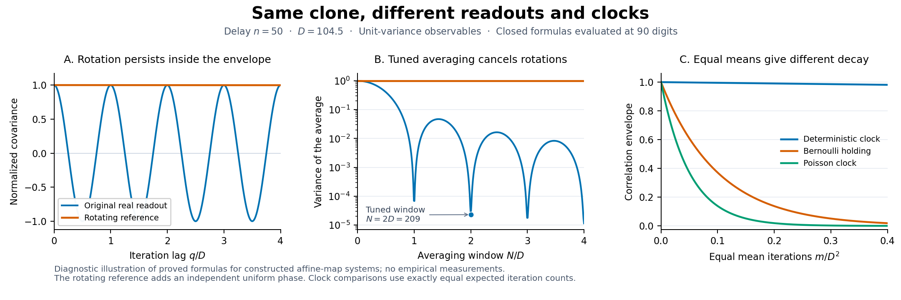

# Cubic memory, vanishing averaging variance, and explicit clock sensitivity

**Date:** 2026-11-23. **Source snapshot:** `79dc6c6e9d2f370b505ff47cfaed3feba46d4899`.

For the actual piecewise affine interval maps constructed in the
[renewal-clock note](clone_renewal_clock_20261123.md), the clone's subleading
finite-state mode has correlation envelope lasting order `D^3`, where
`D=2n+9/2`. Nevertheless,
its normalized long-run averaging variance is asymptotic to `1/(4D)`.
At the explicitly integer horizon `N=2D=4n+9`, the variance of the
**unnormalized sum** tends to 1 while the correlation envelope tends to 1.
These are compatible because the mode rotates on the shorter scale `D`.

This note proves the covariance power spectrum, the finite-window variance,
a phase-aligned real measurement, and the effect of specified clock changes.
An autonomous rotating reference gives a different measured variance larger
by a factor asymptotic to `16D^4/pi^2` in the long-run coefficients. Independent
random holding changes this same mode's decay scale from cubic to quadratic.
Even holding with probability `kappa/D`, tending to zero, changes its cubic
leading constant. Thus neither a correlation-envelope gap nor a mean clock
determines the fluctuation statistic without specifying the readout and clock.

**Evidence status.** The asymptotic, Fourier, and measure-theoretic arguments
below are written proofs. The finite stochastic/eigenmode ingredients are
separately formalized; the exact scope is recorded in Section 8. The
[companion verifier](verify_clone_resonant_readout.py) supplies exact finite
rational regressions and optional high-precision diagnostics, not universal
analytic proofs. AI-assisted derivation and independent AI review are disclosed
below; no human mathematical review is asserted.

**Meaning of the measured quantities.** A spectrum below is the Fourier
transform of a stationary covariance. A variance is an integral against an
explicit invariant probability measure. Neither is identified with a causal
response, a susceptibility, an extremal width, or a native quadratic-map
observable. No fluctuation-dissipation theorem is assumed. The distinction
between these quantities is part of the result.

## 1. Exact objects and the transition to actual interval-map correlations

Fix `n>=0`, `d=2n+5`, `D=d-1/2`, and the directed `d`-cycle with extra edge
`n -> n+2`. Its row-source adjacency is `A`. Let `t>1` be the positive root
of `z^d=z+1`, and `z_1` the unique upper-half-plane root with largest
non-Perron modulus. Define

\[
 v_i(z)=\begin{cases}z^i,&i\le n,\\z^i/(1+z),&i>n,\end{cases}
 \quad h_i=v_i(t),\quad
 P_{ij}=\frac{A_{ij}h_j}{t h_i},\quad
 \lambda=\frac{z_1}{t}=\rho e^{i\theta}.
 \tag{1}
\]

The renewal-clock note, Sections 1--4, proves the actual matrix identity
`Av(z)=zv(z)`, positivity of `h`, stochasticity of `P`, strict `rho<1`,
selection of this subleading root for every `n`, and the analytic expansion

\[
 \log\lambda=\frac{2\pi i}{D}
  +\frac{-a+ic}{D^3}+O(D^{-5}),\qquad
 a=\frac{\pi^2}{2},\quad c=\frac{\pi\log2}{2}.
 \tag{2}
\]

The logarithm in (2) is the branch tending to zero. In particular,

\[
 \gamma:=1-\rho=\frac{\pi^2}{2D^3}+O(D^{-5}),\qquad
 \theta=\frac{2\pi}{D}+\frac{\pi\log2}{2D^3}+O(D^{-5}).
 \tag{3}
\]

Here is the actual probability space being used. Write
`a_0=1/(1+t)`, `b_0=t/(1+t)`, `m=d-b_0`, and
`pi_(n+1)=a_0/m`, `pi_i=1/m` otherwise. Put
`s_i=sum_(j<i) h_j`, `I_i=[s_i,s_(i+1))`, and `X=[0,sum_i h_i)`.
The Borel map and probability measure are

\[
 T(x)=s_{i+1\bmod d}+t(x-s_i)\quad(x\in I_i),\qquad
 \frac{d\mu}{dx}\bigg|_{I_i}=\frac{\pi_i}{h_i}.
 \tag{4}
\]

At the shortcut row the image is the adjacent union
`I_(n+1) union I_(n+2)`; every other row has one image interval. The exact
identities in (1) verify these image lengths. Each allowed inverse branch
has slope `1/t`. Thus an allowed cylinder of length `q+1` has Lebesgue
length `h_(i_q)/t^q`, and therefore

\[
 \mu\{x:T^j x\in I_{i_j},\ 0\le j\le q\}
 =\pi_{i_0}\prod_{j=0}^{q-1}P_{i_j i_{j+1}}.
 \tag{5}
\]

Disallowed cylinders are empty. Direct summation of incoming inverse-branch
densities and `pi P=pi` proves `T_*mu=mu`; equivalently, one may verify
invariance on Borel subsets of each image interval using those same constant
densities. Half-open intervals settle endpoints exactly. This is the written
realization proof in the renewal-clock note, Section 6; its measure-theoretic
content is not replaced by a finite matrix identity.

Let `g_i=v_i(z_1)/h_i`, initially without normalization, and put
`G(x)=g_i` on `I_i`. Then `Pg=lambda g`, `pi g=0`, and
`sum_i pi_i |g_i|^2>0`. Divide `g` and `G` by the positive square root
of the latter sum. The resulting actual Borel observable satisfies

\[
 \int G\,d\mu=0,\qquad \int|G|^2\,d\mu=1,\qquad
 C(q):=\int\overline G\,G\circ T^q\,d\mu=\lambda^q
 \quad(q\ge0).
 \tag{6}
\]

Indeed, (5) gives the endpoint law `pi_i(P^q)_ij`; multiplying it by
`conj(g_i)g_j`, summing, and using `P^q g=lambda^q g` proves (6).
Centering follows from `pi g=pi Pg=lambda pi g` and `lambda!=1`.
This is the explicit transition from the finite eigenmode to a correlation
of actual points of the interval map.

There is no assertion `G o T=lambda G` pointwise. Such an assertion would
contradict `mu`-invariance and the positive `L^2` norm when `rho<1`.
The correct statement is the conditional expectation identity for the
partition process, followed by integration. The map (4) is constructed
piecewise affine dynamics; no identification with the archive's actual
quadratic maps has been proved.

## 2. A real observable requires its own phase construction

Complex covariance alone does not justify assigning the same normalized real
covariance to `Re G`. Set

\[
 m_2=\int G^2\,d\mu.
\]

The endpoint-law proof also gives
`integral G(G o T^q) dmu=lambda^q m_2`. For any real `alpha`, expansion
of the real parts yields

\[
 \int \operatorname{Re}(e^{i\alpha}G)
       \operatorname{Re}(e^{i\alpha}G\circ T^q)\,d\mu
 =\frac12\operatorname{Re}\!\left[
    \lambda^q(1+e^{2i\alpha}m_2)\right].
 \tag{7}
\]

Choose `alpha` with `e^(2i alpha)m_2=|m_2|`; choose zero if `m_2=0`.
Since `|m_2|<=1`, the real observable

\[
 F=\frac{\operatorname{Re}(e^{i\alpha}G)}
         {\sqrt{(1+|m_2|)/2}}
 \tag{8}
\]

is well defined, centered, and has unit variance. Equation (7) then proves

\[
 \int F\,F\circ T^q\,d\mu
 =\operatorname{Re}(\lambda^q)=\rho^q\cos(q\theta).
 \tag{9}
\]

This construction supplies a real physical mathematical measurement for all
the averaging statements below. It is necessary to justify the covariance
formula, even though a different phase might also work in special cases.
The exact verifier includes a rational stationary chain with `m_2` purely
imaginary: its raw real part has nonzero lag-one covariance when `Re lambda=0`.
The phase-aligned measurement satisfies (9), and the uncorrected formula is
rejected as a mutation.

## 3. A moving narrow resonance and a vanishing zero-frequency density

Extend `C(-q)=conj(C(q))`. This defines the negative-lag covariance without
requiring `T` to be invertible. For each fixed `n`, `sum_q |C(q)|<infinity`,
so its Fourier series converges absolutely and uniformly:

\[
 \begin{aligned}
 S(\omega)&=\sum_{q\in\mathbb Z}C(q)e^{-iq\omega}\\
 &=\frac{1-\rho^2}{|1-\lambda e^{-i\omega}|^2}
 =\frac{1-\rho^2}{(1-\rho)^2+4\rho\sin^2((\omega-\theta)/2)}.
 \end{aligned}
 \tag{10}
\]

For a direct proof put `z=lambda exp(-i omega)` and sum
`1+z/(1-z)+conj(z)/(1-conj(z))`. The numerator simplifies to
`1-|z|^2`. Formula (10) is positive, has integral `2pi`, and its Fourier
coefficients are exactly `C(q)`, by termwise integration of the uniformly
convergent series. Accordingly `S(omega)domega/(2pi)` is a probability
spectral measure. This is the classical Poisson kernel, also the normalized
first-order autoregressive spectrum [1]; that kernel is not a new discovery.

The complex spectrum has its exact maximum at `omega=theta` modulo `2pi`.
Using (3) in (10) gives

\[
 \begin{aligned}
 S(0)&=\frac{1-\rho^2}{|1-\lambda|^2}
       =\frac1{4D}+O(D^{-3}),\\
 S(\theta)&=\frac{1+\rho}{1-\rho}
       \sim\frac{4D^3}{\pi^2},\\
 \frac{S(\theta)}{S(0)}
       &=\frac{|1-\lambda|^2}{(1-\rho)^2}
       \sim\frac{16D^4}{\pi^2}.
 \end{aligned}
 \tag{11}
\]

For the first line, `1-rho^2=pi^2/D^3+O(D^-5)` and
`|1-lambda|^2=4pi^2/D^2+O(D^-4)`. The other two lines follow directly.
Thus a cubic inverse envelope gap is compatible with a vanishing
zero-frequency density and a quartically growing peak-to-zero ratio.

For every fixed bounded interval of real `u`, uniformly on that interval,

\[
 \gamma S(\theta+\gamma u)\longrightarrow\frac2{1+u^2}.
 \tag{12}
\]

Indeed the left side is
`(1+rho)/(1+4rho sin^2(gamma u/2)/gamma^2)`; Taylor's formula for sine
has a uniform remainder on bounded `u`-sets. For all sufficiently large `D`,
the full width at half maximum exists and is exactly

\[
 W=4\arcsin\frac{\gamma}{2\sqrt\rho}\sim2\gamma.
 \tag{13}
\]

If the quality factor is **defined here** as `Q=theta/W`, then
`Q~2D^2/pi`. This is a frequency-to-full-width ratio for (10), with no
additional physical interpretation assumed.

The probability measures `S(omega)domega/(2pi)` converge weakly on the circle
to the point mass at zero, even though `S(0)->0`. To prove this directly,
fix an angular neighborhood of zero. Eventually `theta` lies inside its
half-sized neighborhood. On the complement, the denominator in (10) is
bounded below by a positive constant independent of `n`, while
`1-rho^2->0`. The spectral mass there tends to zero. Unit total mass and
continuity of test functions finish the proof. The apparent pointwise
paradox disappears because the center approaches zero on scale `D^-1`
while the width is only of order `D^-3`.

For the normalized **real** observable (8), the spectrum is instead

\[
 S_F(\omega)=\frac12\left[
   P_\rho(\omega-\theta)+P_\rho(\omega+\theta)\right],
 \qquad P_\rho(u)=\frac{1-\rho^2}{1-2\rho\cos u+\rho^2}.
 \tag{14}
\]

Here `S_F(0)=S(0)`. At `omega=theta`, the second peak contributes
`O(D^-1)`, whereas the first contributes half the height in (11).
Consequently `S_F(theta)~2D^3/pi^2` and
`S_F(theta)/S_F(0)~8D^4/pi^2`. The exact maxima of the sum in (14)
need not occur exactly at `+theta` and `-theta`. The corresponding local
rescaled profile near either center is `1/(1+u^2)`, with half the complex
height. This prevents a factor-of-two error in a real measurement.

## 4. Exact averaging variance and cancellation after two rotations

For integer `N>=1`, define the variance of the unnormalized complex sum by

\[
 V_N=\int\left|\sum_{j=0}^{N-1}G\circ T^j\right|^2\,d\mu.
\]

Stationarity and (6), or stationarity and (9) for the real observable, give
the same number:

\[
 \begin{aligned}
 V_N
 &=\int\left(\sum_{j=0}^{N-1}F\circ T^j\right)^2\,d\mu\\
 &=N+2\operatorname{Re}\sum_{q=1}^{N-1}(N-q)\lambda^q\\
 &=N S(0)-2\operatorname{Re}
       \frac{\lambda(1-\lambda^N)}{(1-\lambda)^2}.
 \end{aligned}
 \tag{15}
\]

The final identity is finite algebra: multiply the weighted geometric sum
by `(1-lambda)^2`, or use
`sum_(q=1)^(N-1)(N-q)lambda^q=N lambda/(1-lambda)
-lambda(1-lambda^N)/(1-lambda)^2`. It involves no limiting theorem.

At each fixed `n`,

\[
 \lim_{N\to\infty}\frac{V_N}{N}=S(0),\qquad
 |V_N-N S(0)|\le\frac4{|1-\lambda|^2}=O(D^2).
 \tag{16}
\]

The first equality is the long-run variance coefficient of this observable;
the variance of its average is `V_N/N^2`. Equation (16) is a second-moment
statement and does not assert a central limit theorem. The bound supplies
a sufficient joint-limit condition `N/D^3 -> infinity` for
`V_N/[N S(0)] -> 1`. It does not assert that this condition is necessary
for specially chosen windows. In particular, the large-`N` approximation
cannot be substituted without control of this remainder when `N` and `n`
both vary.

### An explicit linearly long window

Let `N=2D=4n+9`, which is an integer for every `n`. Then

\[
 V_{4n+9}=1+O(D^{-2}),\qquad
 \operatorname{Var}\!\left(\frac1{4n+9}
        \sum_{j=0}^{4n+8}F\circ T^j\right)
   =\frac{1+O(D^{-2})}{4D^2},\qquad
 \rho^{4n+9}\longrightarrow1.
 \tag{17}
\]

Here is the complete remainder calculation. Put `w=log lambda` and
`B=-a+ic` from (2). Since `2Dw=4pi i+2B/D^2+O(D^-4)`,

\[
 1-\lambda^{2D}=-\frac{2B}{D^2}+O(D^{-4}),\qquad
 \frac{\lambda}{(1-\lambda)^2}
 =\frac1{2\cosh w-2}=-\frac{D^2}{4\pi^2}+O(1).
\]

Thus the correction term in (15) is
`-Re(B)/pi^2+O(D^-2)=1/2+O(D^-2)`, while
`2D S(0)=1/2+O(D^-2)`. Adding proves (17). Finally
`2D log rho=-pi^2/D^2+O(D^-4)`, proving the envelope limit. Two
approximate rotations cancel the sum substantially before the envelope
relaxes. This is an exact asymptotic for an actual real observable and
integer time window, not an inference from a plotted spectral peak.

The window is calibrated to the phase. For a general sequence with
`N/D -> beta>0`, the different statement is

\[
 \frac{V_N}{N^2}\longrightarrow
   \left(\frac{\sin(\pi\beta)}{\pi\beta}\right)^2.
 \tag{17a}
\]

Indeed, for `0<=q<=N=O(D)`, (2) gives
`lambda^q=exp(2pi iq/D)+O(D^-2)` uniformly. Substituting into the
normalized double covariance sum changes it by `O(D^-2)`. The resulting
expression is the squared modulus of
`N^(-1) sum_(j=0)^(N-1) exp(2pi ij/D)`, whose Riemann-sum limit is
`beta^(-1) integral_0^beta exp(2pi is) ds`. This proves (17a).
Thus a generic window of order `D` need not have vanishing average variance;
the sharper next-order limit in (17) uses the exact choice `N=2D`.

### A finite-state martingale identity explains the variance coefficient

Write `X_j` for the partition state under `mu`, and set
`u=g/(1-lambda)`. From the full cylinder law (5),

\[
 M_{j+1}=u(X_{j+1})-(Pu)(X_j)
        =u(X_{j+1})-\lambda u(X_j)
\]

has conditional mean zero given `X_0,...,X_j`. Telescoping gives

\[
 \sum_{j=0}^{N-1}g(X_j)
 =u(X_0)-u(X_N)+\sum_{j=0}^{N-1}M_{j+1},\qquad
 \mathbb E|M_{j+1}|^2
 =\frac{1-\rho^2}{|1-\lambda|^2}=S(0).
 \tag{18}
\]

For the second equality expand the square, use stationarity for the two
norm terms, and `E[conj(u(X_j))u(X_(j+1))]=lambda E|u|^2` for the
cross term. Distinct martingale differences are orthogonal by conditional
expectation. This identifies the variance of the stochastic innovations;
the endpoint term is explicitly retained. It is a specialized finite-state
Poisson-equation calculation, not a new general martingale method.

## 5. A rotating reference must be constructed as an actual stationary system

A deterministic time-dependent multiplier `exp(-ij theta)` is not by itself
an autonomous observable of (4). To make that additional measurement explicit,
let `Haar` be normalized angular Lebesgue measure on the circle and define

\[
 \widetilde X=X\times\mathbb T,\quad
 \widetilde\mu=\mu\times\mathrm{Haar},\quad
 \widetilde T(x,\phi)=(Tx,\phi+\theta),\quad
 H(x,\phi)=e^{-i\phi}G(x).
 \tag{19}
\]

Both factors preserve their measures, so the product does too. Direct
substitution proves

\[
 \int\overline H\,H\circ\widetilde T^q\,d\widetilde\mu
 =e^{-iq\theta}\lambda^q=\rho^q.
 \tag{20}
\]

Haar integration gives `integral H^2=0`, `integral |H|^2=1`, and
centering. Therefore the real observable `sqrt(2) Re H` is normalized and
has the same real correlation `rho^q`. Its zero-frequency spectrum and
long-run variance coefficient are exactly `(1+rho)/(1-rho)=S(theta)`.
Comparison with the original real observable (8) gives the quartic ratio
in (11), now as a comparison of two completely specified real measurements.

At the shorter horizon `N=2D`, the variance of this new real average tends
to 1: its normalized double covariance sum is bounded between
`rho^(N-1)` and 1. The original real average has variance asymptotic to
`1/(4D^2)` by (17). Thus the readout comparison is visible already on a
linear window, with a variance ratio asymptotic to `4D^2` there.

The full product system is not mixing: its circle factor has unit-modulus
rotation correlations. Equation (20) concerns the specified observable only.
This construction makes no claim that the original map acquired a new
Koopman eigenfunction or that its zero-frequency causal susceptibility
equals this covariance measurement.

## 6. Mean clock agreement does not preserve the correlation decay scale

### Independent holding has a deterministic skew-product realization

Let `Omega={0,1}^N` with the product law assigning probability `1/2` to
each bit and let `sigma` be the one-sided shift. On the actual product
probability space define

\[
 R(x,\omega)=(T^{\omega_0}x,\sigma\omega),\qquad
 G_R(x,\omega)=G(x).
 \tag{21}
\]

This is a measurable deterministic map preserving `mu` times the Bernoulli
law: condition on the first bit, use preservation by `T^0` and `T`, and
use independence of that bit from the tail. It follows that the process
is stationary. If `N_q=sum_(j=0)^(q-1) omega_j`, then
`G_R o R^q=G o T^(N_q)`. Independence and (6) prove exactly

\[
 C_R(q)=\mathbb E\lambda^{N_q}
       =\left(\frac{1+\lambda}{2}\right)^q=\eta^q.
 \tag{22}
\]

On partition states this is the lazy kernel `Q=(I+P)/2`. Expansion of
`|eta|^2=(1+2rho cos theta+rho^2)/4` using (3) gives

\[
 1-|\eta|\sim\frac{\pi^2}{2D^2}.
 \tag{23}
\]

For a comparison at exactly equal expected numbers of original iterations,
let `m_n=floor(sD^2)`, with fixed `s>=0`. Then `E N_(2m_n)=m_n`, but

\[
 \rho^{m_n}\longrightarrow1,\qquad
 |\eta|^{2m_n}\longrightarrow e^{-\pi^2 s}.
 \tag{24}
\]

These are the correlation **moduli**; their phases need not converge.
This counterexample addresses the claim that equality of mean iteration
counts suffices to transfer a decay rate. The surviving formulation must
control the distribution of the clock, or directly its transform
`E[lambda^(N_q)]`. No statement about worst-state total-variation mixing
time follows from this selected-mode calculation alone.

### A vanishing holding probability can still change the leading constant

More generally, holding with probability `epsilon` replaces the mode by
`eta_epsilon=epsilon+(1-epsilon)lambda`. This has the exact identity

\[
 |\eta_\varepsilon|^2
 =[\varepsilon+(1-\varepsilon)\rho]^2
   -2\varepsilon(1-\varepsilon)\rho(1-\cos\theta).
 \tag{25}
\]

Fix `kappa>=0` and take `epsilon_D=kappa/D` for all sufficiently large `D`.
Using (3), `D^2(1-cos theta)->2pi^2`, and
`1-|eta|=(1-|eta|^2)/(1+|eta|)` in (25) gives

\[
 D^3(1-|\eta_{\kappa/D}|)\longrightarrow
 \frac{\pi^2}{2}+2\pi^2\kappa.
 \tag{26}
\]

Thus a kernel perturbation tending to zero at rate `1/D` changes the cubic
leading constant. Dividing the logarithmic decay rate by the mean movement
probability `1-kappa/D` leaves the same limit, because that probability tends
to 1. A control of means alone does not remove the discrepancy. Formula
(25) also proves that holding probabilities `o(1/D)` preserve the constant.
These are explicit robustness statements for this family, not universal
claims about arbitrary return-time processes.

### A Poisson clock supplies a second exact comparison

Let `N_t` be an independent rate-one Poisson process and start `x` with law
`mu`. The observed process `Y_t=T^(N_t)x` is stationary: future increments
are independent, and each `T^k` preserves `mu`. Conditioning on `N_t`
gives the classical continuous-time transform [3], here proved directly:

\[
 \mathbb E[\overline{G(x)}G(Y_t)]
 =e^{-t}\sum_{k\ge0}\frac{t^k\lambda^k}{k!}
 =e^{t(\lambda-1)}.
 \tag{27}
\]

Its selected-mode envelope rate is
`1-Re lambda~2pi^2/D^2`. At integer times `m_n=floor(sD^2)`, the
Poisson clock and the deterministic clock both have mean iteration count
`m_n`, while their envelopes tend respectively to `exp(-2pi^2 s)` and 1.
This is a specified randomized observation process, with no inference that
it is the native physical clock of a quadratic or KKL system.

## 7. Which correlations are additional, and which mathematics is classical?

The archive was searched first, at the source snapshot above, for
`Green-Kubo`, `Lorentzian`, `Poisson kernel`, `resonance`, `spectral density`,
`power spectrum`, `autocorrelation`, `time average`, `zero frequency`,
`linewidth`, and `quality factor` across research, papers, and formalization.
Existing matches included parabolic satellite resonance, the
[three-component weighted growth resonance](airplane_inverse_problems_20261114/markov/RESEARCH.md),
and [finite spatial diffraction](airplane_inverse_problems_20261114/diffraction/airplane_phase_retrieval.md).
Those are different objects. This search did not locate the temporal
zero-frequency suppression, two-rotation averaging limit, or the explicit
clock-sensitivity statements proved here. A finite text search cannot
establish exhaustive archive novelty or worldwide priority.

The Poisson kernel and first-order autoregressive spectrum are classical;
Ibragimov, Kabluchko, and Lifshits [1] provide a primary-paper example of the
spectral formula and its geometric-series expansion. Benefits of
nonreversibility for asymptotic variance predate this work; Neal [2]
constructs nonreversible finite chains with no larger asymptotic variance
than the reversible chains used as inputs. That theorem is context, not an
imported comparison theorem for our particular nonreversible family.
Independent holding and Poissonization are also standard Markov-chain
constructions; [3, Section 20.1] gives the latter explicitly. The renewal
note separately credits the established necklace-chain phase-diffusion
mechanism, including Wilmer's work and its fixed-bead hypothesis.

The additional contribution is the joint, explicitly realized calculation
for the archive's exact clone family: cubic envelope memory, vanishing
long-run averaging variance, the integer-window limit (17), a quartic
readout-dependent coefficient ratio, and the clock threshold (26). Each
conclusion is proved from the same identified eigenmode and actual
stationary cylinder law. No claim that these methods or general mechanisms
have never appeared elsewhere is made.

## 8. Evidence, remaining physical bridges, and reproduction

| Transition | Mathematical input and output | Evidence |
|---|---|---|
| Full adjacency to stochastic eigenmode | Actual rows, root equation, positive `h`; obtain `P`, `Pg=lambda g` | Existing `FullCloneRenewal.lean` and the renewal note, Sections 1--2 |
| Finite mode to centered stationary endpoint covariance | Stationary positive `pi`, nonzero mode, `lambda!=1`; obtain zero mean, positive second moment, and covariance `lambda^q * secondMoment` for every `q` | [FiniteMarkovCorrelation.lean](../../formalization/weighted/FiniteMarkovCorrelation.lean), namespace `LoopsMarkovCorrelation`; square-root normalization of `G` is written in Section 1 |
| Endpoint model to actual interval-map covariance | Construct (4), invariant density, and all cylinders (5); identify the observable | Written proof in the renewal note, Section 6, and Section 1 here |
| Actual covariance to real readout, spectrum, and finite variance | Explicit phase (8), absolute convergence, finite double sums | Written proofs (7)--(18); not Lean analysis or measure theory |
| Selected root to asymptotic statements | Polar root selection for every delay and analytic implicit-function expansion | Written renewal-note Sections 3--4 and the remainder calculations here |
| Fair holding to a finite transformed mode | `Q=(I+P)/2`, same stationary law, mode `(1+lambda)/2` | `lazy_stochastic`, `lazy_stationary`, `lazy_mode`, and `lazy_mode_correlation` in `FiniteMarkovCorrelation.lean`; actual skew-product realization is written in (21)--(22) |
| Reference/clock change to actual new covariance | Product/Haar invariance, Bernoulli invariance, or independent Poisson increments | Explicit written constructions (19)--(27) |
| Exact finite examples and numerical values | Rational Markov examples; high-precision clone roots | Regression and diagnostic evidence only, in the companion verifier |

`FiniteMarkovCorrelation.lean` passed direct Lean compilation and Lake build
with the archive's pinned toolchain. Its audited public endpoint and mode
certificates depend only on `propext`, `Classical.choice`, and `Quot.sound`.
This verifies the finite statements just listed; it does not label the
analytic limits or actual measure construction as kernel-checked. The
bridge register records published-head build evidence separately.
In particular, the passage from stochastic matrix entries to actual
Lebesgue cylinder lengths is a distinct proof obligation even when the
finite matrix identities have been proved in Lean.

To transfer any conclusion here to a different physical mathematical object,
one must independently establish the invariant measure, the observable and
its moments, the finite-time joint law or another sufficient covariance
identity, and the relevant clock law. A conjugacy of unweighted transition
graphs establishes none of those distributional assertions by itself. A
width or coercivity conclusion additionally requires a theorem relating its
defined quantity to the particular covariance statistic being used, with
quantifiers and constants uniform on the required family. Those native
identifications remain open. No H2, H3, cross-scale, or MLC premise is
discharged by this note.

Run the exact finite regressions with the Python standard library:

```bash
python3 -B research/independent_audits/verify_clone_resonant_readout.py
```

The default checks five rational stationary chains, 90 independently
propagated path-variance horizons, 18 phase-aligned real horizons,
martingale-innovation variance, the finite Poisson-kernel algebra, and
binomial clock transforms. Three deliberately incorrect identifications
are rejected, including raw-real covariance and reversed complex phase.
This is finite regression, not a universal proof of the assertions above.

For 90-digit numerical diagnostics, using `mpmath 1.3.0`:

```bash
python3 -B research/independent_audits/verify_clone_resonant_readout.py \
  --numerics --output results/clone_resonant_readout_20261123.json
```

The optional run checks the root equations to residual below `10^-75`
and compares the closed variance against the independently evaluated
finite covariance sum. It samples delays `0,2,10,50,100,500`. At `n=500`,
`D S(0)=0.2500012358507368725`, `V_(2D)=1.0000024453519553905`, and
`D^2(1-|eta|)=4.9372562135861366502`, approaching the proved limits
`1/4`, `1`, and `pi^2/2`. Root residuals do not certify root enclosures
or all-delay error bounds. The written root-selection and remainder
arguments carry those mathematical obligations.

### Reproducible scientific figure



**Figure.** Diagnostic evaluation of the closed formulas at `n=50`,
`D=104.5`, using unit-variance observables. Left: (9) for the original real
readout and (20) for the explicitly augmented rotating reference. Center:
the variance of their averages, evaluated from (15), including the exactly
tuned integer window `N=2D=209`. Right: the deterministic, Bernoulli, and
Poisson correlation envelopes at the same expected genuine iteration count
`m`; these are respectively `rho^m`, `|eta|^(2m)`, and
`exp(m(Re lambda-1))`. Lines join evaluations at integer lags, windows, and
mean counts. This is a numerical illustration of the written theorems,
with no empirical measurements and no additional physical identification.
The rotating reference is the actual product construction (19).

Regenerate the PNG and SVG with
[generate_clone_readout_figure.py](../../code/generate_clone_readout_figure.py):

```bash
python3 -B code/generate_clone_readout_figure.py
```

The generator uses `mpmath 1.3.0` at 90 digits for the roots and
cancellation-sensitive variance formulas, and `matplotlib 3.10.8` for
rendering. It supplies fixed SVG metadata and removes trailing whitespace;
the SVG is available beside the displayed PNG. The image has been visually
inspected for labeling, line placement, and legibility.

### References and attribution

1. I. Ibragimov, Z. Kabluchko, M. Lifshits, *Some extensions of linear
   approximation and prediction problems for stationary processes*,
   Stochastic Processes and their Applications **129** (2019), 2758--2782,
   [DOI](https://doi.org/10.1016/j.spa.2018.08.001),
   [author preprint](https://arxiv.org/abs/1610.04985).
   Example 4.2, equations (22)--(23) in the linked preprint, gives the
   first-order autoregressive spectral density and its geometric-series
   expansion. This note derives its shifted normalized formula directly
   in (10).
2. R. M. Neal, *Improving Asymptotic Variance of MCMC Estimators:
   Non-reversible Chains are Better*, Technical Report 0406, University
   of Toronto, 2004, [author manuscript](https://arxiv.org/abs/math/0407281).
   Cited as prior context on nonreversibility and variance, not as a theorem
   whose hypotheses are silently assigned to this family.
3. D. A. Levin, Y. Peres, with contributions by E. L. Wilmer,
   *Markov Chains and Mixing Times*, second edition, 2017,
   [author-hosted text](https://pages.uoregon.edu/dlevin/MARKOV/mcmt2e.pdf),
   Section 20.1, equations (20.1)--(20.3), for the independent Poisson-clock
   construction. Formula (27) is proved directly above.

**AI disclosure.** OpenAI ChatGPT agents assisted in mathematical derivation,
independent formula review, literature comparison, and verifier generation.
The two-rotation limit, phase correction, product realization, and clock
constants received a separate AI audit; this is not represented as human
peer review. Primary sources supply attribution, not certification of the
new archive-specific arguments.
