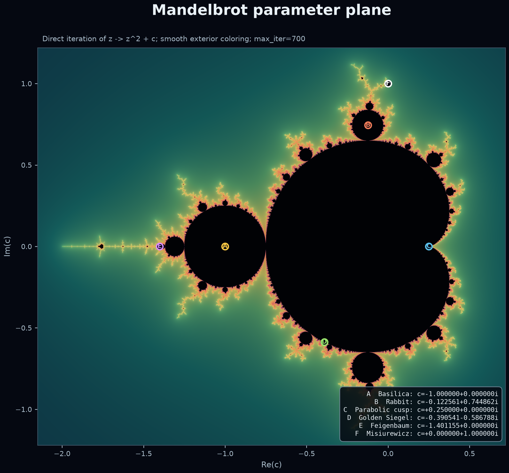
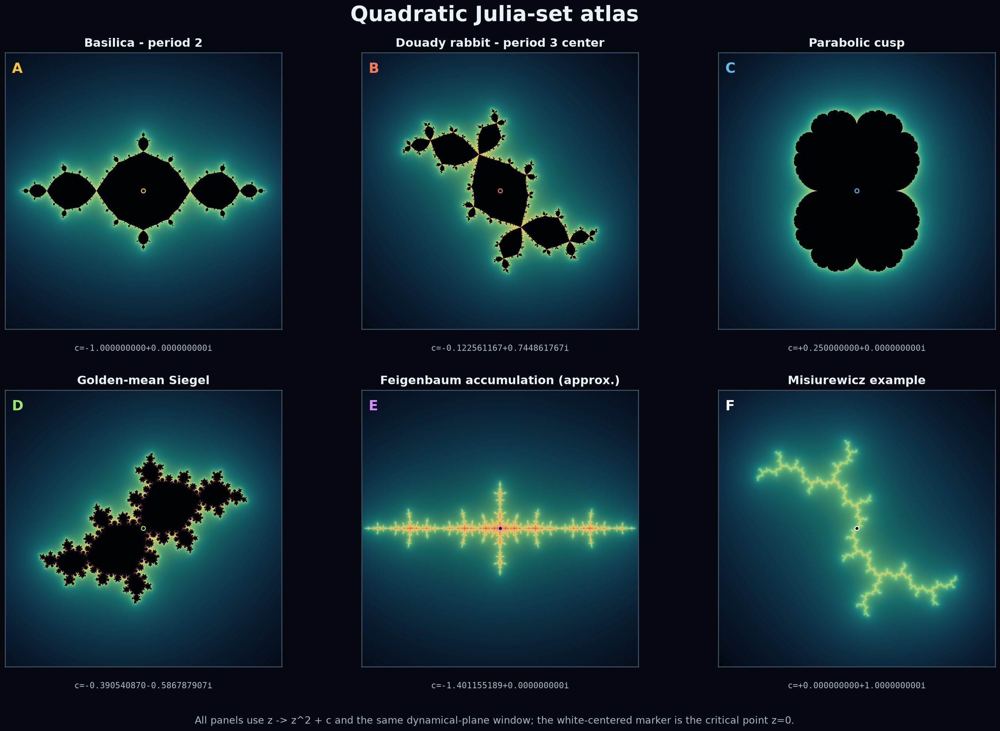

# Unified MLC proof program

Status: **open proof program with a proved no-go result and a corrected reduction**  
Source lock date: 2026-07-25

This directory implements the requested research task as a proof-facing package. It does
not claim that MLC has been proved. The primary sources themselves still identify two
missing programs, and the proposed Master Transition Lemma does not follow from the
published estimates.

## Fractal illustrations

The documentation now includes reproducible Mandelbrot and Julia-set plates.
Their generator, exact render manifest, and proof-safety statement are in
[`figures/README.md`](figures/README.md).





These images are computational illustrations only. They do not promote MLC,
UPTCR, VAAPC-I, analytic coercivity, or any other proof obligation.

## Novelty and impact audit

The project-wide claim audit dated 2026-07-25 is recorded in
[`novelty_and_value_audit_20260725.md`](novelty_and_value_audit_20260725.md).
Its machine-readable sidecar classifies the 209 internally proved ledger
nodes present at that dated audit snapshot in
[`novelty_classification_20260725.json`](novelty_classification_20260725.json),
with an independent consistency check in
[`novelty_classification_20260725_validation.md`](novelty_classification_20260725_validation.md).
Later proved nodes are not retroactively covered by that snapshot and must
receive a separate novelty audit before any originality claim.

The audit's conclusion is deliberately narrower than the inventory below.
The KKL delayed-clone correction is the strongest candidate-original result;
the direct-decoration rooted-end package is a promising but unverified
first-scale construction; and the counterexample catalogue has substantial
quality-control value. Most other proved entries are classical lemmas,
conditional compilers, source reconstructions, or no-go results. No global
MLC gate or new MLC parameter class has been closed.

The research pass has produced the following concrete results:

1. a source-locked theorem and notation ledger;
2. an exhaustive classification of families by the Kahn--Kapiamba--Lyubich invariants,
   with a separate audit of what is still needed for a canonical decomposition of an
   individual tower;
3. an exact obstruction to using unmarked quadratic-like width, and to closing a
   forward-amplification induction by a universal growth bound;
4. a corrected conditional reduction of MLC to a backward, marked-width transition
   theorem over entropy-clock blocks;
5. an exact finite-horizon inflation specification, including the stagewise
   forward-closure and relative-cover lift conditions, plus a qualitative locally
   saturated telescope for full inverse itineraries with separated compact obstacles;
6. a second no-go theorem: even genuine quadratic-like maps with identical
   topological/marking data can have arbitrarily large or small extremal width, so
   topological inflation and quantitative calibration are independent obligations;
7. a direction-correct reduction showing that a forward upper transition yields
   backward amplification only after a strict forward contraction is proved in an
   error-stable chart gauge;
8. an exact finite-electrode surface response theorem and a proof that KKL WAD
   domination becomes Loewner domination under an itinerary-faithful port model;
9. a Value-observability no-go theorem: response, total WAD weight, and unweighted
   port data do not determine KKL Value when compression merges support classes with
   different Hubbard-tree coefficients;
10. an exact row-space criterion for Value observability in a lifted port-Laplacian
    state, including the minimal augmentation rank and a one-scalar closure of one
    source-licensed KKL primitive Value block;
11. a typed KKL Value-incidence audit: for raw source-to-target incidence \(N\), the
    project map is \(B=N^{\mathsf T}\), KKL \(v,w\) are project-left/project-right,
    and Value uses \(v^2w\). The audit also gives a primitive counterexample to the
    printed \(+\lambda^k\) finite-\(n\) clone equation;
12. an independent repair of that finite graph theorem:
    \(H(t)=\sum_k t^{-k}R_k\) and
    \(\rho(H(\lambda_n))=\lambda_n^n\), proving the fixed-template limits and both
    typed gate-eigenvector limits. An irreducible non-permutation integer return
    graph of dimension at most \(d\) has \(\rho\ge2^{1/d}\), so corrected clones
    with return depth \(K\le N<n\) have multiplier
    \(>2^{1/(2d)}\), stable under weighted relative loss
    \(\epsilon<1-2^{-1/d}\). The corresponding homogeneous KKL Value factor is
    at most \(2^{-1/(2d)}\) only after the realized WAD transition is proved to
    satisfy \(Y\le(f^r)^*X+E\) with actual pullback exponent \(r\ge n\);
13. an exact graph criterion showing that a translation corridor is a KKL
    cross-section clone precisely when its full edge-multiplicity graph has only the
    declared chain edges in the interior, with bounded endpoint defects absorbable
    into the active graph. The still-open step is realizing this graph from the
    finite-horizon virtual dynamics;
14. a finite-state realization certificate: the gate is a cross section exactly when
    the active quotient is acyclic, equal-gate-count closed walks of consecutive
    lengths certify primitivity for every clone delay, and a primitive base alone is
    insufficient. The graph certificate is now separated from the conditional KKL
    Value corollary;
15. a framed transfer trichotomy: nonzero irreducible bounded-dimensional return
    endomorphisms are cycle permutations or have an explicit entropy gap, while
    every nonexpanding remainder is transient extinction or reducible polynomial
    shear. Open layer transfers are never assigned gauge-dependent entropy;
16. a nonstationary support-automaton pumping theorem: an \(s\)-state,
    \(d\)-dimensional transfer language has a Boolean-support skeleton of length at
    most \(s2^{d^2}-1\), with every removed segment retained in an ordered,
    prefix-face-dependent insertion history. Cyclic non-simple support has a bounded
    algebraic witness; dynamical entropy still requires a framed repeatable return;
17. an exact future-equivalence and memory audit: fixed alphabet plus finite horizon
    can require exponentially many faithful states, prescribed exits require
    unbounded clocks, and reverse-ordered nesting may require a stack. The corrected
    target is uniformly finite control modulo explicitly retained geometric counters
    and, only if source-realized, a finite-alphabet LIFO stack;
18. a constructive automaton theorem from an exactly memory-compiled,
    Markov-complete marked-cell signature, including separate WAD transport-quotient
    and fixed-family output-observability criteria and checkpoint-pure macro
    compression. The signature bounds control states but does not bound core/WAD
    dimensions;
19. an independent red-team pass with concrete matrix counterexamples, followed by
    repairs to zero-SCC classification, product orientation, endpoint-frame
    invariance, clone degeneracy, counter-fiber safety, and the missing
    nilpotent/extinction branch;
20. a second red-team pass proving that finite-control projection does not license
    memory-safe pumping, bounded signatures do not bound transfer dimensions, and
    output observability does not imply compositional WAD transport;
21. a compactness no-go: unbounded counters and finite stack words in their discrete
    topology are not precompact. The later future-observable compactification
    supplies a formal compact end topology for an already realized exact system and
    frozen proof-use catalog; analytic nondegeneration remains open in
    `H3_COERCIVITY`;
22. a complete-source audit of KKL's virtual-occupancy remark: it imports only
    Proposition 3.7's large-width static amplification/tame/wave split inside the
    full KKL category. It does not import either branch closure. The virtual
    continuation is therefore separated into a Section-4 interface theorem, a
    tame full-return theorem, and a long-iterate wave theorem;
23. an exact access-complete limb-tree theorem: \(m\) non-anchor marked atoms
    produce at most \(4m-2\) oriented tree sides and, charging up to two local
    decorations at every prescribed vertex including the anchor, at most
    \(6m\) ideal intervals. A star-tree family proves that
    selected-component occupancy alone cannot give this bound;
24. a quantifier-correct branch-assembly theorem: invoke the static split at
    the wave-selector parameter, close the tame branch at that same parameter,
    and take the maximum of every width/high-type threshold. A logical
    countermodel proves that unrelated tame and wave inputs do not compose;
25. a proof-minimal virtual Section-4 interface and an abstract static
    trichotomy. The theorem is now formally closed from axioms `S4-AC` through
    `S4-END`; the geometric realization of those axioms for Dudko's carrier
    remains open and is itemized into nine exact obligations;
26. a full-return tame-branch audit that proves the critical-encounter degree
    formula, linear marking-density absorption, the abstract Value contradiction,
    and a conditional same-parameter tame transfer. It also proves that a general
    rotation \(a/q\) cannot be replaced by \(1/q\) through a cyclic-order-preserving
    relabeling;
27. a long-wave audit giving, conditional on the open bounded-visits
    interval-growth repair, the conservative complete horizon
    \(H_B(q)=(216B^2+1)(q+B+4)\); the finite-horizon Wave reduction also
    remains conditional on the native stationary proof repair.  The audit
    proves the exact obstruction showing that one degree-two endpoint return
    cannot supply KKL's bounded terminal fan;
28. a simultaneous finite inverse-tree fan theorem: once the proof-required full
    inverse components and separated compact obstacles are supplied, one root
    Jordan neighborhood realizes all selected proper sheets at once. A branch
    with \(m\) critical encounters has degree \(2^m\), and branches
    \(m=0,\ldots,M\) form a dyadic fan of total degree \(2^{M+1}-1\).
    Complete access marking, immersion properness, itinerary exhaustion, and
    one-shot width transport remain open;
29. an exact component-saturation no-go: for \(f(z)=z^2\), the closed right
    half-disk and the unit disk are full, contain the critical point/value, and
    satisfy \(f(H_-)=H_+\), but \(H_-\) is not the unique component of
    \(f^{-1}(H_+)\). Partial forward invariance therefore cannot replace the
    inverse-component hypothesis needed by the fan;
30. a seed-to-marked-fan reduction: forward-coherent connected seeds have a
    unique canonical pullback saturation; finite disjoint forward-closed
    obstacle systems give the exact stage complement inclusions; and a
    future-complete root endpoint set pulls back with preserved cyclic order
    and exact size \(|P_r|(2^{M+1}-1)\). Constructing those seeds and proving
    root future completeness for the actual virtual carrier remain open;
31. an exact endpoint-birth ledger:
    \[
    p_0=D_{0,N-1}p_N+\sum_{j=0}^{N-1}D_{0,j-1}b_j.
    \]
    One genuinely new endpoint per degree-one corridor stage gives \(O(q)\)
    marking, while births confined to a bounded terminal quadratic window have
    a uniform geometric-sum cost;
32. a local no-birth theorem: on a degree-one interval, equality of the pulled
    and original carrier near that interval, absence of attached pullback
    components, and conformal endpoint lifts force zero genuine births. The
    virtual translation target is therefore a local carrier-equality theorem,
    not merely equal combinatorial labels;
33. a source-locked attachment-support reduction: KKL Proposition 6.5 lists
    every extra pulled ideal piece as the ideal boundary of a component of
    \(\mathcal T'\setminus\mathcal T\) attached at the old interval, and
    Proposition 6.7 kills those attachments on KKL's native central corridor
    by the restricted equality
    \[
      \mathcal T'\cap\mathcal L_{[B,q-B-2]}
      =
      \mathcal T\cap\mathcal L_{[B,q-B-2]}.
    \]
    Thus no pulled excess meets the relevant central intervals; no global
    equality \(\mathcal T'=\mathcal T\) is imported. Abstractly, endpoint births are supported
    only on such attachments; bounded attachment windows give the exact
    geometric-sum bound. Proving bounded attachment support for the virtual
    carrier is a new explicit open obligation;
34. a root-pullback carrier equivalence: one full root continuum and the
    routed component partition of all its finite iterated pullbacks determine
    the entire saturated forest. Whole required packages must stay inside
    single components, and sheet count is exactly the component quotient.
    A corridor edge is degree one exactly when its target avoids the critical
    value. The remaining construction is one simultaneous virtual root-carrier
    separation theorem, not an independent connector choice at every stage;
35. a source-locked LaTeX manuscript that separates proved, imported,
    conditional, and open statements in the rendered theorem names. Its
    appendix is generated directly from the machine ledger, so duplicate IDs,
    missing dependencies, unknown statuses, empty evidence fields, or a
    non-open MLC target stop the build. The release compiles with no LaTeX,
    package, overfull-box, underfull-box, citation, or reference warnings;
36. a corridor attachment-transport theorem: a commuting
    orientation-preserving homeomorphism of the actual pulled/immersed carrier
    pairs bijects attachment components, their ideal intervals, and their
    marked prime-end sides. Thus one attachment-free anchor kills attachment
    support throughout a natural degree-one corridor. Root routing alone does
    not supply this pair naturality, so the virtual gate is now split into two
    explicit construction obligations rather than silently assumed;
37. a univalent carrier-pair construction and exact anchor obstruction:
    transporting one actual anchor pair in its entirety gives the commuting
    square and prime-end cyclic order without local connectivity, but Dudko's
    published connected-hull data do not select an attachment-free anchor.
    The interval/triod countermodel proves the underdetermination. A finite
    monotone attachment-orbit completion has a least functorial fixed point;
    any sheet, critical-word, obstacle, access, or localization collision in
    that closure is unavoidable under further monotone absorption.
38. a canonical-interface carrier obstruction: a finite proof-use ledger has
    one minimal typed inventory, and monotone completion is order-independent
    on a fixed implication-complete cell universe, but two prescribed points
    have no least connected full planar carrier.  For an explicit univalent
    branch of \(z^2\), the first upper-half-disk excess has a complete
    critical-free itinerary and every monotone absorption erases a protected
    upper prime-end access.  The replacement invariant therefore retains full
    attachment traces and protected-access survival maps; a cell quotient
    that forgets them cannot certify analytic naturality.
39. the Universal Protected-Tower Compactness and Rigidity Proposition
    (`UPTCR`): one six-clause, source-locked open proposition packages the
    canonical carrier, exact analytic realization, finite Value-observable
    response state, backward transition, coercive marked compactness, and
    tower rigidity.  The implication `UPTCR => MLC` is proved from the
    backward-record lemma, Yoccoz's complementary theorem, and the connected
    relative-neighborhood clause.  UPTCR itself, every gate it packages, and
    MLC remain open.
40. an independent UPTCR cross-validation: the conditional implication is
    re-proved with the invariant-Beltrami, affine-normalization, and relative
    neighborhood steps explicit.  Three specification errors are corrected:
    the one-degree-two condition applies only to the selected return spine
    because the auxiliary Wave fan has degrees \(2^m\); a bounded window does
    not license a nonzero protected collision; and the three block routes
    cover but need not partition the blocks.  The attempted proof stops
    exactly at UPTCR-1 because no checked source supplies the protected
    dynamical routing certificate.
41. a protected regulated connector theorem: an explicit finite protected
    ribbon-routing certificate now produces an actual compact connected full
    carrier with singleton attachment traces, injective cyclic-order-
    preserving crosscut-chain survival, and exact univalent naturality,
    without local connectivity.  KKL's lamination-lifted Hubbard tree
    supplies the source-faithful model.  The remaining UPTCR-1 input is the
    open `VIRTUAL_PROTECTED_ROUTING_CERTIFICATE`: for the actual
    virtual-Molecule block, every lifted fiber, regulated edge, and filled
    component must avoid the protected collars while realizing the complete
    pullback routing and critical words.
42. an exact protected free-component criterion: after the complete finite
    root-shadow, protected-collar, obstacle, critical-exclusion, and
    localization inventory is frozen, a protected connector exists if and
    only if one component of the free routing domain has simultaneous
    singleton ports to every required atom.  A first collar or obstacle
    separating two port classes is an exact monotone-unrepairable
    obstruction.  The actual virtual assertion
    `VIRTUAL_COMMON_FREE_COMPONENT` remains open.
43. an augmented-atom common-domain theorem: if the frozen forbidden
    inventory is covered by finitely many pairwise disjoint full augmented
    root-shadow atoms and full separated obstacles inside one Jordan
    localization, and every original atom retains an explicit free
    singleton port, compacta Alexander duality proves that their common
    complement is connected.  This closes the planar implication, not the
    virtual construction.  The new source-faithful obligation
    `VIRTUAL_AUGMENTED_ATOM_PORT_CERTIFICATE` remains open.  A separating
    annulus gives an exact underdetermination model for the public
    connected-hull data and exposes post-fullification merger and port-loss
    failures.
44. a fixed augmented-packet closure and port audit: for one fixed typed
    assignment, fullification is an order-independent closure, so a
    favorable processing order cannot remove a final merger.  Every merger
    or localization escape has an actual seed/bounded-chamber witness and
    persists under monotone same-label enlargement.  Individual
    unprotected original-atom ports can be truncated in disjoint packet
    neighborhoods, eliminating global arc untangling as a separate gate.
     The remaining `VAAPC` input is the actual component inventory, zero
     unique-closure collision, original-atom exposure, complete-horizon
     transport, and uniform incidence/compression.
45. a horizon-first source-adequacy theorem for `VAAPC-I`: on a fixed
    finite typed Wave-horizon graph, reachability from the complete proof-use
    seed set is the unique least inventory.  Under horizon extension, the
    old slice remains frozen exactly when no new proof seed reaches an
    omitted old record.  Dudko's public “appropriate number” of first
    returns supplies no stopping rule, while KKL's native inventory requires
    an unproved typed bridge to the virtual carrier.  The exact first open
    replacement input is `VIRTUAL_WAVE_HORIZON_CERTIFICATE`; packet labels
    remain additional actual geometric data.
46. a resolved finite Wave-horizon compiler and a conditional native KKL
    stopping audit: if the separately open interval-growth implication is
    supplied, the critical-visit recursion stops before \(216b^2\) linked
    waves for fixed parabolic bound \(b\), while the actual iterate horizon
    is the sum of the witnessed return words.  The virtual certificate
    remains open until actual marked branches exist.
47. a marked-correspondence boundary-action theorem: paths in an actual
    typed branch graph give the required prefix-closed language; a
    forward-invariant full carrier containing all critical values gives an
    unmarked complement covering/inclusion pair; and exact ideal-marking
    action is equivalent to \(E^\iota\subset E^g\) on the prime-end
    boundary.  An exterior-disk phase countermodel proves that carrier,
    degree, relative-cover existence, and prime-end circles do not determine
    the action.  The remaining actual inputs are
    `VIRTUAL_RETURN_BRANCH_LANGUAGE`,
    `VIRTUAL_PROVISIONAL_COMPLEMENT_PAIR`, and
    `VIRTUAL_ACCESS_ACTION_CERTIFICATE`.
48. a demand-closed analytic return-atlas compiler: every child is formed
    on an actual nonempty pullback component, so its composite is the exact
    summed polynomial iterate with chronological critical, degree, sheet,
    obstacle, localization, and access data. Exact injective enlargement
    morphisms preserve old words; complete no-birth stability requires a
    bijection on demanded branch-component pairs. The explicit
    \(z^2-1\) return-base calculation shows why the still-open virtual
    construction must first select an open return localization.
49. a source-locked native principal-nest return atlas: Lyubich's Markov
    pullback and boundary avoidance give actual nice open puzzle bases,
    proper first-return components, exact integer iterates, the central
    degree word \((2,1,\ldots,1)\), univalent lateral words, and
    external-angle-normalized prime-end markings.  This closes the native
    analytic positive control.  It does not identify an intermediate
    virtual scale with a puzzle level.  An explicit relative-isotopy
    counterexample proves that an isotopy class of neighborhoods is
    insufficient, so the new
    `VIRTUAL_SCALE_TO_PUZZLE_SELECTOR` remains open.
50. a first direct-decoration selector: Kahn--Lyubich's escape puzzle
    gives the source-defined depth
    \(\nu_{\rm dec}(1)=nq+1\), actual compact first-return domains, exact
    branch words, and native prime-end markings.  The terminal primitive
    cycle cannot fit in one critical base: \(K_1\) is the first excluded
    component, so the replacement skeleton is an actual multi-base return
    chain.  The full raw separating fan has \(2^n\) candidate access
    records, so one must prove either that a bounded subset is
    proof-complete or that the demanded subset has a future-faithful
    compression.  The
    protected analytic connector, deeper-scale recursion, and uniform
    compression remain open.
51. a native terminal Hubbard-tree anchor: KKL's native prime primitive
    Hubbard tree supplies an actual compact connected forward-invariant
    carrier for the complete terminal cycle.  Its unique path from \(K_1\)
    to \(K_0\) selects a native ideal attachment side.  Finite marked
    vertex packages have unique convex subtrees, exact transport under an
    injective tree branch, and one-gate enlargement forests.  This does not
    select the \(s=2\) virtual package: the new exact gate is
    `VIRTUAL_VERTEX_PACKAGE_SELECTOR`, which must choose the actual Cantor
    components, retained critical returns, protected sides, obstacles, and
    proof-use demands before the recursive subtree exists.
52. a virtual Cantor-package type correction: Dudko's proposed virtual
    carrier starts from a Cantor family, whereas KKL's terminal Hubbard tree
    starts from one finite primitive cycle.  An infinite component family
    cannot be exactly enumerated by finitely many terminal vertices, and a
    finite quotient is valid exactly when every quotient fiber is
    indistinguishable by all observables in the claimed horizon.  The
    corrected order is therefore
    `VIRTUAL_CANTOR_PACKAGE_REALIZATION`, then the prefix-local scale
    selector and return correspondence, then the frozen Wave horizon, then
    `VIRTUAL_PROOF_USE_TRACE_SELECTOR`, and finally the compatibility gate
    `VIRTUAL_VERTEX_PACKAGE_SELECTOR`.  At \(s=2\), the checked sources do
    not yet define the address-to-component map or analytic branch action,
    so no first excess component or zero collision is fabricated.
53. a direct-decoration pullback compactification: the two actual univalent
    \(f^q\)-pullbacks in the Kahn--Lyubich decoration puzzle generate a
    compact rooted-end family of actual preterminal Julia pullbacks and
    connected nested end fibers.  The construction keeps geometric nesting
    \(\operatorname{gpar}(wa)=w\) separate from the partial analytic shift
    \(\sigma_{\rm pre}(aw)=w\), records the empty-root transition
    separately, proves topological finite-fiber root-enlargement naturality inside the
    first-level gap, and moves the first scale-\(2\) bottom field to the open
    `VIRTUAL_DISCONNECTED_MARKING_TRANSFER`.  It does not identify the end
    fibers as small Julia sets or promote the global virtual package;
54. a finite-cylinder commuting-iterate lift: once equal-depth source and
    target cylinders are selected and actual containment is proved,
    commutation of polynomial iterates forces
    \(f^r=h_v^{-1}\circ F\circ h_w\), with exact image equality under
    surjectivity and preserved proper degree.  The new exact open gate is
    `VIRTUAL_CYLINDER_TARGET_ADDRESS_SELECTOR`: it must choose a unique
    target address compatibly with parents, the partial shift, root
    transition, markings, and enlargement.  Critical chronology remains
    separate metadata.
55. a complete Research Push II quarantine and reconstruction: fourteen
    local or compiler-level theorems survive adversarial checking, including
    critical-cut conservation, proper-square degree conservation, the
    conditional retimed pair, the stagewise critical-word ladder, the
    closure-embedded planar telescope compiler, and the planar/end no-go
    results.  The proposed marked-telescope and finite-horizon promotions
    fail because the supplied work assumes the scale-two root portrait,
    protected relative-cover geometry, and end realization.  These missing
    inputs are now exposed as
    `VIRTUAL_FINITE_WORD_ROOT_PORTRAIT_AUTHORIZATION`,
    `DIRECT_DECORATION_END_PRIME_END_COFINALITY`, and
    `VIRTUAL_END_BLOWUP_REALIZATION`.
56. a complete Research Push III end-rescaling and plumbing audit: the
    normalized direct limit of an independently supplied root portrait,
    finite shift-graded cylinder materialization, exact conformal observable
    transport, and the conditional serial-exhaustion law survive.  The
    proposed scalar nodal-response theorem fails at its interface reduction:
    a cut cross-section has functional trace modes, and on a length-\(L\)
    cylinder the constant conductance \(2\pi/L\) does not control the
    \(\pi k\coth(kL)\) energy of the \(\cos(k\theta)\) mode.  The exact new
    open gate is `END_PLUMBING_TRACE_RESPONSE_CONTROL`; all downstream
    finite-horizon and transition promotions are rejected.
57. a complete Research Push IV full-trace audit: the exact rectangle
    Dirichlet-to-Neumann operator, its semigroup, scalar-collapse criterion,
    sharp trace-renormalized comparison, compact end limit, Hilbert
    elimination law, and conditional strict-transfer estimate are proved.
    The claimed physical collar is refuted: inverse pullback divides angular
    width by \(2^q\), so full parent and child equipotential arcs do not make
    one serial rectangle.  `DIRECT_DECORATION_TRACE_COLLAR_REALIZATION` is
    the new open source-facing gate and `END_PLUMBING_TRACE_RESPONSE_CONTROL`
    remains open.
58. a complete Research Push V physical-contact and welding audit: the
    conditional active/inactive Jordan-cell decomposition, corrected
    open-atom refinement, regular-interface fiber-product response,
    extended-infimum functoriality, closed-form pushforward no-go, and
    fixed-standard-neck cap compactification survive.  The proposed
    physical series law fails without an all-depth contact audit: an exact
    alternating-attachment chain reactivates a side port two levels later
    and bypasses the middle shell.  Whole-tail uniformization also introduces
    word-dependent endpoint welding maps, so scalar resistance does not
     determine a fixed-coordinate response.  Both proposed gates remain
     open.
59. a deduplicated audit of the cumulative side-research PDF library.  It
    retains the primitive-root parabolic nondegeneracy theorem, the
    fixed-modulus ambient-end no-go, the serial-annulus singleton bridge,
    and the sectorwise dyadic Böttcher trace isometry.  It rejects the
    proposed componentwise-constant response quotient and the proposed weak
    graph compactification by exact counterexamples.  The corrected
    multi-port gauge retains relative port potentials, and weak operator
    convergence is recorded as insufficient for welding algebra.
60. an independent Push-V re-verification.  It corrects one missing plus
    sign, source-types the binary branches versus length-\(n\)
    macrobranches, proves the finite tame contact-overlay response theorem,
    and replaces an unlabeled contact-pair graph by canonical physical
    contact atoms with complete incidence data.  It confirms rather than
    closes the all-depth contact and welding gates.
61. a Research Push-VI audit proving the narrow binary nested-separator
    calculus and rejecting the proposed finite atom-to-atom response
    cocycle.  The audit retains exact set-level contact transport and
    stage-specific fiber-product response, while recording the expanding-ray
    atomization obstruction, normalized-overlay defect, trace-space type
    error, and SCC overclassification.
62. a Research Push-VII audit proving the fixed-block binary structural
    contact automaton and the fixed-tree KKL pair-state moment
    factorization.  It rejects the non-source-faithful boundary compiler,
    undeclared pseudo-piece Sobolev traces, omitted cover-versus-immersion
    welding, overstrong safe-gap theorem, and unconstructed operadic
    response.  The compiler's finite-label false positives are preserved as
    explicit regression evidence.
63. a Research Push-VIII audit proving only an abstract finite
    linear-label marking enumerator and a pull--push word-composition
    no-go theorem.  It rejects the claimed fixed-horizon marked interface:
    the finite labels do not encode KKL proper-path lifts, the advertised
    success fixture is not a degree-one boundary covering, the end-proper
    test is false, and the proposed welding word is ill-typed and fails by
    an exact \(2\times2\) matrix counterexample.  Actual path-lift,
    whole-end-interval, collar, fiber-product, and enlargement certificates
    remain open.
64. a corrected source-locked direct-decoration path-lifted collar pass.
    It proves the tile-injectivity gluing criterion, a local homogeneous
    trace theorem, and the finite-label pullback no-go, but demotes the
    actual KL pseudo-piece embedding: a general bold ambient map is only an
    immersion, an explicit degree-one annulus immersion has a same-tile
    self-collision.
65. a hostile outer-port audit proving the abstract embedded-disk
    accessible-footprint formula, the conformal ideal-circle identification
    for the audited KL pieces, a degree-one lower-strip no-go, and a
    common-coordinate cap theorem only as a conditional positive control.
    At that pass the actual KL embedding and \(O\)-footprint remained open;
    item 72 resolves the full canonical embedding negatively.
66. an exact KL tile-injectivity reduction.  For a degree-one annulus
    immersion, a universal-cover tile lift is injective exactly when the
    bold base-annulus immersion is injective; full properness would make
    the base map a one-sheeted covering.  KL supply neither global base
    univalence nor full annulus properness at a general \(\psi\)-ql stage.
67. an exact finite-Blaschke counterexample satisfying Kahn's complete
    abstract annulus-lemma hypotheses, including the analytic
    orientation-preserving degree-one inner boundary and the prescribed
    modulus relation, while remaining noninjective.  It blocks an
    abstract collar-to-global upgrade but is not an actual KL dynamical
    stage.
68. a complete abstract degree-two \(\psi\)-ql counterexample with a
    proper companion branch, exact common connected inverse, complementary
    degree \(+1\), and a remote immersion self-collision.  It is not an
    actual KL localization-stage collision.
69. the exact subgroup-reflection criterion for a lift of an
    independently supplied physical embedding:
    \(A\) is injective exactly when \(a_*^{-1}(H_t)=H_s\).  Item 72 applies
    it to the physical inclusion underlying the ordinary primitive
    canonical localization and proves that reflection fails.
70. a conditional finite-horizon Kahn-collar embedding theorem.  Coherent
    collar truncations embed when the central maps embed, tile indices are
    bijective, Kahn's full annulus data hold, gluing is exact, and the
    retained tile collars reflect central overlaps.  The checked sources
    do not supply that overlap-reflection hypothesis.
71. a relative-overlap correction for the full KL star gluing.  Exact
    equivalence-relation reflection shows that only the target overlap
    lying in the source-central image can cause a tile--central collision.
    For the fixed direct pair, component bijectivity gives
    \(Q\cap P_{j(i)}=Q_i\), so full tile injectivity supplies the required
    relative reflection automatically.  Full reflection over all of
    \(P_{j(i)}\) is a stronger non-gating saturation question.
72. the forced canonical-localization collision theorem.  A finite
    full-pullback argument produces and isolates an excess component
    \(X\subset(f^p)^{-1}K_p\) disjoint from the target little-Julia packet.
    Its peripheral loop is nonlocal in the source cover and null in the
    target, so the localized inclusion is noninjective.  Exact equalizer
    pullback propagates the collision to every later inclusion leg.  The
    universal footprint/contact route is rerouted through a
    sheet-sensitive groupoid retaining
    \(a_*^{-1}(H_t)/H_s\).
73. the canonical localization sheet-resolution factorization.  The full
    canonical lift factors uniquely as an \(H_s\)-to-\(K\) covering
    followed by an embedding, with identical kernel pair.  Winding proves
    \([K:H_s]=\infty\); exact base change propagates the factorization
    through full, unselected complementary-cover equalizers, but not
    through filled or prime-end completion; and explicit subgroup formulas
    classify based-coset merger and birth without overclaiming geometric
    final-root stability.
74. Kahn-iterate ambient complementary-component alignment.  At every
    finite iterate the full unfilled equalizer is exactly
    \[
      (\mathbf U^{r+1}\setminus K^{r+1})
      \times_{\mathbf U^r\setminus K^r}
      (\mathbf U^{r+1}\setminus K^{r+1})
    \]
    and is connected.  If a whole-annulus covering/embedding factorization
    \(A_s\xrightarrow{q}P\xrightarrow{e}A_t\) with \(eq=\iota\) is supplied,
    surjective \(q/e\) base change makes its resolved intermediate connected.
    For one fixed seed, KL use these same \(\mathbf U^m\) iterates in the
    direct-decoration construction.  Oriented annular degree \(+1\)
    identifies the pullback of each declared target tile with the connected
    source universal cover after lifted basepoints fix the deck phase.
    This theorem is conditional on the stated \(q/e\) factorization; it does
    not identify the canonical infinite sheet-resolution cover with the
    whole actual KL tile, collapse separately glued copies, or equate the
    covering and inclusion component maps.
75. a resolved-intermediate full-boundary no-go and relative replacement.
    A nontrivial universal cover cannot extend continuously through any
    point of its deck-group limit set to a Hausdorff completion; the same
    orbit argument forbids a nonconstant deck-invariant composite from
    extending there.  In the annular \(q/e\) tower the deck group is the
    kernel \(N=\ker e_*\), and the two resolved-source wrapping ends
    \(\zeta_\pm\) lie in \(\Lambda(N)\) whenever \(N\ne1\).  KL identify
    actual-tile ends \(\omega_\pm\) with named vertices at which the
    actual inclusion-induced tile map \(L_a\) extends.  The based
    source-cover biholomorphism extends with
    \(\overline\Phi_a(\omega_\pm)=\zeta_\pm\), so the transported
    composite is \(K_a=L_a\Phi_a^{-1}=e_aq_a\).  Therefore any
    covering/embedding factorization of that whole actual
    boundary-extended KL tile map is one-sheeted.  The former identification
    of the canonical infinite resolution with the whole KL tile is
    quarantined.  Exact boundary descent remains valid only on a proved
    invariant subset of the domain of discontinuity
    \(\partial\mathbb D\setminus\Lambda(N)\).  At this point in the
    dependency chain, the next gate was the
    canonical-resolution/KL-tile correspondence audit recorded in item 76;
    the actual \(O,\xi,\eta\) footprints remain open.
76. the canonical-resolution/whole-KL-tile correspondence no-go.  A
    whole-tile comparison cannot simultaneously use the based
    universal-cover identification, conjugate the annular deck
    generators, retain an injective target comparison, identify the two
    interior composites, and carry the wrapping fixed points to KL's
    named continuous boundary values when the canonical deck kernel is
    nontrivial.  The ordinary primitive canonical kernel is infinite, so
    this closes the whole-tile option negatively.  It does not prove the
    actual KL immersion injective; it leaves proper collar/interior,
    relation-valued, retimed one-sheet, and revised-localization branches
    to be tested separately.
77. the canonical/KL restricted-interface classification.  For every
    **supplied fixed labeled same-source datum**, based lifting constructs
    the relation span
    \[
      \mathcal R\longleftarrow\mathcal E
      \longrightarrow\widehat A_t^{\rm KL}.
    \]
    Pulling a target parametrization back tile by tile and taking the tagged
    disjoint union over all source labels gives an exact étale family of
    maximal parameter-compatible interior lifts; labels, resolved traces, sheets, and deck
    phases are not quotiented.  A nontrivial canonical kernel forbids
    descent to a map on \(\mathcal R\), and the two source-locked wrapping
    values are common cluster values of every resolved fiber orbit.
    KL does **not** supply an extension on the whole standalone tile
    circle, so no value on all of \(\Lambda(N)\) is claimed.  The
    degree-two identity-annulus family separately rules out an
    **unscaled** universal additive collar/target crossing-width charge
    from Kahn's hypotheses alone; it does not rule out calibrated or
    source-specific responses.  Exact unchanged equalizer retiming
    preserves every infinite fiber.  A revised localization is
    one-sheeted exactly under subgroup reflection, after its based lift
    condition is checked.  The construction does not align every Wave
    stage or prove geometric-trace exhaustion, map properness on complete
    end-intervals, omitted-family
    control, prime-end naturality, final-root no-birth, or parameter
    realization.
78. full-KL-pseudo-piece maximal-lift properness.  On one supplied full
    pseudo-piece inclusion immersion whose source and target ideal closures
    are closed conformal disks and whose KL boundary extension is
    continuous, every maximal parametrized lift of a KKL proper target path
    has two unique source ideal endpoints.  Endpoint naturality is exact.
    Internal parameter endpoints may map to target interior, so this is
    path properness, not properness of the immersion on an ideal interval.
79. parametrized-pullback KKL exhaustion no-go.  KKL retains every proper
    source path contained in the geometric inverse trace.  The identity
    lollipop contains a loop-omitting proper restriction absent from the
    parametrized graph.  The exponential immersion
    \(e^{-(1+z)/(1-z)}\) gives one target diameter infinitely many proper
    source restrictions, and its disjoint logarithmic branch collars have
    unbounded aggregate raw interior crossing width.  This last statement
    is not a complete KKL-marked WAD/Value response theorem.
80. stationary filled-graph realization and degree correction.  Kahn's
    fiber-product filled set is an analytic graph over the embedded
    quadratic-like germ.  The graph lifts of \(K_0^b\) and
    \(K_0^{b+1}\) are whole distinct final components, and both final
    restrictions have degree two.  This repairs the source's degree-one
    coefficient but proves no occurrence-level incidence.
81. raw untagged path-image collision.  An explicit degree-two
    pseudo-quadratic-like pair has two distinct proper immersion
    restriction components with one identical covering image.  The common
    image is not a KKL Wave and no complete acting outer marking is
    asserted, so this is a multiplicity no-go rather than a KKL
    counterexample.
82. stationary noncollision source reduction.  Every selected small-Julia
    pull is conformal until the one central quadratic collar.  Under actual
    retained-corridor hypotheses, equality of terminal images is exactly a
    collision under that collar's deck involution.  KKL's coarse component
    route cannot exclude it because the two central parent routes merge in
    one component of \(T\setminus K_1\).
83. one retained chain and the two-occurrence binder gate.
    \(N\)-unbreakability guarantees at least one retained restriction
    component at each stage, and all retained components have the same
    singleton untagged image.  It does not bind the two line-1603 portions
    to two segmented retained extension towers.  Each tower must retain
    every full proper stage path and the strict occurrence window by which
    the next restriction lies in the preceding output.  Attachment
    absorption gives a real filter hazard, while KKL's interval itinerary
    permits adjacency and same-pulled-interval transitions.  The exact
    source theorem `KKL_STATIONARY_TWO_OCCURRENCE_BINDER` remains open.
84. strict and segmented reconstruction.  Exact common-parameter equality
    of all full stage paths does reconstruct one path in the complete Kahn
    fiber product, but this is only a special case.  KKL restrictions are
    defined by image containment and may use strict nested windows.  The
    proved `PQL_SEGMENTED_OCCURRENCE_RECONSTRUCTION` identifies the correct
    finite invariant: all full stage paths, all occurrence maps, and the
    compatible path at every tower prefix.  One deepest path loses the
    discarded shoulders of earlier proper paths.
85. finite embedded-collar naturality.  For each fixed finite Kahn horizon,
    the complete immersion embeds a neighborhood of the pulled filled set;
    within the resulting tree-complement collar it is conformal and
    preserves the induced accesses and cyclic order.  This proves
    `KKL_STATIONARY_FINITE_EMBEDDED_COLLAR_NATURALITY`, but Wave
    subordination does not put an actual route inside that collar.
86. continuation-exit overflow.  A measurably selected first exit from a
    fixed embedded collar overflows its annular crosscuts, so its width is
    at most \(1/\mu_h\).  This proves the block-dependent
    `KKL_STATIONARY_COLLAR_EXIT_OVERFLOW` only for the explicitly selected
    source-lift crossing class.  It does not cover a target trace that only
    touches and reenters or continues on another global immersion sheet.
    No period- or degeneration-uniform lower modulus follows, and the
    calibrated `KKL_STATIONARY_UNIFORM_COLLAR_EXIT_CHARGE` remains open.
87. quantitative stationary defect route.  The Quantitative Stationary
    Defect Bound (`KKL_STATIONARY_QUANTITATIVE_DEFECT_BOUND`, or QSDB)
    remains open.  The proved `KKL_STATIONARY_QSDB_SUFFICIENCY` assumes
    QSDB in KKL's native transverse measure, an HTND or explicit
    \(R(F)+1\) absolute scale, the disjoint
    \(B=A^{N\text{-br}}\cup A^{\rm sh}\) estimate, and KKL's
    small-breaking theorem.  Only under those hypotheses does terminality
    transfer from \(B\) to \(A\), while the unbreakable branch becomes
    strictly short.  This is not a proof of QSDB or the stationary repair.
88. qualitative-collar vertical-charge no-go.  In the exact family
    \[
      U_R=\mathbb D_R,\quad U'_R=\mathbb D_{\sqrt R},\quad
      K=\overline{\mathbb D},\quad T=[-a,a],\quad
      f(z)=z^2,\quad\iota(z)=z,
    \]
    the vertical width stays bounded as \(R\downarrow1\), while every
    horizon-\(h\) filled-set collar has reciprocal modulus at least
    \(2\pi2^h/\log R\).  This proves
    `KAHN_QUALITATIVE_COLLAR_VERTICAL_CHARGE_NO_GO`: Kahn's qualitative
    collar hypotheses cannot imply the desired vertical-linear charge.
    The family is not a native periodically repelling primitive KKL block,
    so the native uniform collar/route charge remains open.

At the close of this earlier checkpoint, the machine ledger validated
407 obligations: 25 imported, 283 proved internally, and 99 open. The targets `MLC`,
`UNIVERSAL_PROTECTED_TOWER_CLOSURE`, VAAPC-I,
`VIRTUAL_WAVE_HORIZON_CERTIFICATE`, and all downstream Wave certificates
remain open.

The corrected state variable is not a continuum \(H\) alone. It is a marked datum

\[
  {\mathfrak H}_n=(S_n,H_n,B_n,P_n^{\le r_n},{\cal I}_n,\Gamma_n),
\]

where \(B_n\) records satellite base cycles or neutral access data,
\(P_n^{\le r_n}\) is the part of the postcritical orbit actually used by the return
argument, \({\cal I}_n\) is the ideal/translation marking, and \(\Gamma_n\) is the
specified marked family of essential closed curves and/or proper access arcs. The
candidate degeneration is

\[
  D_n^\#=\operatorname{Ext}_{S_n\setminus
  (H_n\cup B_n\cup P_n^{\le r_n})}(\Gamma_n).
\]

This is a specification, not yet a constructed invariant for all towers.
The virtual-block proof pass shows that \(D_n^\#\) is only one component of the required
state. The homogeneous geometric coordinate is
\[
\mathscr R_B=
\left(
Q_B/r_B,\Lambda_B/r_B,S_B^{\rm std}/r_B
\right),
\]
while the discrete/error side data are
\[
\sigma_B=
\left(
r_B,\boldsymbol\nu_B,\omega_B,\rho_B,\kappa_B/r_B,\mathcal P_B,\mathcal F_B
\right),
\qquad
\rho_B=r_{\rm mark}/r_\parallel.
\]
Here \(\boldsymbol\nu_B\) is the vector of exact corridor/return counters,
\(\omega_B\in\mathcal T^*\) retains the explicit finite-alphabet nesting word
whenever its labels affect the future; it may be treated as a stack only after a
source-faithful LIFO theorem is proved. The coordinate \(\mathcal F_B\) is the discrete
Frobenius-flag/transfer type when the block has not yet been routed out of the shear
branch. The finite record \(\mathcal P_B\) includes the port/ribbon order and the
source-licensed endpoint core frame/holonomy.
Only the eventual augmented geometric state is scaled by a homogeneous gauge; raw
\(r_B\), \(\boldsymbol\nu_B\), \(\omega_B\), and \(\mathcal F_B\) are side data.
Counter values and word depth are allowed to be unbounded, but the number of
counters, alphabet, and all permitted update/guard rules must be universal. Their
discrete spaces are not automatically compact.
The BC1 audit proves that the response-only state is insufficient for
KKL Value unless the ports are Value faithful. The provisional corrected state is
\[
\mathscr R_B^{\rm val}
=
\left(
Q_B/r_B,\Lambda_B/r_B,\mathbf V_B/r_B,S_B^{\rm std}/r_B
\right),
\]
where \(\mathbf V_B\) records every inequivalent outgoing Value moment, unless a
uniform finite-feature theorem makes it redundant. A common Lyapunov function must
still calibrate the surviving state into the scalar potential used by the backward
record argument. The shear no-go shows that a non-regularized shear branch may require
one further uniformly finite homogeneous moment vector \(\mathbf\Xi_B/r_B\):
\[
\mathscr R_B^{\rm aug}
=
\left(
\mathscr R_B^{\rm val},\mathbf\Xi_B/r_B
\right).
\]
The transfer trichotomy must either construct and transport \(\mathbf\Xi_B\), or prove
pseudo-Siegel/sectorial regularization makes it unnecessary.

## Files

- [source_ledger.md](source_ledger.md) locks every imported theorem used here.
- [regime_and_hulls.md](regime_and_hulls.md) gives the regime partition, virtual-hull
  specification, and compatibility obligations.
- [master_transition.md](master_transition.md) proves the no-go theorem, states the
  corrected transition theorem, and separates known estimates from missing ones.
- [manuscript.md](manuscript.md) is the proof manuscript in conditional-reduction form.
- [latex/README.md](latex/README.md) documents the formal LaTeX manuscript,
  its generated proof-ledger appendix, build procedure, and release checks.
- [dependency_audit.md](dependency_audit.md) traces the final MLC claim backward and
  marks every open edge.
- [virtual_block_quotient.md](virtual_block_quotient.md) records the failed
  bounded-topology quotient, proves the translation-orbit replacement lemmas, and
  states the corrected virtual compression target.
- [finite_horizon_inflation.md](finite_horizon_inflation.md) defines the truncated
  \(\psi\)-ql category, proves the complement/lifting prerequisites and a local
  Jordan-collar telescope under exact hypotheses, and leaves selected fiber-product
  routing/categorical promotion and analytic width control open.
- [marked_collar_calibration.md](marked_collar_calibration.md) proves exact calibration
  for a connected exterior continuum and states the vector-valued multi-corridor
  extension that remains open.
- [corridor_network_calibration.md](corridor_network_calibration.md) proves the abstract
  WAD corridor sandwich and records why harmonic series transport requires a
  balance/bottleneck gate before any matrix or cone argument.
- [neutral_transition_interface.md](neutral_transition_interface.md) imports the DL25
  per-tile transitional estimates, corrects total-versus-density normalization, and
  proves the tile-aggregated error-absorption criterion.
- [virtual_hull_realization.md](virtual_hull_realization.md) separates finite cell-tree
  extraction from analytic access realization, proves the conditional
  incidence/replication calibration, and exposes the congestion invariant
  \(r_{\rm mark}/r_\parallel\).
- [canonical_virtual_interface_carrier.md](canonical_virtual_interface_carrier.md)
  freezes the interface certificate, proves the finite inventory and
  completion results, and records the exact quadratic protected-access
  collision and replacement invariant.
- [entropy_and_cycle_bookkeeping.md](entropy_and_cycle_bookkeeping.md) proves the exact
  discounted entropy-error formula and the necessary directed-cycle test for a common
  backward-expanding or forward-contracting chart gauge.
- [network_response_state.md](network_response_state.md) proves the finite-network
  response calculus in which parallel gluing is addition and serial gluing is Schur
  complement, and states the open surface comparison.
- [bc1_finite_port_response.md](bc1_finite_port_response.md) proves exact
  finite-electrode and WAD response theorems, converts itinerary-faithful WAD
  domination to Loewner order, and proves the Value-observability obstruction.
- [bc2_value_feature.md](bc2_value_feature.md) proves the lifted-state row-space
  criterion, the minimal Value-feature rank, and the exact affine contraction of one
  source-licensed primitive Value coordinate.
- [virtual_clone_entropy.md](virtual_clone_entropy.md) proves the bounded-reduced-
  dimension entropy gap, corrected variable-template cloned-block contraction,
  bounded-entropy eigencone compactness, and the unbounded-dimension counterexample.
- [corrected_clone_theorem_derivation.md](corrected_clone_theorem_derivation.md)
  derives the exact negative-weight literal-clone equation, fixed-template limits,
  both typed Perron-vector limits, and the uniform \(n>K\) multiplier bound.
- [corrected_clone_theorem_redteam.md](corrected_clone_theorem_redteam.md) and
  [corrected_clone_quantitative_audit.md](corrected_clone_quantitative_audit.md)
  independently attack the theorem, sharpen the integer entropy gap, and isolate the
  nonuniform-template, perturbation, and eigencone failure modes.
- [corrected_clone_regression_stress.md](corrected_clone_regression_stress.md)
  exhaustively and randomly stress-tests small return matrices, mixed return
  lengths, periodic reductions, and the sharp \(n=K\) boundary; its computations are
  diagnostic, while its boundary proof is exact.
- [corrected_clone_integration_map.md](corrected_clone_integration_map.md) records the
  downstream dependency and constant migration.
- [corridor_clone_criterion.md](corridor_clone_criterion.md) proves the exact
  corridor-to-clone graph equivalence, bounded endpoint-defect absorption, and the
  conditional finite-corridor union rule, and isolates the dynamical realization
  gate.
- [dynamical_corridor_certificate.md](dynamical_corridor_certificate.md) converts the
  cross-section condition to active-graph acyclicity, gives a delay-robust primitivity
  witness and counterexample, and states the complete finite-state virtual
  realization certificate.
- [corridor_entropy_shear_dichotomy.md](corridor_entropy_shear_dichotomy.md) proves
  the nonzero irreducible framed-return entropy dichotomy, the
  extinction-or-polynomial-shear normal form, and the identity-interior defect-run
  decomposition, and states the refined virtual transfer trichotomy.
- [corridor_support_automaton.md](corridor_support_automaton.md) proves the finite
  Boolean-support pumping reduction and bounded algebraic branching witness, leaving
  framed source-faithful virtual automaton construction and contextual loop
  regularization open.
- [virtual_language_memory.md](virtual_language_memory.md) proves the minimal
  future-equivalence criterion, finite-horizon and exact-exit no-go theorems,
  bounded-memory sufficiency, exact counter-fiber safety, the limits of bounded
  additive counters, and the abstract reverse-word stack model.
- [virtual_support_automaton_construction.md](virtual_support_automaton_construction.md)
  proves the abstract source-faithful quotient, Markov-signature construction,
  checkpoint macro, WAD transport-quotient, and fixed-family future-observability
  criteria, with independent dimension and memory-compilation hypotheses.
- [virtual_core_cocycle_program.md](virtual_core_cocycle_program.md) is the formal
  next analytic task: first realize the exact raw virtual core/WAD cocycle, then prove
  its uniform counter/stack follower quotient and framed-return routing.
- [virtual_automaton_source_research.md](virtual_automaton_source_research.md) is the
  source-locked audit showing that KKL supplies a special finite
  core/cross-section model with retained length. Its printed spectral bridge is
  rejected and replaced by the documented internal clone repair; no checked source
  supplies Dudko's virtual counter/stack follower.
- [transfer_convention_and_frame.md](transfer_convention_and_frame.md) locks the
  source-column product convention, the typed raw-incidence bridge to KKL Value, and
  why only framed returns have intrinsic spectral data.
- [kkl_transfer_orientation_audit.md](kkl_transfer_orientation_audit.md) is the
  line-and-hash source audit proving the \(N/B\) and left/right Value translation and
  exhibiting the finite-\(n\) clone-equation counterexample.
- [kkl_virtual_occupancy_source_audit.md](kkl_virtual_occupancy_source_audit.md)
  proves the exact scope of KKL Proposition 3.7 and Remark 4.14, records the
  large-width and access-complete occupancy hypotheses, and separates the static
  Section-4 interface from the still-open tame and long-wave branch closures.
- [virtual_limb_marking_bound.md](virtual_limb_marking_bound.md) proves the exact
  finite-tree conversion from access-complete marked-atom occupancy to a uniform
  ideal multi-interval bound and gives the selected-component star-tree no-go.
- [virtual_branch_assembly.md](virtual_branch_assembly.md) proves the
  quantifier-correct composition of the static, tame, and wave alternatives and
  gives explicit parameter- and threshold-mismatch countermodels.
- [virtual_section4_interface.md](virtual_section4_interface.md) extracts the
  proof-minimal static KKL interface, proves the resulting abstract
  amplification/tame/wave trichotomy, and lists the exact virtual realization
  obligations that remain open.
- [virtual_tame_full_return.md](virtual_tame_full_return.md) audits every
  full-return, localization, Wanderers, and Value premise in the tame closure,
  proves its algebraic reductions, and states the conditional virtual transfer.
- [virtual_long_iterate_wave.md](virtual_long_iterate_wave.md) audits the complete
  Wave stopping time, proves the finite-horizon bound and degree-two fan no-go,
  and isolates the marked interval-action, critical-limb, and fast-forward-fan
  constructions.
- [selected_marked_fast_forward_fan.md](selected_marked_fast_forward_fan.md)
  proves simultaneous local saturation and exact dyadic degree arithmetic for a
  finite full inverse tree, then states the eight remaining marked and analytic
  realization clauses `SMF1`--`SMF8`.
- [saturated_virtual_seed_forest.md](saturated_virtual_seed_forest.md) proves
  canonical pullback saturation from forward-coherent seeds, finite obstacle
  complement closure, and exact cyclic pullback of a future-complete root
  endpoint marking; it isolates the six-part Virtual Seed Certificate.
- [marked_endpoint_birth_ledger.md](marked_endpoint_birth_ledger.md) derives
  the exact degree-weighted cost of endpoints first exposed at intermediate
  stages and states the five-part Virtual Endpoint-Birth Certificate.
- [kkl_translation_no_birth_source_audit.md](kkl_translation_no_birth_source_audit.md)
  source-locks KKL Propositions 6.5 and 6.7, proves that attachment support
  localizes endpoint births, and isolates the open virtual bounded
  attachment-support theorem.
- [corridor_attachment_transport.md](corridor_attachment_transport.md) proves
  exact transport of attachment support under marked carrier-pair naturality,
  reduces an entire degree-one corridor to one attachment-free anchor, and
  isolates the two virtual realization inputs.
- [virtual_corridor_pair_naturality.md](virtual_corridor_pair_naturality.md)
  constructs pair naturality from one actual anchor by full univalent
  transport, proves the anchor underdetermination countermodel, and defines
  the least finite attachment-orbit closure and collision invariant.
- [virtual_return_base_atlas.md](virtual_return_base_atlas.md) proves the
  native principal-nest return atlas and isolates the source-facing virtual
  selector.
- [virtual_scale_to_puzzle_selector.md](virtual_scale_to_puzzle_selector.md)
  proves the first direct-decoration depth \(\nu_{\rm dec}(1)=nq+1\),
  constructs its analytic return atlas, proves the single-critical-base
  cycle exclusion, and records the \(2^n\) raw access-growth obstruction.
- [terminal_hubbard_anchor.md](terminal_hubbard_anchor.md) imports KKL's
  native terminal Hubbard tree, proves finite-subtree functoriality and
  one-gate enlargement, constructs the terminal cycle anchor and its ideal
  attachment side, and isolates the open virtual vertex-package selector.
- [finite_cylinder_commuting_lift.md](finite_cylinder_commuting_lift.md)
  proves the equal-depth commuting-iterate formula after actual target
  containment is known and isolates the open component-level target-address
  selector.
- [critical_chronology_and_retimed_telescope.md](critical_chronology_and_retimed_telescope.md)
  proves the pointwise critical-cut and proper-square laws, the conditional
  retimed finite-cylinder pair, two exact chronology counterexamples, the
  embedded-Jordan critical-spine compiler, and planar end-collapse
  constraints.  It keeps root-portrait authorization, relative-cover
  assembly, prime-end cofinality, and analytic end realization open.
- [research_push_2_assessment_and_integration.md](research_push_2_assessment_and_integration.md)
  locks every supplied Push II artifact, records the theorem-by-theorem
  adversarial disposition, audits the proposed code, ledger, TeX, and PDF,
  and explains why no existing global open gate is promoted.
- [research_push_3_assessment_and_integration.md](research_push_3_assessment_and_integration.md)
  locks and renders every supplied Push III artifact, reconstructs the
  normalized end and conformal-invariance results, proves the exact
  cylinder trace-mode obstruction, audits the stale dependency patch, and
  keeps nodal response, marked finite-horizon assembly, UPTCR, and MLC open.
- [referee_issue_resolution_20260724.md](referee_issue_resolution_20260724.md)
  verifies the external issue list against the live source, records every
  repair and source hash, and freezes the corrected dependency order without
  promoting UPTCR or MLC.
- [Public contribution and review protocol](../../CONTRIBUTING.md)
  defines the proof, counterexample, source-audit, reproducibility, AI-disclosure,
  and status-promotion standards for external contributions.
- [root_pullback_virtual_carrier.md](root_pullback_virtual_carrier.md) proves
  the one-root component-routing equivalence, the exact critical-value
  corridor criterion, and the virtual root-carrier certificate.
- [support_automaton_redteam.md](support_automaton_redteam.md) records the independent
  counterexamples, semantic audit, and exact remediation map.
- [virtual_automaton_second_redteam.md](virtual_automaton_second_redteam.md) tests the
  repaired construction against dimension, memory-pumping, WAD transport, machine
  class, macro-resolution, and emission failures.
- [post_repair_semantic_audit.md](post_repair_semantic_audit.md) cross-checks live
  ledger statements and evidence against the repaired proof texts.
- [block_contraction_program.md](block_contraction_program.md) is the formal next
  research task: it states the open response-calibrated complete-block contraction
  theorem, proves its exact reduction to backward amplification, and lists the
  falsification suite.
- [research_log.md](research_log.md) is the chronological decision and source-check
  record.
- [adversarial_audit.md](adversarial_audit.md) is the live attack matrix for claims,
  constants, horizon leakage, and circularity.
- [proof_obligations.json](proof_obligations.json) is the machine-readable dependency
  ledger; `python audit_proof.py` validates its graph and reports the live blockers.
- [audit_transfer_regressions.py](audit_transfer_regressions.py) runs the finite
  matrix, language, and limb-tree counterexamples as regression tests; passing it
  is diagnostic and discharges no analytic proof obligation.

## Hard conclusion

The scalar functional in the requested plan cannot be simultaneously:

- uniformly comparable to inverse root modulus at unbounded satellite roots; and
- uniformly controlled there after a hull regularization.

For a quadratic polynomial with satellite relative period \(s\), BLOT gives

\[
  \operatorname{mod}(A)<\frac{2\pi}{\log(4(s+1))},
  \qquad
  \frac1{\operatorname{mod}(A)}>
  \frac{\log(4(s+1))}{2\pi}.
\]

The discrepancy is unbounded, not a universal additive error. Consequently the
replacement must change the marked surface and the curve family; merely renaming the
ordinary root annulus as a “virtual hull width” does not work.

There is a second obstruction. A recurrence of the form

\[
  D_{n+k}\ge \lambda D_n-C,\qquad \lambda>1,
\]

toward deeper scales does not contradict any source-locked universal growth theorem.
Unbounded satellite periods can force ordinary inverse moduli to grow arbitrarily fast.
The existing successful arguments instead use a backward record principle: bad geometry
at a deep scale forces still worse geometry at a preceding scale, eventually
contradicting finiteness at the top of the tower.

## Exact remaining theorem

The shortest honest target is the **Marked Backward Transition Theorem** in
[master_transition.md](master_transition.md). It has three genuinely new parts:

1. extract a monotone finite cell tree from the virtual Cantor carrier and realize it
   as a selected \(\psi\)-ql correspondence with complete prime-end/access marking;
2. prove bounded access and translation incidence, standard-width density, and
    marking-to-parallel-replica congestion; prove independent universal core/WAD
    dimensions and exact memory-safe checkpoint compilation; construct the
    bounded-dimensional primitive reduced clone by realizing the exact corridor
    graph, its actual return-depth bound \(K<n\), and the typed WAD domination
    \(Y\le(f^r)^*X+E\) for an actual pullback exponent \(r\ge n\), which activates
    the proved negative-weight recurrence and Value contraction; when exact
    corridor purity fails, construct the
   finite support automaton without projecting away exact memory, prove the layered
   transfer trichotomy, and regularize or retain its reducible shear state; then
   calibrate the KKL/DL surface families to a common response/Value state;
3. group identity localization/chart steps with the dynamical step, then prove either
   strict forward contraction for each complete forward upper entropy-clock block or
   an independent backward lower transition; finally prove a discounted or telescoping
   error estimate and backward amplification, while the zero-entropy part is absorbed
   by pseudo-Siegel regularization.

Within item 2, the Section-4 logic is no longer the immediate gap: its abstract
trichotomy is proved. The sharp Wave-side construction is the selected marked
fast-forward fan (a degree-one corridor plus bounded auxiliary sheets), while the
tame side still needs a return-complete carrier, bounded critical-encounter
complexity, ordered WAD pullback, typed Value realization, and unified-chart closure.
The unmarked local-saturation and degree part of that fan is now proved by the
finite inverse-tree theorem. The remaining Wave gap begins with construction of
the actual inverse forest and its future-closed separated obstacles, followed by
the cyclic access/ribbon marking. Surjective forward invariance of connected full
hulls is insufficient: the construction must prove pullback-component saturation.
The saturation and pullback-marking operations themselves are now formalized and
proved. The live geometric input has been reduced first to
`VIRTUAL_AUGMENTED_ATOM_PORT_CERTIFICATE`.  Fullification order and global
port-arc untangling are no longer open: the fixed-packet audit proves the
unique closure and truncates individual ports in disjoint packet
neighborhoods.  The actual virtual dynamics must still supply `VAAPC-I`
(the frozen typed component inventory).  Its first ordered subgate is
`VIRTUAL_WAVE_HORIZON_CERTIFICATE`: define the stopping rule, stage branches,
complete proof-use ledger, dependency universe, and final-root-enlargement
stability before assigning packet labels.  It must then supply `VAAPC-C` (zero collision for the
unique completed packets), `VAAPC-P` (one unprotected access landing on
every original root-shadow atom), `VAAPC-H` (full-packet transport), and
`VAAPC-U` (uniform incidence or faithful compression).  The proved
augmented-domain theorem then yields `VIRTUAL_COMMON_FREE_COMPONENT`, and
the proved free-component criterion constructs the protected connector.
`VIRTUAL_PROTECTED_ROUTING_CERTIFICATE` remains the larger gate that must
also verify component routing, critical words, future marking, and bounded
root complexity.

Even after this, rigidity requires a uniform puzzle-Teichmüller-diameter or an
equivalent phase--parameter theorem. A priori bounds alone are not enough in the
generality required.

The first part is now split more sharply. A finite-horizon correspondence must first
pass the set-theoretic forward-closure, relative-cover lifting, local-saturation, and
orbit-use audits. It must then pass a separate analytic localization theorem. The
rescaling example in `finite_horizon_inflation.md`, Theorem 7.1, proves that the latter
cannot follow from the former.

## Completion rule

No statement in this directory may be promoted from `OPEN` to `PROVED` unless:

- all constants are quantified before the tower is chosen;
- the hypotheses cover arbitrary mixtures of the four regimes;
- every critical-orbit segment used by a pullback, Wave, Wanderers, or
  quasi-additivity argument belongs to the marking;
- long translation corridors are compressed only modulo their dynamics, never by
  deleting distinct return labels;
- translated arcs counted separately remain distinct global marked WAD coordinates;
- raw return count is never substituted for distinct parallel WAD support;
- neutral per-tile widths and total corridor widths are compared only after the orbit
  normalization is explicit;
- an entropy charge uses the discounted/telescoping error formula, not total entropy
  alone;
- no comparison uses ordinary satellite root modulus uniformly in the relative period;
- the rigidity/parameter step supplies a connected relative-neighborhood basis, not
  merely a nested sequence of shrinking diameter.

The current first virtual analytic subgate is now refined into the proved
native `NATIVE_PRINCIPAL_NEST_RETURN_ATLAS`, the proved first-scale
`FIRST_DECORATION_SCALE_ESCAPE_ATLAS`, and the open
`VIRTUAL_PREFIX_LOCAL_SCALE_SELECTOR`.  The first-scale source fixes
\(\nu_{\rm dec}(1)=nq+1\), but Proposition
`CRITICAL_BASE_CYCLE_EXCLUSION` forces a multi-base carrier and
`DECORATION_FAN_GROWTH` forces a future-faithful access compression.
The next source-facing inputs,
`VIRTUAL_RETURN_BASE_ATLAS` and `VIRTUAL_WAVE_DEMAND_SCHEMA`, remain open.
Their proved
compiler would yield `VIRTUAL_RETURN_BRANCH_LANGUAGE`, which is the first
input to `VIRTUAL_WAVE_MARKED_CORRESPONDENCE`. The finite horizon compiler
and final-root fixed-point theorem are proved in
`virtual_wave_horizon_certificate.md`, but they cannot run until the actual
virtual return bases, analytic branch components, complete continuation
syntax, and access phases have been constructed.
Only after that horizon is frozen may
`VIRTUAL_PROOF_USE_TRACE_SELECTOR`, `VIRTUAL_VERTEX_PACKAGE_SELECTOR`, and
the final `VIRTUAL_SCALE_TO_PUZZLE_SELECTOR` be evaluated.

## Research Push IV: full-trace advance and exact collar obstruction

The fourth co-agent packet has been quarantined, hashed, reproduced, and
audited in `research_push_4_assessment_and_integration.md`.

The valid advance is the complete trace calculus for a genuine width-one
rectangle:

- exact spectral Dirichlet-to-Neumann response;
- exact serial composition across a complete common trace;
- the exact criterion for scalar/electrode collapse;
- the sharp trace-renormalized error
  \(2/(e^{\pi R}-1)\);
- compact convergence to two half-cylinder responses;
- preservation of relative Loewner bounds under Hilbert-trace elimination;
  and
- the exact degradation formula for a separately proved strict response
  transition.

The packet's proposed dynamical collar theorem is false as stated.  In the
exact Böttcher model \(z\mapsto z^{2^q}\), inverse pullback changes an
equipotential arc of angular width \(\Delta\) to width
\(\Delta/2^q\).  The full parent and child arcs therefore cannot be opposite
equipotential sides bounded by the same two rays.  The physical region
between nested puzzle cylinders has unmatched boundary pieces and may
require extra trace ports.

Accordingly:

```text
BOTTCHER_TRACE_COLLAR_ATLAS                  rejected as proved
PULLED_EQUIPOTENTIAL_SERIAL_RECTANGLE_NO_GO proved
DIRECT_DECORATION_TRACE_COLLAR_REALIZATION  open
END_PLUMBING_TRACE_RESPONSE_CONTROL         open
H2_RESPONSE_REALIZATION                     open
UPTCR                                       open
MLC                                         open
```

The immediate response-side task is to decompose one actual
\(P\setminus Q_a^\circ\), retain the unequal parent/child trace footprints
and every extra side component, and prove that the resulting least
multi-port response state composes compactly with sufficient accumulated
resistance.  The rectangle formulas may be applied only after that
geometric realization.

## Research Push V: one-cell advance and exact iterated-tail obstruction

The fifth co-agent packet has been quarantined, hashed, reproduced,
rendered, and independently audited in
`research_push_5_assessment_and_integration.md`.

The one-cell topology is now exact under an explicit hypothesis.  If nested
closed Jordan disks \(Q\subset P\) have complete boundary intersection one
closed arc \(A\), then

\[
 P\setminus\operatorname{int}Q
 =
 \overline{\operatorname{int}P\setminus Q}\cup A,
\]

the active closure is a Jordan disk, and the interior of \(A\) is
inaccessible from it.  At one intermediate boundary, removing the genuine
endpoints of the inherited and following attachment arcs gives at most four
open atoms, classified exactly as common active, outgoing-only,
incoming-only, or double-inactive.  Actual common active traces glue by a
fiber-product Dirichlet infimum.

Those local results do not iterate automatically.  The nested rectangles

\[
\begin{aligned}
D_0&=[0,10]^2,\\
D_1&=[1,9]\times[1,10],\\
D_2&=[3,9]\times[3,8],\\
D_3&=[3,8]\times[4,7]
\end{aligned}
\]

have alternating top, right, and left attachment arcs.  On
\(\{9\}\times(3,8)\), shells \(C_1\) and \(C_3\) are active while \(C_2\)
is inactive.  Contact-closing the physical union therefore glues
nonconsecutive shells and bypasses \(C_2\).  A locally one-sided port cannot
be eliminated until the all-depth contact graph proves its last use.

There is a second independent obstruction.  A whole-tail uniformization
has endpoint trace maps \(J_w^\pm\); in fixed physical coordinates its
response is

\[
 (J_w^-\oplus J_w^+)^*
 \mathcal N_{R_w}
 (J_w^-\oplus J_w^+),
\]

not merely \(\mathcal N_{R_w}\).  No uniform boundedness or precompactness
of this welding cocycle has been proved.

Accordingly:

```text
ACTIVE_INACTIVE_PHYSICAL_CELL                 proved conditionally
ATTACHMENT_ARC_OPEN_ATOM_REFINEMENT           proved
REGULAR_INTERFACE_FIBER_PRODUCT_RESPONSE      proved conditionally
FINITE_TAME_CONTACT_OVERLAY_RESPONSE          proved conditionally
INFIMUM_PUSHFORWARD_FUNCTORIALITY              proved
CLOSED_FORM_PUSHFORWARD_NO_GO                 proved
FIXED_STANDARD_NECK_MULTIPORT_COMPACTIFICATION proved conditionally
DIRECT_DECORATION_ALL_DEPTH_CONTACT_CLOSURE   open
FINITE_LIVE_COMMON_REFINEMENT_FRONTIER        open
DIRECT_DECORATION_TRACE_WELDING_COMPACTNESS   open
DIRECT_DECORATION_TRACE_COLLAR_REALIZATION    open
END_PLUMBING_TRACE_RESPONSE_CONTROL           open
VAAPC-I / UPTCR / MLC                         open
```

The immediate response-side task is now
`PHYSICAL_END_CONTACT_WELDING_CONTROL`: source-select one branch
granularity, refine every physical contact into canonical incidence atoms,
prove true last use and no-bypass/coercive response control, and construct
an algebra-compatible compactification of the endpoint welding cocycle with
uniform constants.

## Research Push VI: separator localization retained; finite cocycle rejected

The sixth co-agent packet is audited in
`research_push_6_assessment_and_integration.md`.  All eleven supplied
SHA-256 values match, the finite computations were reproduced and extended,
and the submitted bundle remains unchanged.

One narrow theorem is retained.  For every fixed binary
direct-decoration address chain
\[
D_0\supset D_1\supset\cdots,
\]
the accumulated prefix
\(\Omega_j=\operatorname{int}D_0\setminus D_j\) can meet the next or any
future shell only on the current separator \(\partial D_j\).  Physical
boundary persistence is interval-convex.  Under separately verified tame
Sobolev-interface hypotheses, prefix-to-next-shell fiber-product
minimization therefore gives the exact stage response.  This captures the
Push-V alternating-rectangle bypass without an all-pairs raw shell graph.

The proposed finite response cocycle is not adopted:

- the expanding external-ray map generally prevents the claimed finite
  atom-to-single-atom partition; a finite blockwise relational mask is
  available under explicit endpoint-orbit hypotheses, but its KL binary
  source realization and trace-restriction operators remain open;
- a frozen physical overlay normalizes to
  \(h_{w_j}(Z\cap S_{j+1})\), which is word- and stage-dependent absent an
  equivariance theorem;
- full \(H^1\) is not conformally isometric, while homogeneous Dirichlet
  energy requires the correct constant quotient or grounding; and
- the compiler's union-graph SCCs do not describe recurrence along the
  supplied address.

The authoritative ledger adds only
`BINARY_DIRECT_DECORATION_NESTED_SEPARATOR_CALCULUS`.  The proposed eleven
nodes and duplicate meta-gate are rejected.  The ledger has 296
obligations: 23 imported, 210 proved, and 63 open.  The all-depth marked
contact state, finite live frontier, welding, trace collar, end plumbing,
H2, MBTT, VAAPC-I, UPTCR, and MLC remain open.

## Research Push VII: fixed structural contacts retained; pseudo-trace response rejected

The seventh co-agent packet is audited in
`research_push_7_assessment_and_integration.md`.  Its fifteen supplied
SHA-256 values match, all eight unit tests and all 1,100 exact algebra checks
reproduce, and the bundle remains unchanged.

Two narrow theorems are retained.

First, one fixed source-locked binary direct-decoration block has an exact
structural contact automaton:

\[
\widehat C_{wa}=g_a(\widehat C_w\cap C_a),
\qquad
\partial D_u\cap\partial D_{ut}=\phi_u(C_t).
\]

The source depth-\(n\) endpoint fan shifts by prefix deletion, and after that
depth the normalized structural contact is either the complete
\(\alpha\)-ray port or the empty state.  A source-faithful boundary graph
must distinguish vertex joins from equipotential connectors; the submitted
alternating ray/equipotential schema does not.

Second, on one fixed finite KKL terminal Hubbard tree,

\[
\operatorname{Val}(X)
=
\lambda^{-2m}
\langle aa^\top,\mathsf M_m(X)\rangle
\]

for a positive-semidefinite pair-state moment
\(\mathsf M_m(X)\).  Its dimension is
\(|E|^2(|E|^2+1)/2\), so this is not a universal state.

The advertised pseudo-trace and response promotions are rejected.  The
Kahn--Lyubich pseudo-piece source supplies coverings, immersions, finite
ideal-boundary arcs, and continuous boundary extension, but no
\(H^1_{\rm fin}\) ideal-arc trace theorem or response form.  The packet also
omits the inclusion-immersed copy and hence the pulled-versus-immersed
welding.  Its safe-gap hypothesis permits a root enlargement to reach
\(\partial P\), and no physical binary Dirichlet cell decomposition is
constructed.

The compiler is retained only as a finite-label diagnostic.  It still
passes with missing boundary words, false vertex shifts, three lifts over
one root atom, empty flags, or empty refinement relations.  The independent
reproduction is `validate_push7_audit.py`.

The ledger adds only
`FIXED_BLOCK_BINARY_CONTACT_AUTOMATON` and
`FIXED_KKL_PAIR_STATE_MOMENT_FACTORIZATION`.  It now has 298 obligations:
23 imported, 212 proved, and 63 open.  The complete marked contact state,
trace/welding/collar realization, end plumbing, H2, MBTT, VAAPC-I, UPTCR,
and MLC remain open.

## Research Push VIII: finite marking enumeration retained; analytic interface rejected

The eighth co-agent packet is audited in
`research_push_8_assessment_and_integration.md`.  Its supplied files match
the manifest after accounting only for line-ending normalization in the two
regenerated reports.  The compiler reproduces 1,221 accepted and 279
obstructed tables in 1,500 trials, but this is validation of its own finite
predicate, not of a KKL interface.

Two narrow results are retained.

First, for an already certified finite linearly cut boundary atlas, assume
the submitted deletion-and-seed sets are the actual immersion pullbacks and
that the supplied endpoint predicate is the desired action predicate.
Maximal nonproper runs then force adjacent target labels into the same
block; interval-convex transitive closure gives the unique finest
hull-disjoint partition, and exhaustive coarsening enumeration returns a
maximum-cardinality valid marking or a finite obstruction.  This is
`FINITE_LINEAR_LABEL_MARKING_ENUMERATOR`; it does not realize an analytic
atlas.

Second, the proposed word law \(W_2W_1=W_{\rm comp}\) is not a formal
consequence of pull--push welding.  Consecutive \(W_i=P_iR_i\) generally
act on different trace spaces.  Even after an arbitrary identification, the
required interchange moves \(P_1\) past \(R_2\), which need not commute.
The exact \(2\times2\) counterexample is recorded as
`PULL_PUSH_WELDING_WORD_COMPOSITION_NO_GO`.  A valid composition theorem
requires a geometric fiber product and a Beck--Chevalley interchange
square.

The headline completion is rejected.  KKL immersion pullback quantifies
over all proper target paths and their unique proper lifts; Push VIII stores
only finite atom labels.  Its success fixture has four atoms whose two
endpoint images coincide despite a claimed homeomorphism onto a
nondegenerate target atom.  Of the 1,221 accepted random tables, 1,220 fail
that elementary covering consistency check.  The code also tests
end-properness only on the first and last micro-atoms, rather than on the
whole KKL end intervals.  Finally, compiler success can occur when the only
nonempty pulled component is neither proper nor end-proper, leaving the
advertised welding undefined.

At the conclusion of the Push-VIII audit, the ledger added exactly the two
narrow proved nodes above and changed no prior status.  It then had 300 obligations:
23 imported, 214 proved, and 63 open.  The required replacement is an
actual path-lifted collared correspondence certificate with complete
proper-path lifts, relative-cover subgroup data, whole-end-interval
properness, transported-gauge collar maps, a fiber-product composition
square, and a no-new-sheet component bijection under final-root
enlargement.  All marked-interface, trace/collar/welding, H2, MBTT,
VAAPC-I, UPTCR, and MLC gates remain open.

## Direct-decoration path-lifted collar certificate

The completed source-locked pass is
[direct_decoration_path_lifted_collar_certificate.md](direct_decoration_path_lifted_collar_certificate.md).
Its finite adversarial checks are
[validate_path_lifted_collared_interface.py](validate_path_lifted_collared_interface.py).
The script checks bookkeeping distinctions only; it is not evidence for the
analytic theorems.

For either fixed Kahn--Lyubich direct-decoration branch
\(g=f^q|_{Q_a}:Q_a\to P\), the inclusion-induced pseudo-piece immersion
\[
  \boldsymbol\iota_a:\mathbf Q_a\longrightarrow\mathbf P
\]
is known from KL to be holomorphic and locally univalent, but its global
injectivity is not a source theorem at a general \(\psi\)-ql stage.  The
later canonical-localization audit proves that the ordinary primitive
canonical seed is in fact noninjective; the discussion in this paragraph
is the earlier reduction, retained for separately restricted pairs.  The dynamical branch
bijects the complementary components, and KL surjectivity therefore makes
the inclusion component map bijective.  If every tile immersion is
injective, the complete quotient-collision audit does prove a global
embedding.  The missing premise cannot be inferred from degree one:
\[
 F_a(z)=z+\frac{a}{2\pi i}e^{2\pi iz},
 \qquad a>e^{2\pi h},
\]
is a \(\mathbb Z\)-equivariant locally univalent strip map with a
same-tile self-collision.  This proves
`TILE_INJECTIVITY_GLUE_EMBEDDING_CRITERION` and
`DEGREE_ONE_ANNULUS_IMMERSION_INJECTIVITY_NO_GO`, while
`DIRECT_DECORATION_DEGREE_ONE_PSEUDO_EMBEDDING` remains open only as a
restricted-class, non-gating question; the later actual canonical
collision rules out its former universal full-canonical interpretation.

There is also a deliberately local trace theorem.  A compact nondegenerate
subarc in the relative interior of one KL universal-cover ideal tile arc
admits, in a uniformizing coordinate, a bounded Lipschitz quadrilateral
collar.  Its minimum-Dirichlet-energy trace space modulo constants is a
Hilbert quotient, and conformal transport between the selected collars is
an exact isometry by conformal invariance of planar Dirichlet energy.  This
proves `KL_TILE_INTERIOR_HOMOGENEOUS_TRACE`.  It supplies neither a canonical
collar nor a physical Julia-boundary collar, full gauge, universal norm
comparison, immersion transport, or word naturality.

The finite-label limitation is now analytic rather than merely
combinatorial.  Embed the upper half-disk \(\Omega\) holomorphically in the
unit disk.  The source arc mapping to the open diameter is nonproper, while
the complementary source arc maps to the selected target ideal interval.
The deletion-and-seed label hull retains every open source atom, including
the nonproper atom; the no-go does not require the separate endpoint
predicate to retain the two intervening vertices.
Nevertheless, a target crosscut with both ideal endpoints in the other
target interval can enter and leave \(\Omega\) through the diameter; its
intersection with \(\Omega\) is the unique source proper lift subordinate
to a prescribed subarc of that nonproper side.  The target path is not
subordinate to the selected interval, so the KKL universal proper-path
implication excludes that subarc.  This proves
`NONPROPER_LABEL_HULL_PULLBACK_NO_GO`: proper/nonproper and flanking labels
do not determine the KKL immersion pullback.

The next source pass resolves the abstract prime-end part of that gate.
Kahn's
universalization definition identifies the named KL
\(\lambda,\xi,\eta\) boundary with the conformal ideal circle of the
simply connected pseudo-piece.  For any disk embedding with a continuous
ideal extension, a Jensen--Fatou argument makes every boundary fiber
light.  Topological properness of a target-path intersection component
then forces a singleton source limit at both ends.  First/last traversal
and repeated-access hairpin arguments give the exact formula

\[
 \iota^*I=\{p:\Phi_\iota(p)\subset I\}.
\]

This formula applies to a fixed KL map only after injectivity has been
proved on that separately restricted pair.  It cannot be applied to the
unresolved image of a canonical seed, where the later forced-collision
theorem shows that the full map is noninjective.  A sheet-sensitive
immersion/groupoid footprint theorem is required there.  A second audit
also refutes the former exact
lower-strip inference.  For small nonzero \(\varepsilon\),
\[
 L_\varepsilon(z)=z+\varepsilon\sin(2\pi z)
\]
is already a \(\mathbb Z\)-equivariant holomorphic embedding of a strip
into a taller strip, but its upper boundary is wavy.  Thus a degree-one
annulus immersion need not be a translation.  If one explicitly assumes
that both annuli are concentric restrictions in one conformal external
coordinate and that the tile map lifts their literal inclusion, the
lower-strip, isolated-cap, closed-\(O\)-footprint, and three-atom
tile-star conclusions follow.  This is a conditional positive control,
not the actual KL theorem.

This proves:

- `KL_PSEUDOPIECE_CONFORMAL_IDEAL_BOUNDARY`;
- `EMBEDDED_DISK_ACCESSIBLE_FOOTPRINT_THEOREM`;
- `DEGREE_ONE_ANNULUS_IMMERSION_INJECTIVITY_NO_GO`;
- `KAHN_ANNULUS_GLOBAL_INJECTIVITY_NO_GO`;
- `KL_TILE_INJECTIVITY_BASE_ANNULUS_REDUCTION`;
- `PSI_QL_GLOBAL_INJECTIVITY_NO_GO`;
- `KL_LOCALIZATION_SUBGROUP_REFLECTION_CRITERION`;
- `FINITE_HORIZON_KAHN_COLLAR_EMBEDDING`;
- `KL_CANONICAL_LOCALIZATION_FORCED_COLLISION`;
- `TILE_INJECTIVITY_GLUE_EMBEDDING_CRITERION`;
- `GENERAL_ANNULUS_IMMERSION_LOWER_STRIP_NO_GO`;
- `COMMON_COORDINATE_NESTED_ANNULUS_OUTER_CAP`.

The complete proofs and skeptic audits are
[`embedded_disk_accessible_footprint_theorem.md`](embedded_disk_accessible_footprint_theorem.md)
and
[`direct_decoration_outer_port_footprint.md`](direct_decoration_outer_port_footprint.md).
The exact base/lift reduction and its source audit are in
[`actual_kl_tile_injectivity_gate.md`](actual_kl_tile_injectivity_gate.md).
The exact annulus counterexample and its full algebraic certificate are in
[`kahn_annulus_global_injectivity_no_go.md`](kahn_annulus_global_injectivity_no_go.md).
The complete abstract \(\psi\)-ql no-go, conditional cover criterion, and
finite-horizon collar theorem are respectively
[`psi_ql_global_injectivity_no_go.md`](psi_ql_global_injectivity_no_go.md),
[`kl_localization_subgroup_reflection_gate.md`](kl_localization_subgroup_reflection_gate.md),
and
[`finite_horizon_kahn_collar_embedding.md`](finite_horizon_kahn_collar_embedding.md),
with the subsequent exact gluing correction in
[`kl_relative_overlap_cartesianity.md`](kl_relative_overlap_cartesianity.md).
The actual canonical-stage obstruction and its full-pullback, subgroup,
and equalizer proofs are
[`kl_canonical_localization_forced_collision.md`](kl_canonical_localization_forced_collision.md).

For an ordinary primitive \(p\)-renormalizable stage, put
\[
 F=f^p,\qquad A=K_p,\qquad
 B=\mathcal K_p=\bigcup_{j=0}^{p-1}f^j(A).
\]
Kahn's canonical source deletes \(F^{-1}B\), while its target deletes
\(B\).  The global degree of \(F:U^p\to U^0\) is \(2^p\), whereas the
central component has degree two.  A proved finite full-pullback lemma
therefore supplies an excess full component
\(X\ne A\) of \(F^{-1}A\).  Invariance of each little Julia set under
\(F\) and primitive disjointness imply \(X\cap B=\varnothing\).
Finiteness permits a Jordan disk \(D_X\) separating \(X\) from both \(B\)
and every other pulled component.  A based peripheral loop around \(X\)
has winding one, so it is not in the source local subgroup \(H_s\); after
the physical inclusion it contracts through \(D_X\) in the target
complement, so its class lies in \(H_t\).  Hence
\[
 a_*^{-1}(H_t)\supsetneq H_s,
\]
and the localized inclusion has two distinct source-cover points with one
target image.

Whenever \(a_*^{-1}(H_t)/H_s\) is used below, it denotes the pointed
left-coset set; no quotient-group structure is assumed without a
normality proof.

Kahn's exact equalizer recursion propagates the collision through every
later inclusion leg.  Whenever that same seed carries the KL
direct-decoration depths \(m=\nu q+1\) and
\(n=(\nu-1)q+1\), degree-one deck equivariance transports the collision
to each full universal-cover tile and the glued pseudo-piece.  This
same-seed implication is not an unsourced parameter-existence assertion.
It proves that the universal full embedded-pseudo-piece carrier is
unavailable, not that any global MLC gate is closed.

The next pass proves
`KL_LOCALIZATION_SHEET_RESOLUTION_FACTORIZATION`.  With
\(K=a_*^{-1}(H_t)\), the physical canonical lift factors uniquely as

\[
 \widehat X_s\xrightarrow qP_K\xrightarrow e\widehat X_t,
 \qquad A=e\circ q,
\]

where \(q\) is the \(H_s\)-to-\(K\) covering, \(e\) is embedded, and the
kernel pairs of \(A\) and \(q\) agree.  The category of elements of the
\(q\)-monodromy functor is the canonical path groupoid.  Winding separates
the powers of the peripheral class, so

\[
 [K:H_s]=\infty.
\]

Every full canonical collision fiber is therefore infinite.  Exact
base-change propagates the factorization through Kahn's full, unselected
complementary-cover equalizers.  The exact membership chain
\[
 x\in K^{r+1}
 \Longleftrightarrow i_r(x)\in K^r
 \Longleftrightarrow f_r(y)\in K^r
 \Longleftrightarrow y\in K^{r+1}
\]
identifies the full complementary equalizer with
\[
 (\mathbf U^{r+1}\setminus K^{r+1})
 \times_{\mathbf U^r\setminus K^r}
 (\mathbf U^{r+1}\setminus K^{r+1}).
\]
Kahn's pullback theorem makes this the complement of an FJ-set in a disk,
so it is connected.  Since the base-changed \(q\)-cover is surjective,
the resolved intermediate is connected as well.  KL use the same
\(\mathbf U^m\)-tower when the same fixed seed carries direct-decoration
data.  Kahn's oriented annular-degree-\(+1\) theorem further shows that,
for every source tile \(a\), the pullback of its target tile
\(j_\iota(a)\) is the connected source universal cover after the lifted
basepoints fix the deck phase.  Distinct source labels over one target
remain distinct.  Base-changing \(q/e\) produces a connected resolved
intermediate embedded in that target tile **provided** the whole-annulus
covering/embedding factorization
\[
 A_s\xrightarrow{q}P\xrightarrow{e}A_t,\qquad eq=\iota,
\]
has first been supplied.  This proves the ambient equalizer statement and
the conditional tilewise clause of
`KAHN_ITERATE_COMPLEMENTARY_COMPONENT_ALIGNMENT`.  It does not identify
the canonical infinite sheet-resolution cover with the whole actual KL
tile, collapse the separately glued universal-cover copies, or equate the
covering and inclusion component maps.

The next pass, documented in
[`resolved_intermediate_relative_ideal_boundary.md`](resolved_intermediate_relative_ideal_boundary.md),
proves `RESOLVED_INTERMEDIATE_RELATIVE_IDEAL_BOUNDARY`.  For a nonconstant
universal covering
\[
 q_a:\mathbb D\longrightarrow\mathcal R_a
\]
with deck group \(\Gamma_a\), no continuous point-valued extension exists
at any \(\zeta\in\Lambda(\Gamma_a)\) into a Hausdorff completion.  Indeed,
choose deck transformations \(\gamma_n\) with
\(\gamma_nz_0\to\zeta\).  Hyperbolic isometry and bounded-distance
convergence give \(\gamma_nz\to\zeta\) for every \(z\), whereas
\(q_a(\gamma_nz)=q_a(z)\).  Continuity would therefore identify every
value of the nonconstant map.  The same argument applies to every
nonconstant \(\Gamma_a\)-invariant composite.

For a whole-annulus factorization as above, put
\[
 G=\pi_1(P),\qquad H=q_*\pi_1(A_s),\qquad N=\ker e_*.
\]
Since \(e_*q_*=\iota_*=\operatorname{id}_{\mathbb Z}\),
\[
 G=N\rtimes H,\qquad
 \mathcal E_a/H=A_s,\qquad
 \mathcal E_a/N=\mathcal R_a,\qquad
 \mathcal E_a/G=P,
\]
and \(q_a:\mathcal E_a\to\mathcal R_a\) is the universal cover with
deck group \(N\).  If \(N\ne1\), normality and non-elementarity put both
resolved-source annular wrapping endpoints
\(\zeta_\pm\) in \(\Lambda(N)\).  KL's strip uniformization identifies
actual-tile endpoints \(\omega_\pm\) with the two named wrapping
vertices, and KL prove continuous extension of the actual
inclusion-induced tile map \(L_a\) there.  The based cover
biholomorphism satisfies
\(\overline\Phi_a(\omega_\pm)=\zeta_\pm\), and the correctly typed
invariant composite is \(K_a=L_a\Phi_a^{-1}=e_aq_a\).  Hence a
covering/embedding
factorization of the **whole actual boundary-extended KL tile map** must
have \(N=1\): it is one-sheeted.

Thus the former simultaneous use of an infinite canonical sheet-resolution
fiber, a whole-tile \(q/e\) identification, and KL wrapping-end continuity
is inconsistent.  The exact equalizer base change remains valid on the
unfilled canonical cover, but its identification with the whole actual KL
tile is quarantined.

The strongest valid boundary replacement is relative.  If
\[
 \Omega_a=\partial\mathbb D\setminus\Lambda(\Gamma_a)
\]
and \(J\subset\Omega_a\) is a proved \(\Gamma_a\)-invariant open set, then
the properly discontinuous action on \(\mathbb D\cup J\) has a Hausdorff
quotient.  Any continuous extension of the deck-invariant composite on
that same topology descends uniquely to the quotient.  This theorem does
not prove that a KL \(O,\xi,\eta\) interval lies in \(J\), identify its
physical target footprint, prove singleton impressions or cyclic-order
fidelity, or establish properness, end-properness, finite topology, or
final-root stability.

The next comparison pass makes that quarantine exact.  Let
\[
 \mathcal E\xrightarrow q\mathcal R\xrightarrow eT,\qquad L=eq,
 \qquad N=\operatorname{Deck}(q)\ne1,
\]
be the canonical resolved tile factorization.  A whole-tile comparison
would require a based source-cover biholomorphism
\(\Phi:\mathcal E\to\widehat A_s\), a target map \(B\) injective on
\(L(\mathcal E)\), annular generator compatibility, end compatibility,
and
\[
 L_{\rm KL}\Phi=BL.
\]
For a deck sequence \(\gamma_nz\to\zeta_+\in\Lambda(N)\), these clauses
would give
\[
 \overline L_{\rm KL}(\omega_+)
 =\lim_nL_{\rm KL}(\Phi(\gamma_nz))
 =BL(z)
\]
for every \(z\), contradicting nonconstancy and target separation.  Since
the ordinary primitive canonical fiber is infinite, no such whole-tile
comparison exists.  This proves
`CANONICAL_KL_WHOLE_TILE_CORRESPONDENCE_NO_GO`.

The conclusion is deliberately not an injectivity theorem for the actual
KL immersion.  For example,
\[
 F(z)=e^{4(z-1)}:\mathbb D\to\mathbb D
\]
is locally univalent, extends continuously to
\(\overline{\mathbb D}\), and satisfies
\(F(\pi i/4)=F(-\pi i/4)\), but is not a covering onto its image.  The
obstruction is specifically the global deck invariance carried by the
forbidden comparison square.

For an enlargement homomorphism \(\varphi\), the based coset map has no
merger exactly when
\[
 K\cap\varphi^{-1}(H_s^+)=H_s,
\]
and no birth exactly when
\[
 K^+=\varphi(K)H_s^+.
\]
These equalities do not detect a new simply connected component or
prime-end access.  Full final-root stability still requires a Cartesian
geometric cover square, component/path-fiber bijection, obstacle and
nonproper-bridge audit, and authorized endpoint compatibility.

The immediate open gate is now
`DIRECT_DECORATION_WAVE_PROOF_USE_LEDGER`.  The whole-tile option is
impossible, while the relation-valued tile span and tagged maximal
parameter-compatible lifts are proved for each supplied fixed labeled
same-source datum.  The corrected order is:

1. freeze every target-family and KKL universal subordination query;
2. construct the actual glued canonical/KL datum at every ledger stage;
3. build the complete geometric inverse-trace proper-path space, pulled
   marking, and map properness on every complete end-interval;
4. prove the universal Value-observable relation response; and
5. independently prove Cartesian final-root no-birth.

Only after the response is proved may
`DIRECT_DECORATION_OUTER_CAP_FOOTPRINT` construct the corresponding
relative boundary, retain every surviving coset and limit-set defect, and
prove the actual \(O\)-side and complete \(\xi/\eta\)-side target
footprints; it must then
apply the safe-set formula to all
proof-used target intervals only on resolved sheets; prove pairwise
disjointness of the resulting partial marking; prove covering-endpoint
refinement; and prove properness or end-properness on every complete
resolved covering end-interval.  The former
`DIRECT_DECORATION_DEGREE_ONE_PSEUDO_EMBEDDING` node remains open only as a
non-gating restricted-class classification question and has no descendants.

`DIRECT_DECORATION_TILE_CENTRAL_OVERLAP_REFLECTION` now denotes the stronger
full-saturation equality.  It remains open only where a collar, footprint,
or carrier-exhaustion theorem explicitly needs it; it is not a dependency
of the full interior embedding.

The finite-horizon collar theorem gives a smaller conditional route, not a
promotion of that sequence.  It still requires overlap reflection on each
retained collar and then complete proof-use exhaustion of every omitted
outer-return sheet or a uniform defect charge.  Its safe set may have
several connected components, its footprints need not be finite, and its
existential collars are not automatically stable under final-root
enlargement.

The pull--push repair and enlargement repair remain conditional.  A
Cartesian collared fiber-product square satisfying the geometric
Beck--Chevalley identity \(c^*b_*=q_*p^*\) yields the correctly typed
composite, but no such direct-decoration collar square has yet been
constructed.  Likewise, final-root no-birth requires an actual bijection
between old proper lifts and enlarged proper lifts preserving based
subgroup, deck phase, properness, subordination, and collar component;
commutation on the old subdiagram and endpoint preservation do not imply
that bijection.

At that post-repair checkpoint, the ledger had 407
obligations: 25 imported, 283 proved,
and 99 open.  `DIRECT_DECORATION_ALL_DEPTH_CONTACT_CLOSURE`, the physical
trace/collar/welding nodes, VAAPC-I,
`VIRTUAL_WAVE_HORIZON_CERTIFICATE`, all downstream Wave certificates,
UPTCR, MBTT, and MLC remain open.

## Side-research library audit

The cumulative side-research PDFs in `output/pdf` were inventoried and
deduplicated before mathematical review.  The authoritative disposition is
`side_research_library_assessment_and_integration.md`, with complete retained
proofs in `side_research_retained_lemmas.md`.

The later Push-V corroboration is audited separately in
`push5_independent_reverification_and_extrapolation.md`.  Its machine checks
are in `validate_push5_independent_reverification.py` and
`push5_independent_reverification_20260725.json`.

Two proposed advances were false:

1. quotienting every trace port by its own constants erases the positive
   energy of relative electrode potentials, and the proposed bilinear
   infimum is unbounded below;
2. \(\frac12\bigl(\begin{smallmatrix}I&J^*\\J&I\end{smallmatrix}\bigr)\)
   is not the graph projection of a general bounded welding, while bilateral
   shifts show that even true graph projections are not closed under weak
   operator convergence.

The retained narrow results do not construct the physical contact graph,
welding topology, virtual carrier, backward transition, coercive compactness,
or rigidity.  The open count is unchanged, and MLC, UPTCR, and VAAPC-I remain
open.

## Terminal dense-obstacle no-go and the corrected width route

The proposed universal obstacle-free collar at the terminal Hubbard side is
now ruled out, not merely left open.  For every proper compact connected
forward-invariant carrier \(T\subsetneq K\) of a connected polynomial-like
map with \(\operatorname{int}K=\varnothing\), the prime-end closure of the
relative obstacle \(K\setminus T\) fills the complete inner ideal boundary
of the carrier complement.  The proof uses exact polynomial-like external
dynamics and full prime-end impression covariance.  KKL's locally connected
native primitive carrier is proper, so this is an actual native
counterexample to the proposed universal collar gate.

The positive replacement is
[`terminal_dense_obstacle_and_submulticurve_replacement.md`](terminal_dense_obstacle_and_submulticurve_replacement.md).
It proves the correctly typed ordered-multicurve overflow theorem and KL
transfer
\[
 \mathcal W(\mathcal H_Y(v,w))
 \le
 \mathcal W(\Gamma_Y(v,w))
 =
 \operatorname{Bd}_Y(v,w)^{-1}.
\]
This is a sharp coefficient-one relation-valued width comparison.  It
does not identify an original KKL endpoint with a KL prime end.

The immediate constructive gate is occurrence-level and geometric.  A
Wave over the terminal side has that side in its crest, not automatically
at an end.  The two KL half-accesses at the terminal vertex lie in adjacent
tiles, whereas a KL one-tile crossing joins the two sides of one tile.
Therefore every retained Wave occurrence must supply a literal physical
restriction with fixed distinct endpoint continua, a separating puzzle
piece, and a skip witness before KL's skipping-over estimate can be used.
Appending a connector is forbidden because it does not preserve overflow.

The native stationary subbranch now reaches the actual final filled-set
components.  The corrected KKL indexing proves only a conditional
reduction: if line 1603's two-sided noncollision assertion is independently
validated, its two valid applications give the \(K_0^b\) and
\(K_0^{b+1}\) predicates on \(A_{N-1}\).  Kahn's finite fiber-product
theorem independently gives
a homeomorphic filled-set graph coordinate.  It proves
`PQL_ITERATE_FILLED_GRAPH_NATURALITY` and shows that the two canonical
graph lifts are whole, distinct components of the single final
\(\mathcal K^{N-1}\), proving
`KKL_STATIONARY_FINAL_COMPONENT_REALIZATION`.

That same coordinate exposes a source error: both selected final
restrictions have degree two, not degree one.  The proved correction is
\[
 \mathcal W(B)\le2\mathcal W(C)+4,
 \qquad
 \mathcal W(A_{N-1})\le4\mathcal W(\mathcal RF)+4
\]
conditional on the missing proper-path lamination.  The immediate native
gate is
`KKL_STATIONARY_FINAL_PASS_THROUGH_PATH_EXTRACTION`: a source-language
pass-through must survive the proper restriction filter, land at the
declared prime ends, assemble into a measurable lamination, and give the
required width domination.  Therefore
`KKL_PARABOLIC_WAVE_STATIONARY_PROOF_REPAIR` remains open.

The full source-stated KKL Wave amplification theorem is also now
classified open rather than imported.  Independently of the stationary
gap, `KKL_BOUNDED_VISITS_INTERVAL_GROWTH_REPAIR` must prove the corrected
\(6b+k-1\) count, strict pigeonhole excess, and an interval-level
strict-growth or no-periodicity theorem; global Perron--Frobenius
expansion alone is insufficient.

The stronger final-incidence/order/fixed-pair/KL-selector chain remains
open.  Whole distinct graph components do not show that two shallower
pass-through occurrences refine to one final path, determine their order,
or supply one authorized physical KL puzzle certificate.

The width-only binder and exact carrier-pair prime-end naturality are
separate branches.  Neither branch promotes VAAPC-I, UPTCR, MBTT, rigidity,
or MLC; all remain open.

## Stationary survivor/fixed-end advance (2026-07-26)

This pass replaces the undifferentiated stationary “route-exit” defect
by a source-typed survivor problem.  The locked sources are:

```text
.tmp_wave_audit/waves-with-Misha.tex
AD4C774806D9902AA54FA31C56AD6146D8034946F19CC5E9CEC3C51A3F94FDD5
.tmp_wave_audit/not-all-good2.tex
B5D40812E40D2E44037A8FC249DB687211CD67275E66EFFF8E7F29BC7CEDFB01
.tmp_kl06_source/wad.tex
B5DF40A5D33B6B590B430D47693514088AF6FC287BAA5D87B4D11015B990E580
.tmp_kl06_source/psiql2.tex
E4EFCCEC65D8C9C2BDFE2AF8203B3D4D63ECF992B40D302F56FBA78259547228
.tmp_kl06_source/appendix.tex
EA2BE5CC544100D7931C9992E7ED476EBBE4CCE52FAF620BFF357071CB3916F3
```

The two horizons must not be conflated:

\[
 N=H=b+3
 \quad\text{for ambient KKL breakability},\qquad
 m=N-1=b+2
 \quad\text{for the named route pullbacks}.
\]

For any single-valued, native-width-typed first-exit selector, its exit
family has the disjoint decomposition

\[
 E_A^{\rm br}=E_A\cap A^{N\text{-br}},\qquad
 E_A^{\rm sh}=E_A\cap A^{N\text{-nbr}}\cap A^{\rm sh},\qquad
 E_A^{\rm surv}=E_A\cap A^{N\text{-nbr}}\setminus A^{\rm sh}.
\]

The first two terms already lie in
\(B_A=A^{N\text{-br}}\cup A^{\rm sh}\).  The only new defect is the
ambient-singleton, nonshort survivor.  For each such survivor, the
singleton definition of \(F_*\) supplies at least one full retained
predecessor at every stage.  At the first named-route failure there is
therefore either a strict replacement path or a retained-path
marked-state mismatch; pointwise iteration gives a segmented
alternative chain through the finite horizon.  This is not a Borel
replacement lamination, not one deepest fiber-product path, and not a
width estimate.

KKL's fixed-end immersion decomposition supplies the strongest
source-native positive input now available.  Once a valid target WAD
and a proper degree-one source starting end are independently supplied,
its realizing foliation splits into valid full and other-end pieces
with paired coefficient-norm equalities

\[
 \|Y_{\rm full}\|=\|Z'_{\rm full}\|,
 \qquad
 \|Y_{\rm exit}\|=\|Z'_{\rm exit}\|.
\]

These are WAD coefficient identities for the paired source witness,
not an arbitrary marked-modulus isometry.  Finite topology permits a
Borel least-end selector only after a Borel nonempty candidate relation
has been constructed; it gives neither a period-independent number of
marked occurrences nor a Borel selector from the retained-predecessor
fibers.

A certified proper vertical survivor packet satisfies the conditional
source estimate

\[
 \mathcal W(\mathscr S_h^{\rm ver})
 \le 2^h\bigl(V(F)+2\bigr),\qquad
 \sum_{h=1}^{b+2}\mathcal W(\mathscr S_h^{\rm ver})
 \le(2^{b+4}-4)\bigl(V(F)+1\bigr).
\]

Packet existence, native measurability, ideal-end degree, marking
survival, and injective leaf accounting remain hypotheses.  The first
uncontrolled analytic output is a survivor exit whose retained
pushforward is a Wave ending at \(BL_0\): it is neither a vertical
packet nor certified to have the exact final small-Julia incidence, and
using KKL's critical-limb estimate would be circular.

Two oppositely oriented applications of the fixed-end theorem would
produce the desired line-1603 portions only after proving all six
independent clauses

\[
 C_h^-\wedge X_h^-\wedge C_h^+\wedge X_h^+
 \wedge P_h\wedge M_h.
\]

They certify, respectively, the incoming and remote proper-degree-one
ends, exit of both maximal lifts at the same \(L_0^h\) occurrence,
common leaf/window/sheet/access coupling, and survival of both paths
through the native filters with the asserted Wave images.  None is
supplied by line 1600 alone.  Unconditionally, the first defect is
typing: \(BL_0\) and \(L_0^h\) are marked accesses, whereas the
imported theorem requires Freudenthal ends.  Only under the separately
stated physical-carrier and boundary-compatibility hypotheses
\(\mathrm{TWO}_h\wedge\mathrm{INC}_h\) is the unsplit inner
Freudenthal end proved nonproper.

The immediate theorem is therefore a marked fixed-end survivor
partition and response theorem, not another scalar collar estimate.
It must construct the measurable packets, a uniformly bounded or
summably charged retained-predecessor selector, and a noncircular
classification of the \(BL_0\) residual.  The stationary Wave repair,
VAAPC-I, UPTCR, MBTT, rigidity, and MLC all remain open.

## Access-seeded continuation and paired-Wave response (2026-07-26)

The fixed-end shortcut has now been replaced by a typed alternative.
The source-locked result is:

\[
\text{marked ideal access}\ne\text{Freudenthal end}.
\]

The fixed-end immersion theorem therefore cannot be started merely by
renaming \(BL_0\).  In the conditional physical model
\(\mathrm{TWO}_0\wedge\mathrm{TWO}_h\wedge\mathrm{INC}_h\), the tree
complements have two Freudenthal ends, the source inner end is
nonproper, and an applicable outer-end exit term has vertical topology.
That conditional classification constructs no proper packet or width
charge.

The positive access-local theorem is abstract but complete in its
scope.  For a supplied Borel-compatible continuous product family of
disjoint target paths and a supplied continuous lifted seed, the
maximal joint lift domain is open, the lift is continuous, and the
exit time is lower semicontinuous.  In a supplied compact metrizable
ideal model, terminal oscillation, landing, boundary codes, and the
finite-horizon first-failure record are Borel.  KL06's definition of a
valid lamination is merely Borel, so the continuous product pieces,
seeds, seams, seed-side properness, and transverse accounting remain
construction obligations.

The new response calculation is independent of the fixed-end route.
If a full-width survivor family \(S\) has \(r\) pairwise-disjoint,
untrimmed occurrence segments and each is the exact holomorphic image
of a paired source family \(B^i\), then

\[
 \mathcal W(S)\le\bigoplus_{i=1}^r\mathcal W(B^i).
\]

If the \(B^i\) are genuine source Waves ending on whole marked
multi-intervals of degree at most \(2^h\), and one common constant
\(c_{\rm W}\) is valid in the stated KKL Wave estimate, then

\[
 \max_i\mathcal W(C^i)\ge r\mathcal W(S)-C_b,
 \qquad
 C_b=c_{\rm W}\bigl(1+(b+2)\log2\bigr).
\]

For the two stationary portions this is

\[
 \max\{\mathcal W(C^-),\mathcal W(C^+)\}
 \ge2\mathcal W(S)-C_b.
\]

Deck noncollision is unnecessary for this width response.  If both
outputs lie in one certified Wave \(T\), the same lower bound holds for
\(\mathcal W(T)\).  Collision alone does not construct \(T\), and
packet gain becomes ambient KKL terminality only after the packet has
sufficient ambient width, the absolute error is absorbed, and the
output is uniformly controllable.

At the pre-QA freeze, the proposed next theorem was
`KKL_STATIONARY_TYPED_PAIRED_WAVE_REALIZATION`, followed by
`KKL_STATIONARY_BL0_UNIFORM_SURVIVOR_RESPONSE`.  That optional route would
have had to construct the
two actual full-width source Waves by a typed `DIRECT_WAVE`,
`ACCESS_LOCAL`, or genuinely localized `FREUDENTHAL` mechanism,
without duplicating transverse mass.  The uniform hidden Wave constant
is also open because the locked local KKL file states
\(O(1+\log d)\) without its proof or complete dependence audit.
The post-QA reconciliation below supersedes this paragraph as the active
native proof route.

At the pre-QA freeze the authoritative ledger contained 423 obligations: 28 imported,
291 proved, and 104 open.  The stationary repair, VAAPC-I, UPTCR,
MBTT, coercivity, rigidity, and MLC remain open.

## Mathematical QA reconciliation — 2026-07-26

The post-freeze QA pass is recorded in:

- `qa_dependency_status_2026-07-26.md`;
- `qa_native_kkl_stationary_2026-07-26.md`;
- `qa_extremal_wave_2026-07-26.md`; and
- `qa_master_report_2026-07-26.md`.

Its high-severity conclusions are:

1. `kkl_wave_local_end_collision_reduction.md` is retracted.  Its
   Lemmas 6.1--6.2 and Theorem 7.1 are false.
2. A cyclic-cover full-pullback model refutes the literal broad wording
   of KKL Lemma A.13 under the printed definitions.  The node recording
   the printed statement is documentary only.  Dudko--Lyubich's native
   one-common-boundary-interval annular theorem is unaffected.
3. The native KKL stationary proof is incomplete before line 1603:
   line 1576 does not establish the relative telescope.  The active
   repair is split into relative continuation, pointwise two-path
   breaking, measurable final fixed-component exit, and typed
   bounded-degree pushforward.
4. The final canonical continuum degree is \(2\), but degree on the
   whole marked ideal end remains part of the final typed pushforward
   gate.
5. The paired-response program is a stronger optional route, not a
   dependency of the native line-1603 contradiction.

The ledger generator now prints formal hypotheses separately from
proof dependencies, and the proof audit prevents a proved/imported
clause from mapping directly to an open target.  No global theorem was
promoted.

Authoritative post-QA ledger state:

```text
430 obligations
30 imported
292 proved
108 open
MLC open
UPTCR open
VAAPC-I open
native KKL stationary repair open
```

## Gate N1 promotion

`KKL_STATIONARY_RELATIVE_WAVE_CONTINUATION` is now proved.  The
complete proof is in
`kkl_stationary_relative_wave_continuation.md`; the immutable
dependency, source-semantic, and adversarial record is
`kkl_stationary_n1_integration_audit_20260726.md`.

For fixed \(b\), \(N=b+3\), the proof constructs nested proper Borel
stationary subwaves \(A_0\supset\cdots\supset A_{N-1}\) and proves

\[
 \mathcal W(A_n\setminus A_{n+1})\le C_b
 \qquad(0\le n<N-1),
\]

where \(C_b\) is independent of the rotation denominator and every
analytic width.

The pre-pruning Borel atlas first decomposes every KKL packet into a
Borel rectifiable core and a zero-width nonrectifiable family in a
finite-area round-annulus model.  On that core, the native
Dudko--Lyubich proof supplies the relative discarded-width bound
directly from \(O(\log m)\) bounded-width deck-span packets and one
bounded outer buffer.  The new Borel width-envelope theorem
regularizes the possibly non-Borel discard, and the Borel ordered-Wave
construction supplies the occurrence and prime-end data needed for
full source saturation.  The separate measurable-support/additivity
rederivation remains conditional and is not a dependency.

Current ledger:

```text
437 obligations
31 imported
299 proved
107 open
Gate N1 proved
Gates N2--N4 open
native KKL stationary repair open
MLC, UPTCR, and VAAPC-I open
```

## Gate N2 selected-predecessor frontier — 2026-07-27

The current N2 proof and hostile audit are:

- `kkl_stationary_n2_selected_predecessor_endpoint.md`;
- `kkl_stationary_n2_incoming_window_anchor.md`; and
- `kkl_stationary_n2_frontier_audit_20260727.md`; and
- `kkl_stationary_n2_kiwi_model_identification_audit_20260727.md`.

The corrected construction defines the actual critical small-Julia
member \(Q_0\), its unique critical-limb predecessors
\(Q_n=\phi_0^n(Q_0)\), and the canonical selected components
\(Q_n\subset L_0^n\) through \(H=b+2\).  It does not silently use the
undefined printed \(K_0^0\).

The principal new theorem is independent of local connectivity:

\[
 \overline{\Omega_n}=\Omega_n\cup\{\alpha^n\},
 \qquad
 \Omega_n\in\pi_0(K(F)\setminus\{\alpha^n\}),
 \qquad
 \Omega_n=\phi_0^n(\mathfrak L_0).
\]

In the locally connected physical category, dendrite geometry and
finite-tree pruning now prove marked-core incidence and the KKL
line-1598 disjointness at depths \(b,b+1,b+2\) for \(q>b\).  Model
marked incidence is also proved.

The physical non-locally-connected case is not promoted.  A proved
monotone full-lift criterion shows that it would follow from a
monotone semiconjugacy with correctly labelled predecessors and
singleton fixed fiber, the exact identity
\(T=\pi^{-1}(T_{\rm com})\), selected-sheet correspondence, and exact
geometric small-Julia-continuum correspondence
\(\pi(K_i)\subset\bar K_i\).  A primary-source audit proved that the
earlier point-valued formulation
\(\pi(K_i)=\{\bar v_i\}\) is impossible for the transported Kiwi map:
Kiwi's semiconjugacy is injective on finite-orbit points, while every
nondegenerate periodic \(K_i\) contains two distinct periodic points.
The geometric image \(\pi_{\rm Kw}(K_i)\) and the abstract finite-tree
vertex \(\bar v_i\) are now kept at separate quotient levels.  Kiwi's
Theorem 2 and the fiber-quotient factorization additionally give
singleton complete fibers at periodic and preperiodic points for the
transported model.  A marked dynamical homeomorphism of target models
intertwining the Kiwi and KKL projections, together with carrier,
sheet, and marking compatibility, remains open.

Current ledger:

```text
465 obligations
34 imported
316 proved
115 open
locally connected line-1598 repair proved
small-Julia point-collapse obstruction proved
global non-LC geometric continuum lift open
KSEP_H, proof-used occurrence binding, and incoming host open
Gate N2, native KKL stationary repair, MLC, UPTCR, and VAAPC-I open
```
