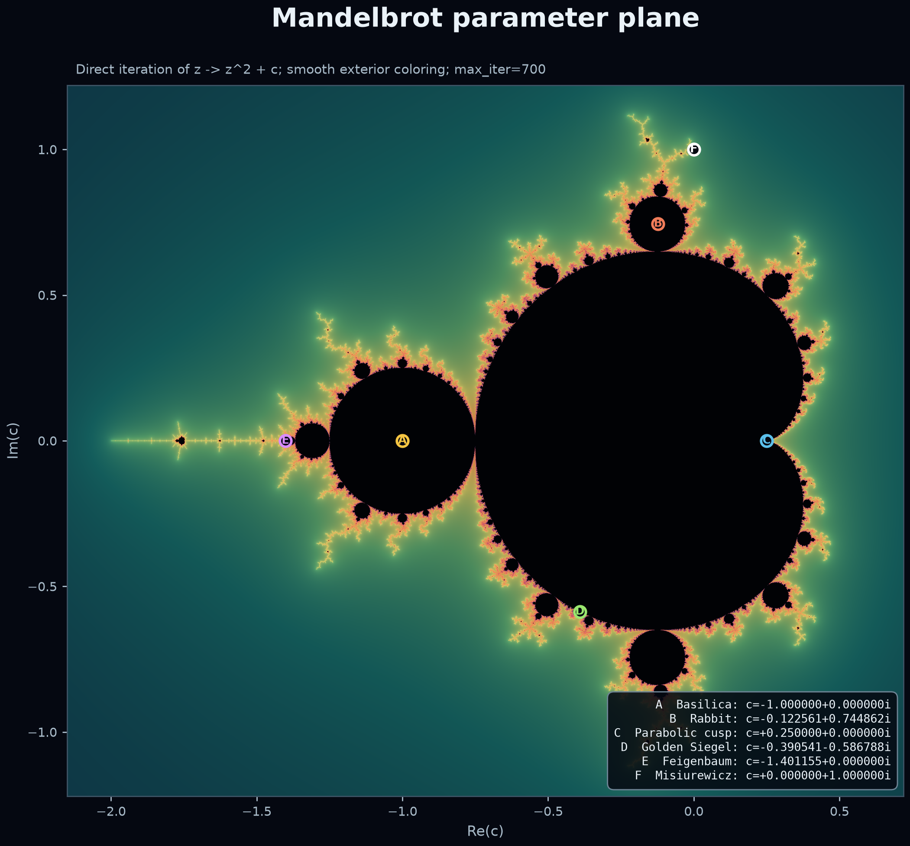
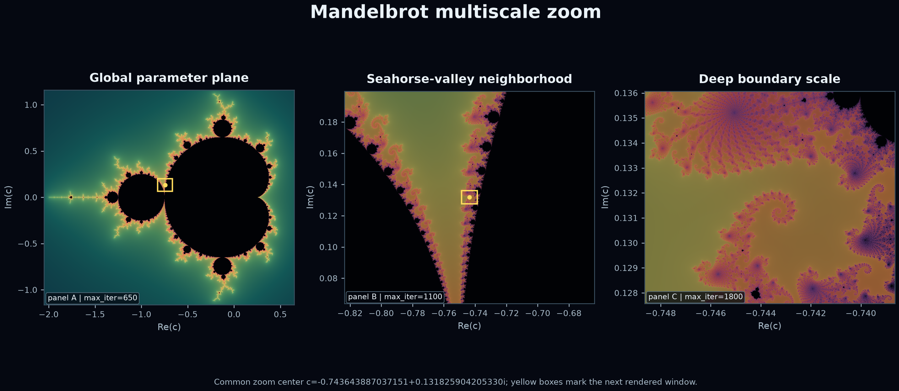
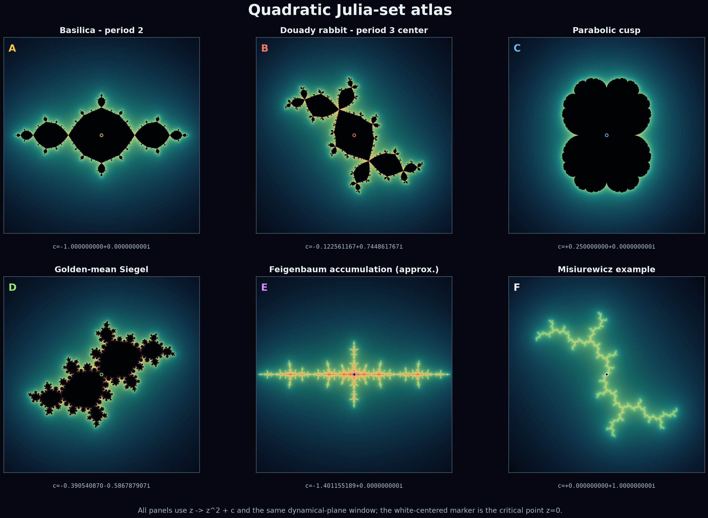
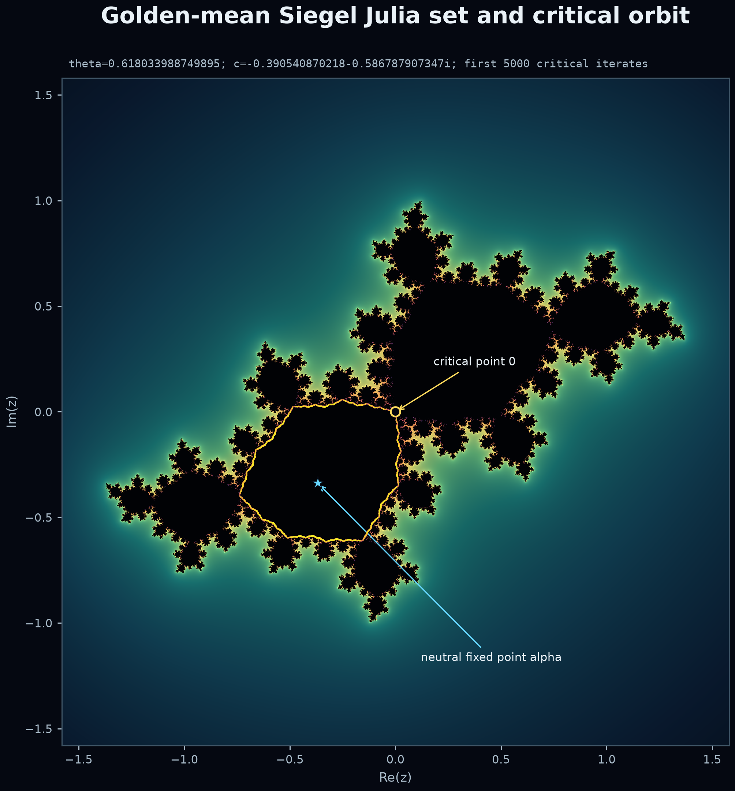

# A marked-width reduction of Mandelbrot local connectivity

## Abstract

We examine a proposed proof of Mandelbrot local connectivity based on a virtual
pseudo-Siegel hull and one extremal-width functional. Two corrections are forced.
First, a continuum alone does not determine the pullback geometry: satellite base
cycles, a finite postcritical marking, ideal accesses, and the curve family must be part
of the state. Second, amplification must run backward in the renormalization tower; a
forward lower recurrence has no contradiction mechanism, and ordinary satellite inverse
moduli admit no period-independent growth cap.

We prove a no-go theorem for unmarked root width and a general backward-record lemma.
We then give a conditional reduction of MLC to a Marked Backward Transition Theorem,
coercivity, and marked-tower rigidity. This isolates the exact analytic theorem still
missing from the literature. The paper does **not** claim an unconditional proof of MLC.

## Computational fractal atlas

The visual plates below are generated directly from iteration of
\(f_c(z)=z^2+c\). They provide parameter-plane and dynamical-plane
orientation only. Dark pixels record failure to escape before a finite
cutoff; neither the pictures nor their apparent fine structure discharge a
proof obligation.









Exact parameters and render settings are in
`figures/fractal_render_manifest.json`; the reproducible generator is
`figures/generate_fractal_plates.py`.

## 1. Statement of results

Let
\[
f_c(z)=z^2+c,\qquad c\in{\cal M}.
\]
When \(f_c\) is infinitely renormalizable, write its normalized checkpoint tower as
\[
F_0\to F_1\to F_2\to\cdots .
\]

To avoid collisions in this manuscript, \(\Sigma_n\) denotes the ambient surface
called \(S_n\) in `regime_and_hulls.md`, and \(\nu_n\) denotes the finite postcritical
horizon called \(r_n\) there. (The symbol \(h_n\) remains the continued-fraction
height invariant.) The symbol \(r_{B,n}\) below is reserved for a block's marking-cell
count.

At each checkpoint attach a regularized marked hull
\[
{\mathfrak H}_n=(\Sigma_n,H_n,B_n,P_n^{\le \nu_n},{\cal I}_n,\Gamma_n)
\]
and marked width
\[
D_n^\#=\operatorname{Ext}_{\Sigma_n\setminus
(H_n\cup B_n\cup P_n^{\le \nu_n})}(\Gamma_n).
\]

After decomposing a virtual or neutral block, let \(r_{B,n}\) be its marking-cell
count, \(Q_n\) its retained scalar WAD/corridor weight, \(W_n^{\rm std}\) its aggregate
standard corridor width, and \(\Lambda_n\) its candidate bounded-terminal response
form. Let \(\mathbf V_n\) denote the vector of inequivalent outgoing KKL Value moments
that are not already recoverable from a Value-faithful port refinement. Unless
sectorial regularization removes the nonexpanding shear branch, let
\(\mathbf\Xi_n\) denote its finite vector of nilpotent transfer moments. The
homogeneous geometric coordinate must therefore be taken provisionally as
\[
\mathscr R_n^{\rm aug}=
\left(
\frac{Q_n}{r_{B,n}},
\frac{\Lambda_n}{r_{B,n}},
\frac{\mathbf V_n}{r_{B,n}},
\frac{W_n^{\rm std}}{r_{B,n}},
\frac{\mathbf\Xi_n}{r_{B,n}}
\right).
\]
We write \(\mathscr R_n:=\mathscr R_n^{\rm aug}\) in the later transition formulas.
The chart side/error data are
\[
\sigma_n=
\left(
r_{B,n},\boldsymbol\nu_n,\omega_n,\rho_n,\frac{\kappa_n}{r_{B,n}},
\mathcal P_n,\mathcal F_n
\right),
\qquad
\rho_n=\frac{r_{{\rm mark},n}}{r_{\parallel,n}},
\]
with \(\boldsymbol\nu_n\) the exact corridor/return counters,
\(\omega_n\in\mathcal T^*\) an optional explicit finite-alphabet nesting stack whose
LIFO dynamics still require a source theorem,
\(\mathcal P_n\) the finite port/ribbon-order and endpoint core-frame/holonomy
record, and \(\mathcal F_n\) the
discrete Frobenius flag/transfer type. Parallel gluing adds response matrices and
serial elimination takes a Schur complement. A chart-calibrated potential
\(L_n=L_{t_n}(\mathscr R_n^{\rm aug};\sigma_n)\), positively homogeneous only in
\(\mathscr R_n^{\rm aug}\) and uniform over the admissible side data, is still
needed. The Value-moment coordinate can be deleted only after proving that the chosen
future-closed ports are Value faithful or that all coefficients merged into one
response coordinate are uniformly comparable. The shear coordinate can be deleted
only after the transfer trichotomy proves its regularization. Raw
\((r_{B,n},\boldsymbol\nu_n,\omega_n)\) may be unbounded and are not coercive
coordinates. If a uniform
balance/bottleneck-chamber theorem linearizes the remaining operations, the geometric
part may specialize to a positive covector.

The definitions and admissibility requirements are those in
`regime_and_hulls.md`.

### Theorem A (unmarked satellite obstruction)

No uniformly bounded scalar hull functional can be universally additively comparable
to inverse quadratic-like root modulus over satellite cycles of unbounded relative
period.

This is Theorem 2.1 of `master_transition.md`, proved directly from BLOT.

### Theorem B (record closure)

If a high calibrated potential at every deep checkpoint forces, up to a fixed additive
error, a strictly larger potential at a preceding checkpoint, then the calibrated
potentials of the whole tower are bounded.

This is Lemma 7.1 of `master_transition.md`.

### Theorem C (conditional MLC reduction)

Assume hypotheses `H1`--`H4` below. Then the Mandelbrot set is locally connected.

- `H1` **Marked construction.** Every infinitely renormalizable quadratic polynomial
  has a canonical entropy-clock checkpoint tower with selected return factorizations
  containing one quadratic step, whose complement splits into a bounded active core and
  resolved raw corridor/transfer carriers containing every proof-used cell, access,
  critical return, and stopping time. A monotone finite
  cell-tree extraction and analytic access realization
  give bounded access/translation incidence, standard-width density, and controlled
  marking-to-parallel-replica congestion. Each finite block has locally saturated
  depth-\(q\) \(\psi\)-ql stages,
  every curve pullback is admissible through its stopping time, and the analytic
  localization loss is relative or entropy-amortized with universal constants.
- `H2` **Marked backward transition.** Uniform homogeneous chart Lyapunov functions
  exist—or a verified response/matrix reduction and uniform positive chart covectors
  exist—and every directed chart cycle passes the expansion audit. After pure
  localization and chart changes are grouped with their dynamical entropy-clock step,
  every complete forward upper block transition has a strict forward contraction in
  an error-stable gauge, as in Lemma 5.4 of `master_transition.md`, or is replaced by
  an independently proved backward lower transition. Every KKL valuation used by
  this contraction is observable from Value-faithful ports or from a uniformly finite
  retained moment vector. Every virtual corridor has a universally
  bounded-dimensional, source-faithful layered core model and finite support
  automaton. The core and compositional WAD dimensions are bounded independently of
  the finite signature count. Raw source-to-target incidence \(N\) is represented by
  \(B=N^{\mathsf T}\), with KKL \(v,w\) in the project left/right roles. Exact
  corridor and return lengths are carried by a universally bounded number of
  restricted geometric counters; any future-relevant nesting word is retained in
  full and is treated as a stack only after a source-faithful LIFO theorem. Before
  pumping, every memory-changing run is compiled into an exact typed checkpoint
  macro or the pumping summary is enlarged by a finite memory congruence. Every WAD
  quotient transports compositionally and is output-exact for the complete fixed
  future-observation family. Only repetitions safe on the reachable memory fiber
  are pumped. The support skeleton, every contextual numerical loop occurrence, and
  every emitted critical/WAD/Value/error/shear record are retained in order.
  Entropy is certified only on closed repeatable framed returns. Irreducible
  non-permutation return windows are grouped into positive-entropy blocks;
  permutation windows supply only an identity interior gauge until the independent
  exact clone certificate applies; and nonexpanding windows are routed to transient
  extinction, sectorial regularization, or a calibrated finite shear state,
  including changes of endpoint frame and Frobenius flag. In the clone
  branch, the reduced return graph is irreducible and non-permutation with
  universally bounded dimension and label depth, while the full KKL core satisfies
  its separately required primitivity/aperiodicity hypothesis. The common delay
  satisfies \(n>N\); the actual WAD domination has pullback exponent \(r\ge n\).
  Any weighted retained transition
  has relative loss
  \(\epsilon<1-2^{-1/d}\) at its own corrected root. Its typed negative-weight
  clone recurrence is proved independently from the literal graph rather than
  imported from the quarantined printed KKL \(+\lambda^k\) equation, and its
  complete multiplier is at least
  \(((1-\epsilon)2^{1/d})^{n/(n+N)}>1\). Its finite
  core/Hubbard transition multigraph satisfies the exact
  chain-interior and reduced cross-section criterion of
  `corridor_clone_criterion.md`, with universally bounded endpoint windows and total
  parallel cross-section size, and its WAD pullbacks carry the complete itinerary
  incidence used by Value. The
  calibrated MBTT inequality
  \[
  L_{p(n)}\ge\lambda L_n-C,\qquad p(n)<n,
  \]
  holds whenever \(L_n>D_*\), with universal
  \(D_*,\lambda>1,C<\infty\).
- `H3` **Dynamical coercivity.** Bounded calibrated potentials coercively control the
  augmented geometric density/response/Value/shear coordinates
  \(\mathscr R_n^{\rm aug}\). Together
  with the declared uniform side constraints on congestion, normalized topology
  charge, and finite port/ribbon/frame/Value-feature type, plus the controlled local hull
  geometry, this implies the dynamical a priori/compactness bounds required by the
  marked tower rigidity theorem. No bound on the raw cell count \(r_{B,n}\), counter
  values, or stack depth is required only after proving that the latter symbolic data
  are forgotten at block closure or admit a continuous compact end/cylinder
  topology; their raw discrete spaces are not precompact.
- `H4` **Phase--parameter rigidity and neighborhood basis.** For every such bounded
  marked tower at parameter \(c\), there are connected relative neighborhoods
  \(U_n(c)\subset{\cal M}\), carried by the nested parapuzzle/parameter pieces, such
  that \(\{U_n(c)\}\) is a neighborhood basis of \(c\) in \({\cal M}\) and
  \(\operatorname{diam}U_n(c)\to0\). Equivalently, one may import a proved theorem
  that the resulting trivial fiber supplies such a connected relative neighborhood
  basis. Shrinking diameters alone are not sufficient.

The proof appears in Section 7. Hypotheses `H1`--`H4` are not all known; Theorem C is a
reduction theorem, not an unconditional solution.

## 2. Source-locked background

The following facts are imported.

1. Yoccoz's puzzle theorem treats parameters that are not infinitely ql-renormalizable.
2. DL23 proves beau bounds and MLC for bounded-combinatorics Feigenbaum parameters.
3. KKL26 proves beau bounds and rigidity for parabolically bounded prime primitive
   families. Its rigidity step uses bounded puzzle Teichmüller diameter in addition to
   beau bounds.
4. DL22/DL25 construct and control pseudo-Siegel disks in their neutral
   \(\psi^\bullet\)-ql settings.
5. BLOT proves that ordinary satellite root moduli tend to zero at least on the scale
   \(1/\log s\), uniformly in the relative period \(s\).
6. Dudko's 2025 survey records unbounded-satellite pseudo-Siegel bounds and virtual
   near-molecule interpolation as the two remaining programs.

No source is imported outside its stated hypotheses. In particular, local
pseudo-Siegel estimates are not assumed to be compatible with arbitrary virtual or
primitive transitions.

## 3. Exhaustive regimes

KKL26 associates to a family of prime types the satellite-chain length \(\ell\), the
largest continued-fraction entry \(h\), and continued-fraction depth \(d\). The
precedence

\[
\ell=\infty;\quad
\ell<\infty,d=\infty;\quad
\ell,d<\infty,h=\infty;\quad
\ell,d,h<\infty
\]

gives, respectively, virtually-satellite, near-neutral, near-parabolic, and
anti-molecule/bounded-satellite families.

This is an exhaustive classification of families. It is not a canonical decomposition
of one tower because the invariants at a single level are finite. An individual block
decomposition requires a stopping rule fixed by analytic thresholds. Hypothesis `H1`
contains this missing construction.

## 4. Why the state must be marked

### 4.1 The root annulus cannot be the invariant

For a degree-two satellite polynomial-like cycle of relative period \(s\), BLOT gives

\[
\operatorname{mod}(A)
<
\frac{2\pi}{\log(4(s+1))}.
\]

Thus
\[
W(A)=\frac1{\operatorname{mod}(A)}
>
\frac{\log(4(s+1))}{2\pi}\longrightarrow\infty.
\]

If a regularized virtual hull has a uniformly bounded scalar \(D\), then
\(|D-W(A)|\) cannot be bounded independently of \(s\). Hence a common invariant cannot
be obtained by comparing an unchanged scalar to root width at every scale.

The correction is geometric. At satellite scales, include the base cycle in the
puncture/ideal marking and use the sectorial curve family. BLOT's marked hyperbolic
geodesic estimate indicates that this altered surface detects the relevant obstruction
even while the unmarked root annulus collapses.

### 4.2 A hull is not enough

The Wave, Wanderers, and covering arguments operate on homotopy classes and univalent
pullbacks. These depend on:

- which base-cycle points are punctures;
- which critical values have already appeared;
- which accesses are identified as ideal vertices;
- which curve family is being measured.

Therefore the notation \(D(H)\) loses indispensable data. The object must be
\({\mathfrak H}\), and the functional must be \(D^\#({\mathfrak H})\).

## 5. The entropy clock

Let \(\rho_j>1\) be the Perron factor of the positive core transition at checkpoint
\(j\), and put \(\epsilon_j=\log\rho_j\). Set \(\epsilon_j=0\) on a purely
zero-entropy sectorial step. Define

\[
E([a,b])=\sum_{j=a}^{b}\epsilon_j.
\]

A positive-entropy block terminates on first reaching a universal
\(\eta_0>0\). A zero-entropy block terminates when its residual degeneration has been
absorbed by a pseudo-Siegel/virtual regularization.

This grouping is necessary because one-step positive entropy may tend to zero near the
molecule. If calibrated Values obey
\[
v_{j+1}\le e^{-\epsilon_j}v_j+\eta_j,
\]
then the exact terminal error is
\[
\sum_j e^{-\sum_{k>j}\epsilon_k}\eta_j.
\]
Uniform contraction follows if this is at most
\[
\theta(1-e^{-E})v_0+C,\qquad\theta<1.
\]
Positive total entropy alone does not imply that estimate. The discounted charge and
the conversion of WAD errors into Value units are part of `H2`.

## 6. Homogeneous calibration and transition direction

The active width, corridor widths, response form, and orbit-WAD Value transform
differently at a chart change. The source WAD calculus includes the harmonic series
operation
\[
x\oplus y=(x^{-1}+y^{-1})^{-1}.
\]
By `corridor_network_calibration.md`, Theorem 6.2, this operation is not uniformly
comparable to any fixed positive linear form on unrestricted \((x,y)\). After
normalization by the block cell count, the primary backward transition statement must
therefore allow
\[
\mathscr R_{p(n)}
\succeq_{{\cal C}_{t}}
\Phi_{tu}(\mathscr R_n)-e_n,
\]
for order-preserving positively homogeneous maps \(\Phi_{tu}\), with constants uniform
over the admissible side data \(\sigma_n,\sigma_{p(n)}\). This inequality does not
assert control of the unnormalized totals when \(r_{B,n}\to\infty\).

At the abstract network level, `network_response_state.md` gives an exact alternative:
parallel families add response matrices and serial gates are eliminated by Schur
complement. The open step is a uniform comparison between surface extremal energy and
that bounded-terminal response form.

If a balance/bottleneck-chamber lemma gives homogeneous orthant coordinates
\(\xi_n=J_{t_n}(\mathscr R_n)\) and a matrix lower model
\[
\xi_{p(n)}\succeq A_{tu}\xi_n-e_n
\]
and positive covectors satisfy
\[
v_t^{\mathsf T}A_{tu}\ge\lambda v_u^{\mathsf T},
\qquad
v_t^{\mathsf T}e_n\le\delta L_n+C,
\qquad
\lambda-\delta>1,
\]
then \(L_n=v_{t_n}^{\mathsf T}\xi_n\) obeys
\[
L_{p(n)}\ge(\lambda-\delta)L_n-C.
\]
This cone calculation is proved as Lemma 5.1 in `master_transition.md`. Existence of the
homogeneous Lyapunov calibration—or the balance theorem, transition matrices, and a
common positive cone field—is open. Raw marking cardinality is not included as a
positive coercive coordinate; it must first be absorbed relatively or charged to
entropy.

The currently available collar/corridor comparison has the opposite, forward-upper
form
\[
  \mathscr R_n
  \preceq
  \Psi_{ut}(\mathscr R_{p(n)})+e_n.
\]
It feeds the backward record argument only if an error-stable gauge has a strict
forward contraction
\[
  L_u(\Psi_{ut}(x))\le\mu L_t(x),
  \qquad0<\mu<1,
\]
or if an independent backward lower transition is proved. Lemma 5.4 of
`master_transition.md` proves this inversion and quantifies the relative-error margin.
The exact complete-block theorem and its five analytic modules are stated in
`block_contraction_program.md`.

Moreover, edgewise inequalities must be composed around every directed chart cycle.
If an admissible cycle fixes a state of positive gauge, neither a common
\(\lambda>1\) backward expansion nor a common \(\mu<1\) forward contraction can exist.

Suppose levels increase deeper into the tower. The desired implication is

\[
\text{bad at }n
\quad\Longrightarrow\quad
\text{worse at some }p(n)<n.
\]

It is not
\[
\text{bad at }n
\quad\Longrightarrow\quad
\text{worse at }n+k.
\]

The latter allows \(D_n=\lambda^n\) and needs an independent upper growth theorem.
The source ledger contains no such theorem for arbitrary unbounded satellite towers.

By contrast, the backward inequality contradicts a new running maximum. This is the
entire content of the record lemma and is independent of how long an entropy-clock
block is.

## 7. Proof of the conditional reduction

**Proof of Theorem C.** Fix \(c\in\partial{\cal M}\).

If \(f_c\) is not infinitely ql-renormalizable, apply the Yoccoz theorem.

Assume that \(f_c\) is infinitely renormalizable. By `H1`, it has a regularized marked
checkpoint tower and state. By `H2`, it has calibrated potentials satisfying MBTT, so
Theorem B gives

\[
\sup_n L_n
\le
\max\left\{
\max_{0\le j\le N_0}L_j,\,
D_*,\,
\frac{C}{\lambda-1}
\right\}<\infty,
\]

where \(N_0\) is the finite exceptional prefix allowed by the construction.

Hypothesis `H3` converts this calibrated bound into the dynamical compactness required
for rigidity. Hypothesis `H4` supplies connected relative neighborhoods
\(U_n(c)\subset{\cal M}\) of arbitrarily small diameter that form a neighborhood
basis at \(c\). Hence \({\cal M}\) is locally connected at \(c\).

Both cases cover every boundary parameter. Interior points are locally connected
trivially. Therefore \({\cal M}\) is locally connected. \(\square\)

The proof makes clear that `H4` cannot be dropped merely by citing a priori bounds.
KKL26 treats bounded puzzle Teichmüller diameter as a separate rigidity input.

## 8. Attempted derivation of MBTT from known tools

The known local engines have the right qualitative pieces:

1. Thin--Thick decomposition localizes a wide family.
2. The Wave and Wanderers alternatives transport or replicate the localized family.
3. Quasi-additivity and covering estimates convert replication into amplification.
4. Positive core entropy contracts WAD Value under forward dynamics, hence gives
   backward amplification.
5. Pseudo-Siegel disks absorb invariant degeneration in neutral fjords.

The attempted composition fails at three exact interfaces.

### Failure I: virtual interaction compression

KKL Value errors depend on topology. In a virtual-molecule block the number of raw
small Julia sets and returns is unbounded. It is impossible to collapse all distinct
return accesses to a uniformly bounded marking while preserving their labels
(`virtual_block_quotient.md`, Theorem 2.2). The proposed connected hull must instead
first admit a monotone finite cell-tree quotient and then an analytic prime-end
realization. That realization must prove complete bounded access incidence,
\(S=O(r_{\rm mark})\), and enough distinct parallel WAD support that
\(\rho_B=r_{\rm mark}/r_\parallel\) is controlled. Finite topology alone proves none
of these. D25 proposes the hull but does not prove this decomposition.

### Failure II: mixed-chart error

DL25 gives local neutral estimates and explicitly requires global input for
applications. There is no theorem showing that ql Value, sectorial width, and virtual
orbit-Value differ by an absolutely summable or sufficiently small relative error
across arbitrary alternating blocks. An \(O(1)\) error per elementary level diverges
when a block has unbounded length. KKL's translation theorem itself contains a term
linear in marking cardinality, confirming that relative domination is sometimes the
correct mechanism. There is also a normalization constraint: DL25's
\(A_m=\ell_mK_F\) is per tile, while the total corridor state should compare with
\(r_mA_m\asymp K_F\), not with \(A_m\).

### Failure III: coercivity and rigidity

The marked functional intentionally stops measuring ordinary root modulus at
unbounded satellites. Therefore bounded \(D^\#\) does not automatically imply ordinary
ql precompactness. A new compactness theorem for marked sectorial/virtual objects is
needed, followed by phase--parameter rigidity.

These are logical gaps, not matters of choosing larger constants.

## 9. Required lemmas in proof order

The unconditional theorem “\({\cal M}\) is locally connected” would follow once the
following statements are proved in this order.

1. **Canonical Checkpoint Lemma.** The entropy-clock stopping rule exists for every
   tower and has bounded active interaction complexity.
2. **Finite Cell-Tree Extraction and Analytic Access-Realization Lemmas.** The Cantor
   carrier admits a monotone quotient onto a finite cell tree with bounded atomic/gate
   incidence. That quotient then lifts to access-faithful prime-end intervals and the
   selected analytic correspondence. `virtual_hull_realization.md` proves the
   resulting complexity and width algebra after bounded access/translation incidence,
   standard-width density, and parallel-replica congestion are supplied; it does not
   prove either realization theorem.
3. **Finite-Horizon Analytic Inflation Theorem.** The partial postcritical data are
   stagewise forward closed; the selected relative-cover lifts are locally saturated
   and core proper; every proof pullback is admissible through the stopping time; and
   the resulting degree-two \(\psi\)-ql correspondence has relative or
   entropy-amortized localization loss. The set-theoretic forward-closure and
   relative-cover lift criteria are proved. Selected fiber-product routing,
   degree preservation, existence from arbitrary virtual hulls, categorical promotion,
   and the width estimate remain open.
4. **Virtual Translation-Compression Lemma.** The realized complement has a bounded
   active core and accelerated translation corridors; all short interaction types are
   bounded modulo translation; marking and standard-width densities are controlled;
   and the marking-to-parallel-replica congestion ratio
   \(\rho_B=r_{\rm mark}/r_\parallel\) is uniformly bounded or small relative to the
   degeneration. Raw return count cannot replace this replication assertion.
5. **Virtual KKL Branch-Realization Lemmas.** Realize `S4-AC`--`S4-END` on the
   access-complete virtual carrier; realize `VR0`--`VR7` for the full tame return;
   and realize `WA1`--`WA12` through
   \(H_B(q)=(216B^2+1)(q+B+4)\) for the Wave branch. The abstract Section-4
   trichotomy and tame Value contradiction are proved once those hypotheses
   hold.  The finite-horizon Wave architecture is conditional in addition on
   the bounded-visits and stationary native-source repairs recorded below.
   The missing Wave object is not one
   degree-two endpoint return: it is a degree-one central corridor plus a bounded
   auxiliary marked fan. A general rotation \(a/q\) also needs geometric
   order-preserving acceleration rather than a modular relabeling. The local
   unmarked fan is no longer open once its full inverse-component tree and
   separated obstacles are supplied: the simultaneous pullback theorem gives
   proper Jordan sheets of degrees \(2^m\). What remains is to construct that
   tree from the virtual carrier and add complete cyclic marking, immersion
   properness, itinerary exhaustion, and one-shot width transport.
   Fullness and surjective forward invariance do not construct the tree:
   the right half-disk maps onto the unit disk under \(z^2\) but is not a
   component of its pullback. Pullback-component saturation must be proved.
   Once forward-coherent connected seeds are supplied, however, their
   component saturation is canonical; finite forward-closed obstacles give
   the complement inclusions, and a future-complete root marking pulls back
   with exact dyadic cardinality. The unreduced geometric task is the Virtual
   Seed Certificate: construct the connectors, sibling separation,
   saturation-location audit, absorb-or-separate remainder, bounded root
   future completeness, and relative-cover/immersion closure.
   The connector portion has a sharper equivalent form: choose one full root
   continuum and prove that every whole required package lies in its assigned
   iterated-pullback component, that the component parent map and sheet
   separation are correct after all future data are included, and that the
   critical value occurs exactly in the declared quadratic windows. This
   Virtual Root-Carrier Certificate determines the entire saturated forest;
   root enlargement can merge formerly separate sheets.
   Root future completeness must include endpoint births: if \(b_j\) genuinely
   new ends appear at a stage preceded by degree \(D_{0,j-1}\), their exact
   initial cost is \(D_{0,j-1}b_j\). A degree-one corridor with one birth per
   stage has \(O(q)\) marking, so the virtual translation region needs a
   no-birth theorem or a separately amortized marking-density charge.
   A sufficient no-birth theorem is now proved: local equality of the pulled
   and original carrier, with no newly attached component and conformal
   endpoint lifts, forces zero births. KKL Proposition 6.5 identifies every
   possible extra ideal piece with an attached component of
   \(\mathcal T'\setminus\mathcal T\), and Proposition 6.7 removes all such
   attachments in its native central corridor by an actual local Hubbard-tree
   equality. The resulting abstract attachment-support reduction is proved.
   What remains virtual is the Bounded Attachment-Support Theorem: empty
   attachment support in the degree-one corridor, bounded access-complete
   support in fixed defect windows, and proper/end-proper relative-cover
   lifts through the full Wave horizon. The central part is reduced further
   by the proved Corridor Attachment Transport Theorem: a commuting marked
   homeomorphism of the actual pulled/immersed carrier pairs transports
   attachment support bijectively, so one attachment-free anchor suffices.
   The complete pair and prime-end marking can be transported functorially
   through univalent corridor branches from one actual anchor. However, the
   interval/triod countermodel proves that Dudko's published connected-hull
   data do not force such an attachment-free anchor. The replacement finite
   attachment-orbit completion has a least functorial fixed point and an exact
   collision flag. Constructing a collision-free analytic anchor for the
   virtual carrier remains open.
6. **Marked Calibration and Lyapunov Lemma.** `WC-A`--`WC-V` hold with explicit
   additive, relative, density-normalized, or discounted error budgets whose
   parameters are universal. Every complete forward upper block transition admits a
   common strictly contracting error-stable Lyapunov calibration, or an independently
   proved backward lower transition admits a common expanding calibration. A
   matrix/covector version requires a separate balance/bottleneck-chamber theorem.
7. **Discounted Antirenormalization Lemma.** Total block error is universally bounded,
   smaller than a fixed fraction of the degeneration gain, or satisfies the exact
   discounted Value charge associated to the accumulated entropy. A raw bound by
   unweighted error count is insufficient.
8. **Marked Backward Transition Theorem.** Residual high width amplifies to an earlier
   checkpoint.
9. **Marked Coercivity Theorem.** Bounded calibrated potentials coercively control the
   geometric response-density state and, with uniform side constraints but no bound
   on raw cell count, imply compactness in the unified marked category. Unbounded
   counter/stack data must be forgotten, bounded, or continuously compactified; a
   discrete side label is not harmless.
10. **Marked Tower Rigidity Theorem.** Such compact towers give connected relative
   parameter neighborhoods forming a basis with diameters tending to zero (or a
   precisely applicable trivial-fiber theorem that supplies that basis).

Items 1--10 are not alternate names for one estimate. Each has a distinct failure mode
and must be checked independently.

## 10. Validation against known cases

### Bounded Feigenbaum

Entropy blocks have bounded length, the hull is the ql filled Julia core, and the
construction must reduce to DL23. No base-cycle correction is needed beyond the
bounded-type machinery.

### Parabolically bounded primitive

The marked quotient must reduce to the WAD/translation setting of KKL26. Its
backward-amplification theorem and bounded puzzle Teichmüller diameter recover rigidity.

### Neutral

The entropy clock remains at zero. The controlled branch must reduce to the
vertical/peripheral pseudo-Siegel estimates of DL22/DL25.

### High-type satellite

The result must coexist with CS15's rigidity theorem even though ordinary root moduli
are not uniformly bounded. This is a required check on `H3`: compactness must be in the
marked/sectorial category, not falsely asserted in the root-annulus category.

## 11. Universal protected-tower closure package

The complete formal statement is
[mlc_closure_proposition.md](mlc_closure_proposition.md). It packages the
ten proof-order items above into six clauses:

1. canonical protected carrier;
2. exact analytic realization;
3. uniformly finite Value-observable response state;
4. backward transition with a complete error charge;
5. coercive marked compactness; and
6. tower rigidity with a connected relative parameter-neighborhood basis.

### Proposition D (UPTCR; open)

There are universal constants, independent of periods, rotation numbers,
transition depths, raw markings, and chart counts, for which every infinitely
renormalizable quadratic polynomial satisfies all six clauses. In Clause 2,
“exactly one degree-two stage” refers only to the selected quadratic return
spine. Auxiliary fan branches retain their complete critical words and have
degree \(2^{m(\beta)}\). A bounded defect window cannot absorb a fatal
collision: every analytically realized protected local model must have zero
sheet, critical, obstacle, access, and localization collision invariant.
Clause 4 requires at least one certified block route, not an unproved
disjoint trichotomy.

This proposition is open. It is the ledger node
`UNIVERSAL_PROTECTED_TOWER_CLOSURE`.

### Theorem E (UPTCR implies MLC; proved conditional implication)

Assuming Proposition D, the backward-record lemma bounds the calibrated
potential. Clauses 5--6 make the full marked parameter fiber a singleton and
identify it with the intersection of nested compact connected relative
neighborhoods. The compact-singleton lemma makes those neighborhoods shrink.
More explicitly, the controlled pullbacks yield a normalized global
quasiconformal sphere conjugacy. A nonzero invariant Beltrami coefficient
would define an invariant line field, so the no-line-field clause makes the
conjugacy conformal. Writing it as \(h(z)=az+b\) and comparing
\(h\circ(z^2+c)\) with \((z^2+c')\circ h\) gives \(a=a^2\),
\(2ab=0\), and hence \(a=1\), \(b=0\), and \(c=c'\). The relative
neighborhood conclusion then supplies a connected neighborhood inside every
ambient neighborhood. Yoccoz handles the complementary
non-infinitely-renormalizable parameters. Therefore Proposition D implies
MLC.

The proof of this implication does not prove Proposition D and does not
change the open status of MLC.

### Cross-validation result

The independent audit is
[uptcr_cross_validation.md](uptcr_cross_validation.md). It proves that the
corrected conditional implication is valid and proves that the current
public source package does **not** yet imply Clause 1. The topological
realization from a protected ribbon-routing certificate is now proved in
[protected_regulated_connector.md](protected_regulated_connector.md).
The critical-value-free \(z^2\) upper-half-disk example shows why monotone
attachment absorption cannot replace the certificate: it erases a protected
prime-end access. The exact planar selection theorem in
[virtual_protected_routing_domain.md](virtual_protected_routing_domain.md)
now constructs the protected connector if and only if one component of the
completed free routing domain has simultaneous singleton ports to all
root-shadow clusters. The further reduction in
[virtual_common_free_component.md](virtual_common_free_component.md) proves
that such a component exists whenever the frozen forbidden data admit
pairwise disjoint full augmented atom/obstacle packets and every original
atom retains an explicit free singleton port. Compacta Alexander duality,
not local connectivity, supplies the common-domain theorem.  The
[fixed-packet audit](augmented_packet_closure_audit.md) further proves that
fullification of one fixed typed assignment is order-independent, that
post-fill mergers, localization escapes, and empty original-atom exposure
loci persist under monotone same-label enlargement, and that individual
unprotected ports can be truncated to a pairwise disjoint family.  Thus the
new [horizon-first inventory audit](vaapc_inventory_source_audit.md) proves
that the actual frozen inventory can be computed uniquely only after the
complete finite stopping horizon, proof-use seeds, and dependency edges are
specified.  Its old-stage slice is stable under extension exactly when no
new seed reaches an omitted old record.  The checked public paragraph gives
no stopping rule for its “appropriate number” of returns, and the KKL
native inventory cannot be transported without a typed component/access
bridge.  The open `VIRTUAL_PREFIX_LOCAL_SCALE_SELECTOR` is the first
ordered virtual selector: it constructs return data without depending on
the eventual proof-use trace.  The marked correspondence then freezes the
Wave horizon; only afterward are the proof-use trace and final
proof-complete selector evaluated.  The remaining clauses are the
source-faithful packet assignment, zero
collision of its unique closure, original-atom exposure, full-horizon
transport, and period-independent incidence or faithful compression. The
actual source-faithful construction
`VIRTUAL_AUGMENTED_ATOM_PORT_CERTIFICATE` remains open and hence so does
`VIRTUAL_COMMON_FREE_COMPONENT`; afterward the larger
`VIRTUAL_PROTECTED_ROUTING_CERTIFICATE` must still prove component routing,
critical words, and future-complexity control. Consequently the proof
attempt still stops at UPTCR-1; UPTCR and MLC remain open.

### Post-referee finite-cylinder lift

At the direct-decoration interface, let
\[
 h_w=f^N|_{Q_w}:Q_w\to P_\sigma,
 \qquad
 h_v=f^N|_{Q_v}:Q_v\to P_\tau
\]
be equal-depth cylinder homeomorphisms and let
\(F=f^r|_A:A\to B\).  Once the actual target containment
\[
 f^r(h_w^{-1}(A))\subset Q_v
\]
has been established, commutation of iterates gives, pointwise,
\[
\begin{aligned}
 h_v(f^r(x))
 &=f^N(f^r(x))\\
 &=f^r(f^N(x))\\
 &=F(h_w(x)).
\end{aligned}
\]
Applying \(h_v^{-1}\) proves
\[
 f^r|_{h_w^{-1}(A)}
 =h_v^{-1}\circ F\circ h_w.
\]
Surjectivity of \(F\) gives exact image equality, and conjugacy by the two
homeomorphisms preserves proper and local degree.  This proves
`FINITE_CYLINDER_COMMUTING_ITERATE_LIFT`.

The proof does not choose \(v\).  The immediate open gate is
`VIRTUAL_CYLINDER_TARGET_ADDRESS_SELECTOR`: it must prove actual
component-level target existence and uniqueness, compatibility with
geometric parents and the partial pre-root shift, a separate root
transition, complete marking transport, and final-root enlargement
naturality.  Unequal cylinder depths are excluded because the displayed
calculation would compare \(f^{N_v+r}\) with \(f^{r+N_w}\).

The same referee pass corrects the KKL import to central-interval carrier
equality only, supplies the missing punctured-cover step in the
complement-pullback proof, and makes unprotected-atom exposure and the
two-route attachment-resolution disjunction independent open inputs.
None of these repairs proves VAAPC-I, UPTCR, or MLC.

### Critical chronology and retimed finite cylinders

The subsequent Push II audit replaces endpoint-only degree bookkeeping by
the stagewise recurrence

\[
 \widetilde d_j e_{j+1}=e_jd_j.
\]

The explicit \(z^2-1\) shear has root word \((2,1)\), lifted word
\((1,2)\), and transverse degrees \((1,2,1)\).  Thus equal total degree
and univalent endpoint projections do not determine the time of the
critical encounter.

Given--but not constructing--a localized root branch
\[
 F=f^r:A\to B,\qquad A\Subset B\Subset\operatorname{int}P,
\]
every proved direct-decoration cylinder
\(h_w=f^{N_w}:Q_w\to P\) carries the exact retimed pair
\[
 (g_w,\iota_w)
 =
 (F\circ h_w,\operatorname{incl}\circ h_w)
 =
 (f^{N_w+r},f^{N_w}).
\]
Its relative map is exactly \(F\).  This proves a conditional compiler,
not `VIRTUAL_DISCONNECTED_MARKING_TRANSFER`: the virtual source still has
to select \(F\), place it in the safe gap, construct its valid protected
marking, authorize simultaneous word ownership, and prove final-root
naturality.

Post-quadratic base change retains degree two exactly when each embedded
Jordan core contains the propagated critical value.  This gives the
proved planar `PLANAR_CRITICAL_SPINE_TELESCOPE_COMPILER`.  Relative-cover
embeddedness, properness, deck phase, protected ideal-boundary action, and
end-properness remain in the open `MAPPING_TELESCOPE` and
`FINITE_HORIZON_ASSEMBLY` nodes.

At an infinite direct-decoration address, the specified unrescaled inverse
branches shrink every compact root set to diameter zero, whereas their
retimed representatives are identical in cylinder coordinates.  This
forces a nontrivial plane-projection fiber for any pointwise coherently
marked nondegenerate limit, but it does not construct an end space.
The multisector prime-end cofinality theorem and the analytic end
realization remain open.

### Fixed-block binary contacts and the pseudo-trace boundary

For one fixed source-locked Kahn--Lyubich decoration block, put
\[
 C_w=\partial P\cap\partial D_w,\qquad
 \widehat C_w=h_w(C_w).
\]
The actual closed-disjoint binary branch package gives the exact identities
\[
 \widehat C_{wa}=g_a(\widehat C_w\cap C_a)
\]
and, for \(v=ut\),
\[
 \partial D_u\cap\partial D_v=\phi_u(C_t),
\]
while incomparable cylinders are disjoint.  The source depth-\(n\)
attachment fan identifies the contact vertices at a prefix \(w\) as
\(\{v_{wt}:|t|=n-|w|\}\), with \(h_w(v_{wt})=v_t\).  At depth \(n\) the
normalized structural contact is the complete root ray pair at \(\alpha\);
the \(L\)-branch preserves it, the \(R\)-branch kills it, and the empty
state is absorbing.

This proves `FIXED_BLOCK_BINARY_CONTACT_AUTOMATON`.  The boundary record
must distinguish rays joined at one landing vertex from rays connected by
an equipotential.  The submitted Push-VII alternating ray/equipotential
word omits that source distinction and is not used as proof evidence.

The Kahn--Lyubich pseudo-piece construction supplies natural coverings,
inclusion immersions, finite ideal-boundary arcs, and continuous boundary
extension.  It does not supply the proposed \(H^1_{\rm fin}\) ideal-arc
trace quotient or a Dirichlet response.  Moreover the dynamical covering
and inclusion-immersed boundary copies are different data; tracking only
the first does not remove the welding problem.  Thus the pseudo-trace,
normalized response, operadic response, and final-root trace-atlas
promotions remain open.

On one fixed finite KKL terminal Hubbard tree, there is nevertheless an
exact algebraic Value factorization.  Grouping pulled bivertical
intersections by
\((f_*^m\alpha,(\iota_m)_*\alpha)\) gives a positive-semidefinite moment
\(\mathsf M_m(X)\) satisfying
\[
 \operatorname{Val}(X)
 =
 \lambda^{-2m}
 \langle aa^\top,\mathsf M_m(X)\rangle.
\]
Its ambient dimension is
\(|E|^2(|E|^2+1)/2\).  This proves
`FIXED_KKL_PAIR_STATE_MOMENT_FACTORIZATION`, but the dimension is not
universal and the direct-decoration branch-to-Hubbard incidence map remains
unconstructed.

### Push VIII: the finite label enumerator and the pull--push obstruction

The Push-VIII proposal correctly separates a coarse KKL action marking from
a possibly finer response or access overlay.  Its submitted compiler does not,
however, construct a KKL immersion pullback.  KKL define \(\iota^*I\) through
unique proper-path lifts and subordination.  The finite labels
``proper target atom'' and ``nonproper'' do not record that path-lift relation,
relative-cover data, or homotopy in the ambient surface.

There is a smaller exact finite result.  Let the target atom indices be the
finite chain \(\{0,\ldots,N-1\}\), the source atom indices the chain
\(\{0,\ldots,m-1\}\), and give every source atom a label
\[
 r_j\in\{0,\ldots,N-1\}\cup\{\bot\}.
\]
For a contiguous target block \(B\), define the *formal label hull* \(H(B)\)
by deleting every source index whose proper label lies outside \(B\), taking
the components of the remaining finite source chain, and retaining exactly
those components containing a proper label in \(B\).  Intersections here are
intersections of source atom indices; source vertices are handled separately
by the endpoint test, so this definition makes no geometric contact claim.

Consider every maximal \(\bot\)-run flanked by proper labels \(p,q\).  If
\(p,q\) lie in distinct target blocks, the run is retained in both formal
hulls: deleting \(q\) leaves it attached to the \(p\)-seed, while deleting
\(p\) leaves it attached to the \(q\)-seed.  Conversely, if the two labels
lie in one block, only that block retains the run.  A one-sided run is
retained by at most its sole neighboring block, and a run without a proper
neighbor is retained by none.  Proper atoms assigned to different blocks
then separate every remaining source-chain component.  Thus the hulls are
pairwise disjoint exactly when each flanking pair \(p,q\) belongs to one
target block.

Because target blocks must be contiguous, take the equivalence relation
generated by those flanking pairs and close every class interval-convexly.
Its convex classes form the unique finest hull-disjoint target partition;
every other hull-disjoint partition is a coarsening.  Now prescribe a map
from source vertices to target vertices.  Among the finitely many
coarsenings, directly test whether both boundary vertices of every retained
hull component map to selected target endpoints, as well as any mandatory
endpoint constraint.  Exhaustive enumeration therefore returns a
maximum-cardinality formally admissible coarsening or the complete finite
obstruction.  This proves `FINITE_LINEAR_LABEL_MARKING_ENUMERATOR`.

The theorem is about the declared atom-index model only.  It is not an
identification \(H(B)=\iota^*B\), a proper/end-proper theorem, or an analytic
realization.

The distinction is visible in the submitted fixtures.  Their advertised
degree-one covering data need not be continuous: the success fixture has
twelve source atoms and eight target atoms, and it declares a source atom
homeomorphic to \(M_0\) while mapping both of its boundary vertices to the
same target vertex.  The randomized generator imposes neither degree,
cyclic-order, nor endpoint compatibility.  Its oracle also uses the same
formal hull rule as the compiler.  Moreover, the code tests end-properness on
the first and last *micro-atoms*, whereas KKL require properness on the
complete end-intervals of the \(f^*\mathcal I\)-multi-interval.  Thus those
computations do not promote an analytic obligation.

There is also an exact obstruction to the proposed word theorem.  If
\[
 F_1=(f_1,\iota_1):V_1\rightrightarrows V_0,
 \qquad
 F_2=(f_2,\iota_2):V_2\rightrightarrows V_1,
\]
then
\[
 R_1:\mathcal T(V_0)\to\mathcal T(V_1),\quad
 P_1:\mathcal T(V_1)\to\mathcal T(V_0),
\]
while \(R_2,P_2\) have the analogous \(V_1,V_2\) types.  Hence
\(\mathcal W_2\mathcal W_1\), with
\(\mathcal W_j=P_jR_j\), is not even typed without an additional
identification.  If all four trace spaces are artificially identified, the
componentwise composite and the product of one-step operators are
\[
 \mathcal W_{\rm comp}=P_1P_2R_2R_1,
 \qquad
 \mathcal W_2\mathcal W_1=P_2R_2P_1R_1.
\]
They differ already for
\[
 R_1=P_2=I,\qquad
 P_1=\begin{pmatrix}1&1\\0&1\end{pmatrix},\qquad
 R_2=\begin{pmatrix}1&0\\1&1\end{pmatrix},
\]
because
\[
 P_1R_2=\begin{pmatrix}2&1\\1&1\end{pmatrix}
 \ne
 \begin{pmatrix}1&1\\1&2\end{pmatrix}=R_2P_1.
\]
An actual word theorem therefore needs a selected analytic fiber product and
a Beck--Chevalley interchange square; matrix associativity alone proves
nothing about it.

The proposed collared trace theorem is likewise not yet an analytic
realization.  A valid local version must start with an explicitly supplied
Lipschitz prime-end quadrilateral, use the quotient trace of one connected
collar/core, and transport a bounded constant-detecting gauge with every
conformal chart.  KKL properness alone does not produce such a collar map.
No closed compatible-image theorem, complete proper-interval welding, or
uniform multiplicity bound is proved in Push VIII.

Accordingly `FIXED_HORIZON_MARKED_BINARY_INTERFACE_COMPLETION` is rejected
as a proved node.  Its replacement input is a
**pullback-complete collared interface certificate** containing:

1. actual source and target pseudo-pieces and both analytic maps;
2. a degree- and cyclic-order-consistent finite prime-end atlas;
3. the complete unique-lift/subordination proof identifying every
   \(\iota^*I\);
4. the actual \(f^*\mathcal I\)-intervals and proper/end-proper decisions on
   whole intervals;
5. conformal collar maps, transported gauges, and connected compatible trace
   quotients;
6. all proper trace arcs and their overlap multiplicity;
7. Cartesian fiber-product and Beck--Chevalley squares for words; and
8. proper-path no-birth/no-loss and collar naturality for every authorized
   final-root enlargement.

Until that certificate is constructed from the source block, the marked
interface, welding, normalized-word, and final-root analytic gates remain
open.  VAAPC-I, H2, MBTT, UPTCR, and MLC remain open.

### Fixed-branch pseudo-piece embedding obstruction and the exact path-lift gate

The requested source-realized follow-up is documented in
[direct_decoration_path_lifted_collar_certificate.md](direct_decoration_path_lifted_collar_certificate.md),
with finite bookkeeping regressions in
[validate_path_lifted_collared_interface.py](validate_path_lifted_collared_interface.py).
The regressions do not discharge any analytic proof obligation.

Fix one of the two Kahn--Lyubich direct-decoration branches
\(g=f^q|_{Q_a}:Q_a\to P\).  For the inclusion \(Q_a\subset P\), let
\[
  \boldsymbol\iota_a:\mathbf Q_a\longrightarrow\mathbf P
\]
be the induced pseudo-piece immersion.  This map is an interior
holomorphic immersion, but global injectivity is open at a general
\(\psi\)-ql stage.  The univalent dynamical branch bijects complementary
components, and KL surjectivity therefore makes the inclusion component
map bijective.  The exact relative-overlap audit in
[kl_relative_overlap_cartesianity.md](kl_relative_overlap_cartesianity.md)
gives, for the unique \(i\) with \(j(i)=j\),

\[
 Q\cap P_{j(i)}=Q_i.
\]

If every **full** universal-cover tile immersion is injective, overlap
commutation then gives

\[
 L_i^{-1}\!\left(\widetilde e_{j(i)}(Q_i)\right)=e_i(Q_i).
\]

A central--central, same-tile, different-tile, and tile--central collision
audit proves that the glued map is an embedding.  Conversely, glued
injectivity restricts to tile injectivity.  Full reflection over all of
\(P_{j(i)}\) is stronger than necessary: an extra tile point over
\(P_{j(i)}\setminus Q\) has no source-central mate and causes no quotient
collision.  That stronger saturation equality remains open only where a
collar, footprint, or carrier theorem explicitly needs it.

The checked source does not prove full tile injectivity.  It does not
follow from degree one: for \(a>e^{2\pi h}\),
\[
 F_a(z)=z+\frac{a}{2\pi i}e^{2\pi iz}
\]
is a \(\mathbb Z\)-equivariant locally univalent strip map with a
same-tile self-collision.  Hence
`TILE_INJECTIVITY_GLUE_EMBEDDING_CRITERION` and
`DEGREE_ONE_ANNULUS_IMMERSION_INJECTIVITY_NO_GO` are proved, while
`DIRECT_DECORATION_DEGREE_ONE_PSEUDO_EMBEDDING` is retained as an open
restricted-class question.  The actual canonical-localization theorem
below proves that its former universal full-canonical interpretation is
false and non-gating.
`DIRECT_DECORATION_TILE_CENTRAL_OVERLAP_REFLECTION` now denotes the
non-gating stronger saturation question.

The exact same-tile gate is now reduced in
`actual_kl_tile_injectivity_gate.md`.  If
\(I:A_s\to A_t\) is the degree-one bold ambient annulus immersion and
\(L\) a compatible universal-cover tile lift, then

\[
 L\text{ injective}\quad\Longleftrightarrow\quad I\text{ injective}.
\]

A base collision \(I(u)=I(v)\), \(u\ne v\), becomes an exact lift
collision after cancelling the uniquely determined target deck shift.
Conversely, base injectivity and freeness of the deck action exclude every
lift collision.  A fully proper degree-one annulus immersion would be a
one-sheeted covering and hence a biholomorphism.  KL prove only an embedded
inner collar and the limited end-properness used in their width argument.
Thus `KL_TILE_INJECTIVITY_BASE_ANNULUS_REDUCTION` is proved.  At that
stage of the audit, bold base-annulus univalence remained open; for an
ordinary primitive full canonical localization it is now resolved
negatively below.  Only restricted noncanonical, unaligned, or separately
truncated classifications remain open.

The abstract annulus shortcut is now refuted under Kahn's full stated
annulus hypotheses.  With
\[
 r'=\frac{1287}{1000},\qquad r=(r')^{16},
\]
the explicit finite Blaschke quotient in
`kahn_annulus_global_injectivity_no_go.md` maps
\(\mathbb A(1,r')\) immersively into \(\mathbb A(1,r)\), extends
analytically to the inner circle as an orientation-preserving degree-one
homeomorphism, and has two distinct source points with the same image.
Exact Gaussian-integer expansions, Sturm chains, rational Rouché disks,
and the harmonic minimum principle prove all clauses.  This proves
`KAHN_ANNULUS_GLOBAL_INJECTIVITY_NO_GO`.  It is not an actual KL
dynamical-stage collision, so it did not by itself resolve a
source-specific map.  The later excess-component theorem below supplies
the actual canonical collision.

Even a future interior embedding theorem would not settle the boundary.
KL allow an ideal source arc under an inclusion immersion to map into the
target interior, so no proper immersion interval or ideal pullback formula
would follow automatically.

A second narrow theorem applies to a compact nondegenerate subarc \(J\) in
the relative interior of one ideal arc of one KL universal-cover tile.
Uniformizing the tile by the disk places \(J\) in the ideal side of a
bounded Lipschitz quadrilateral.  The finite-energy Dirichlet space modulo
constants is Hilbert, and its trace on that side, with the
minimum-extension norm, is a Hilbert quotient.  If one selected collar is
mapped conformally onto another with the ideal side preserved in prime
ends, pullback bijects the admissible extensions and preserves planar
Dirichlet energy.  It therefore acts isometrically on the homogeneous trace
quotients.  This proves `KL_TILE_INTERIOR_HOMOGENEOUS_TRACE`, not a canonical
or physical collar, a constant-detecting gauge, a uniform comparison, an
immersion transport theorem, or a word theorem.

The gap between labels and immersion pullback has an explicit analytic
witness.  Let \(V=\mathbb D\) and
\(\Omega=\mathbb D\cap\{\operatorname{Im}z>0\}\), and compose a Riemann map
\(\mathbb D\to\Omega\) with the inclusion \(\Omega\hookrightarrow V\).
Carathéodory extension identifies one source ideal arc \(E\) with the upper
semicircle of \(V\) and another arc \(N\) with the open diameter, hence with
the target interior.  For the two target semicircle intervals, the
deletion-and-seed rule assigns \(E\) the selected label and \(N\) the
nonproper label and therefore retains every open source atom, including
the nonproper one; no claim about the separate endpoint predicate is
needed.

Choose a compact subarc \(N_0\Subset N\).  A target proper crosscut with
both ideal endpoints in the other target interval can enter \(\Omega\) at
one endpoint of the diameter segment represented by \(N_0\), cross
\(\Omega\) immediately above that segment, and leave at the other endpoint.
Its intersection with \(\Omega\) is its unique source proper lift and is
subordinate to \(N_0\), while the target crosscut is not subordinate to the
selected interval.  The universal implication in the KKL immersion
pullback definition therefore forbids \(N_0\) from that pullback.  Hence the
formal label hull and analytic immersion pullback differ even for a
holomorphic embedding of Jordan disks.  This proves
`NONPROPER_LABEL_HULL_PULLBACK_NO_GO`.

The conformal ideal-boundary and abstract footprint portions of this gate
can be solved exactly; the actual KL outer-side footprint cannot yet be.
Kahn defines ideal boundary by disk uniformization.  For the pseudo-piece
simple-connectivity proof, the central open set is
\(\operatorname{int}Y\), not the closed physical puzzle piece.  Together
with the open universal-cover tiles it covers the path surface because
the only boundary Julia contacts are omitted vertices and every other
central-boundary point belongs to a tile.  The nonempty intersections are
path-connected by pushing boundary subarcs through a Schoenflies collar.
The finite-star van Kampen argument therefore applies.  If the bold target
disk is hyperbolic, Liouville excludes a
plane source; if it is parabolic, the path-space projection omits at least
two vertices and Little Picard excludes a plane source.  Hence the
pseudo-piece is conformally a disk.  The named KL
\(\lambda,\xi,\eta\) arcs tile this conformal ideal circle, and the
inclusion immersion extends continuously to it.  No local connectivity of
the physical Julia set is used.

More generally, let \(\iota:U\hookrightarrow V\) be a holomorphic
embedding of conformal disks with continuous extension to the closed ideal
disks.  A Jensen--Fatou boundary uniqueness argument shows that every
connected boundary fiber is a point.  Every component of a target proper
path intersected with \(\iota(U)\) is topologically proper; its endpoint
cluster set is connected and lies in one light boundary fiber, so it has a
single source ideal endpoint at each end.  Auditing repeated traversals
and using a source hairpin joined to the same complement access in both
directions gives

\[
 \iota^*I
 =
 \{p\in\partial_iU:\Phi_\iota(p)\subset I\}
\]

for every connected target ideal set \(I\).

The abstract formula applies to the KL pair only after the open global
embedding gate is solved.  Moreover, degree-one annulus immersion does not
imply the formerly claimed lower-strip normal form: for small nonzero
\(\varepsilon\),
\[
 L_\varepsilon(z)=z+\varepsilon\sin(2\pi z)
\]
is a \(\mathbb Z\)-equivariant holomorphic strip embedding whose upper
boundary is nonhorizontal.  If one adds the explicit hypothesis that the
annuli are concentric restrictions in one common conformal external
coordinate and that the tile map lifts their literal inclusion, then the
source is the complete lower strip, the upper cap is a full complement
component, and its footprint is the closed target \(O\)-port.  Under that
additional hypothesis,

\[
 \operatorname{relint}\lambda_{s,i}
 \subset\boldsymbol\iota^*I
 \iff
 \overline{\lambda}_{t,j(i)}\subset I.
\]

the open target \(O\)-atom fails, while the native three-atom open
tile-star succeeds.  This proves
`GENERAL_ANNULUS_IMMERSION_LOWER_STRIP_NO_GO` and
`COMMON_COORDINATE_NESTED_ANNULUS_OUTER_CAP` as a conditional positive
control.  The actual KL node
`DIRECT_DECORATION_OUTER_CAP_FOOTPRINT` remains open.

The complete abstract \(\psi\)-quadratic-like axioms still do not repair
the global embedding.  Set

\[
 \mathbf U'=\mathbb D_{75},\qquad
 \mathbf U=\mathbb D_{5625},\qquad
 f(z)=z^2,
\]

\[
 K=[0,1],\qquad K'=[-1,1],\qquad
 i(z)=
 \frac{e^{\pi(z+1)/50}-1}{e^{\pi/25}-1}.
\]

Then \(f\) is a proper degree-two branched cover,
\(i'\ne0\), and an elementary exponential bound gives
\(i(\mathbf U')\subset\mathbf U\).  Enumerating every logarithmic sheet
gives

\[
 i^{-1}(K)=f^{-1}(K)=K',
\]

and \(i|_{K'}\) is a homeomorphism onto \(K\).  The image of the circle
\(|z|=2\) has winding one about \(1/2\), so the complementary-annulus
degree is \(+1\).  Nevertheless,

\[
 i(50i)=i(-50i)
 =
 \frac{-e^{\pi/50}-1}{e^{\pi/25}-1}<0.
\]

This proves `PSI_QL_GLOBAL_INJECTIVITY_NO_GO`.  It is a complete abstract
\(\psi\)-ql counterexample, not the actual canonical-localization collision
proved separately below.

For a localization map independently realized as the lift of a physical
embedding there is now an exact cover-level criterion.  If
\(a:X_s\hookrightarrow X_t\) lifts
between connected covers corresponding to subgroups \(H_s,H_t\), then

\[
 A\text{ is injective}
 \quad\Longleftrightarrow\quad
 a_*^{-1}(H_t)=H_s.
\]

Indeed, two source lifts collide exactly when their path difference is a
class \([\gamma]\notin H_s\) whose image satisfies
\(a_*[\gamma]\in H_t\).  This proves
`KL_LOCALIZATION_SUBGROUP_REFLECTION_CRITERION`.  Kahn's pullback iteration
is Cartesian, but canonical localization is only proved functorial and
immersion-preserving; the path formulation proves forward equivalence, not
the required homotopy-reflection converse.  Thus the criterion identifies
the conditional cover-level obstruction without proving it absent.  At a
general bold \(\psi\)-ql stage the underlying map is only known to be an
immersion; a base collision is an independent earlier obstruction.

The criterion fails on the actual ordinary primitive canonical
localization.  Let \(f:U^1\to U^0\) be primitively
\(p\)-renormalizable, \(p>1\), and put

\[
 F=f^p:U^p\to U^0,\qquad
 A=K_p,\qquad
 B=\mathcal K_p=\bigcup_{j=0}^{p-1}f^j(A).
\]

Kahn's source and target marked surfaces are

\[
 T'=(U^p\setminus F^{-1}B)\cup A,
 \qquad
 T=(U^0\setminus B)\cup A,
\]

and the pre-localization inclusion \(a=i^p:T'\to T\) is physical.
The following derivation proves
`KL_CANONICAL_LOCALIZATION_FORCED_COLLISION`.

1. If \(q:V'\to V\) is a proper degree-two map of plane disks and
   \(K\Subset V\) is a full continuum, nested Jordan neighborhoods of
   \(K\) show that \(q^{-1}K\) is one full degree-two continuum when the
   critical value lies in \(K\), and two disjoint full degree-one
   continua otherwise.  In the first case the component containing the
   critical point exhausts the total degree and is a disk by
   Riemann--Hurwitz.  In the second, the preimage of every sufficiently
   small Jordan neighborhood is two biholomorphic disks.  Intersections
   of the nested closed disks are connected, and their complements are
   increasing unions of connected sets, hence the limiting continua are
   full.
2. Iterating this lemma makes \(F^{-1}B\) a finite family of pairwise
   disjoint full continua, with at most \(p2^p\) members.  Every member is
   isolated by a Jordan disk.
3. \(F\) has global degree \(2^p\), while the central component over a
   small neighborhood of \(A\) has degree two.  Since \(2^p-2>0\), some
   component \(X\ne A\) of \(F^{-1}A\) exists.
4. For \(K_j=f^j(A)\), one has \(F(K_j)=K_j\).  If
   \(X\cap K_j\ne\varnothing\), its image meets both \(A\) and \(K_j\).
   Primitive disjointness rules this out for \(j>0\), while the
   component distinction rules it out for \(j=0\).  Thus \(X\cap
   B=\varnothing\).
5. Choose a Jordan disk \(D_X\Subset U^p\) around \(X\) whose closure
   misses \((F^{-1}B\setminus X)\cup B\).  The complement of the finite
   full family \(F^{-1}B\) is path connected, so a peripheral loop
   \(\partial D_X\) can be based near \(A\).
6. Winding number about a point of \(X\) is one on this based loop and
   zero on every loop from a sufficiently small source local
   neighborhood of \(A\).  Hence its class \([\gamma]\) is not in the
   source localization subgroup \(H_s\).
7. Since \(D_X\cap B=\varnothing\), the same loop contracts across
   \(D_X\) after inclusion into the target complement.  Therefore
   \(a_*[\gamma]=1\in H_t\), and

   \[
   a_*^{-1}(H_t)\supsetneq H_s.
   \]

The source lift of \(\gamma\) consequently has two distinct endpoints
that the target lift identifies.  This is an actual point collision of
Kahn's localized inclusion, not a numerical or abstract-cover model.

The collision also propagates without an existence shortcut.  Kahn's
exact pullback is

\[
 \mathbf U^{r+2}
 =
 \{(x,y):i_r(x)=f_r(y)\},
 \qquad
 i_{r+1}(x,y)=y,\quad f_{r+1}(x,y)=x.
\]

If \(i_r(x_r^+)=i_r(x_r^-)=v_r\), choose
\(y_r\) in the complementary annulus with \(f_r(y_r)=v_r\); then
\((x_r^+,y_r)\) and \((x_r^-,y_r)\) are distinct and collide under
\(i_{r+1}\).  Induction reaches every depth.  Whenever this same seed
carries KL direct-decoration data, it reaches exactly

\[
 m=\nu q+1,\qquad n=(\nu-1)q+1.
\]

Degree-one deck equivariance then converts the base collision into a
same-tile collision in every full universal-cover tile, which survives
the source pseudo-piece gluing.  The same-seed alignment clause is an
explicit implication; no parameter-existence theorem is silently used.
The required replacement invariant retains at least

\[
 \left(
 \operatorname{Comp}(F^{-1}B),\{\tau(X)\},H_s,H_t,
 H_s\backslash\pi_1(\Omega_s),
 a_*^{-1}(H_t)/H_s
 \right).
\]

The last term is the pointed left-coset set, not a quotient group unless
normality of \(H_s\) is proved.

The collision now has a canonical resolution rather than only a warning.
Put

\[
 K=a_*^{-1}(H_t)
\]

and let \(P_K\) be the based component of

\[
 X_s\times_{X_t}\widehat X_t.
\]

Then

\[
 \widehat X_s\xrightarrow qP_K\xrightarrow e\widehat X_t,
 \qquad A=e\circ q,
\]

where \(q\) is the covering induced by \(H_s\leq K\) and \(e\) is an
embedding.  The two maps \(A\) and \(q\) have the same kernel pair.  This
is the unique connected intermediate-cover factorization in the based,
commuting comparison class stated in the proof.  The category of elements
of the monodromy functor of \(q\) is the exact sheet groupoid.

The defect is actually infinite.  Winding about the excess component
gives

\[
 w(H_s)=0,\qquad w(\gamma)=1,\qquad\gamma\in K.
\]

Therefore the cosets \(\gamma^nH_s\), \(n\in\mathbb Z\), are pairwise
distinct and

\[
 [K:H_s]=\infty.
\]

Every resolved collision fiber is infinite, so a finite response state
cannot be a raw list of sheets.  It must be a proved future-faithful
compactification or sufficient quotient preserving every proof-used
path, access, and Value observable.

The factorization is stable under exact equalizer base change.  If
\(i=e q:X\to Z\) and \(f:Y\to Z\), then

\[
 X\times_ZY
\xrightarrow{(x,y)\mapsto(q(x),y)}
P_K\times_ZY
\xrightarrow{(p,y)\mapsto y}
Y
\]

is again a covering followed by an embedding, with the same kernel pair
as the pullback inclusion leg.  Thus the resolved factorization propagates
through every full, unselected Kahn equalizer on the complementary-cover
locus.

The component ambiguity on that unfilled locus can now be removed.  For
Kahn's finite iterates
\[
 (i_r,f_r):(\mathbf U^{r+1},K^{r+1})
 \longrightarrow(\mathbf U^r,K^r),
\]
the membership chain
\[
 x\in K^{r+1}
 \Longleftrightarrow i_r(x)\in K^r
 \Longleftrightarrow f_r(y)\in K^r
 \Longleftrightarrow y\in K^{r+1}
\]
gives the exact identity
\[
 \mathbf U^{r+2}\setminus K^{r+2}
 =
 (\mathbf U^{r+1}\setminus K^{r+1})
 \times_{\mathbf U^r\setminus K^r}
 (\mathbf U^{r+1}\setminus K^{r+1}).
\]
Kahn's pullback lemma makes the left side the complement of an FJ-set in
a disk, hence connected.  For any supplied whole-annulus factorization
\[
 A_s\xrightarrow{q}P\xrightarrow{e}A_t,\qquad eq=\iota,
\]
base change gives a surjective covering from this connected equalizer
onto the resolved intermediate, so that intermediate is connected.
Finally, for one fixed \(\psi\)-ql seed satisfying the KL
direct-decoration hypotheses, KL's \(\mathbf U^m\) are these same Kahn
iterates.  Kahn's inclusion immersion has oriented annular degree \(+1\),
so, for each source tile \(a\), pulling its target tile \(j_\iota(a)\)
back gives the connected source universal cover.  Compatible lifted
basepoints fix the deck phase, and distinct source labels over one target
remain distinct.  Conditional on the displayed factorization, its
tilewise base change gives a connected resolved intermediate embedded in
the target tile.  This proves the ambient equalizer statement and the
conditional whole-annulus clause of
`KAHN_ITERATE_COMPLEMENTARY_COMPONENT_ALIGNMENT`.

The conclusion does not identify the canonical infinite sheet-resolution
cover with the whole actual KL tile.  KL glue separate universal-cover
copies \(\widehat A_i\) to the components of \(Y\setminus K_Y\);
ambient connectedness neither collapses that tile family nor equates the
covering and inclusion component maps.

### Resolved intermediate: full-boundary obstruction and relative descent

The attempted full ideal-boundary factorization fails for every nontrivial
resolved universal cover.  Let
\[
 q_a:\mathbb D\longrightarrow\mathcal R_a
\]
be a nonconstant universal covering with deck group \(\Gamma_a\), and let
\(\zeta\in\Lambda(\Gamma_a)\).  Choose distinct
\(\gamma_n\in\Gamma_a\) such that
\(\gamma_nz_0\to\zeta\).  Since deck transformations are hyperbolic
isometries,
\[
 d_{\mathbb D}(\gamma_nz,\gamma_nz_0)=d_{\mathbb D}(z,z_0).
\]
Bounded hyperbolic distance forces \(\gamma_nz\to\zeta\) for every
\(z\in\mathbb D\).  But
\[
 q_a(\gamma_nz)=q_a(z).
\]
A continuous extension at \(\zeta\) into a Hausdorff completion would
therefore make its boundary value equal to \(q_a(z)\) for every \(z\),
contradicting nonconstancy.  The identical argument applies to every
nonconstant \(\Gamma_a\)-invariant composite.  Thus neither the covering
nor such a composite has a point-valued extension through a deck-limit
point.

For the displayed annular factorization, choose compatible basepoints and
put
\[
 G=\pi_1(P),\qquad H=q_*\pi_1(A_s),\qquad
 N=\ker(e_*:G\to\mathbb Z).
\]
Kahn's oriented degree-one conclusion gives
\[
 e_*q_*=\iota_*=\operatorname{id}_{\mathbb Z}.
\]
Consequently
\[
 G=N\rtimes H,\qquad
 \mathcal E_a/H\cong A_s,\qquad
 \mathcal E_a/N\cong\mathcal R_a,\qquad
 \mathcal E_a/G\cong P,
\]
and \(q_a:\mathcal E_a\to\mathcal R_a\) is the universal covering with
deck group \(N\).  The source annulus has positive finite modulus because
its filled continuum is compactly contained in its puzzle disk, so its
deck generator is hyperbolic.  If \(N\ne1\), then \(G\) is
non-elementary: an elementary torsion-free group containing this
hyperbolic generator would be cyclic, and \(e_*q_*=1\) would force
\(H=G\) and \(N=1\).
The nontrivial normal subgroup \(N\) therefore has a \(G\)-invariant
infinite limit set.  Iterating any of its points under the annular
generator shows that both wrapping fixed points
\(\zeta_-,\zeta_+\) belong to \(\Lambda(N)\).

KL's strip uniformization identifies the actual-tile ends
\(\omega_-,\omega_+\) with the two named vertices where the outer
\(\lambda\)-arc meets the \(J\)-side arcs, and KL prove continuous
extension of the actual inclusion-induced pseudo-piece immersion there.
The based source-cover biholomorphism
\(\Phi_a:\widetilde A_{s,a}\to\mathcal E_a\) conjugates the annular deck
generators and extends with
\(\overline\Phi_a(\omega_\pm)=\zeta_\pm\).  Thus the
correctly typed transported composite is
\[
 K_a:=L_a\Phi_a^{-1}=e_aq_a,
\]
and KL's two source-locked limits for \(L_a\) become limits for \(K_a\)
at \(\zeta_-,\zeta_+\).  If \(N\ne1\), then \(K_a\) would be nonconstant
and \(N\)-invariant, contradicting the preceding no-go at those two
vertices.  Hence:

> Any covering/embedding factorization of the whole actual
> boundary-extended KL tile map is one-sheeted.

This proves
`RESOLVED_INTERMEDIATE_RELATIVE_IDEAL_BOUNDARY`.  It also quarantines the
former simultaneous identification of the infinite canonical
sheet-resolution cover with the whole actual KL tile.  The exact equalizer
base change on the unfilled canonical cover remains valid; what is not
proved is the map that was claimed to turn that cover into the complete KL
tile.

There is an exact relative replacement.  Put
\[
 \Lambda_a=\Lambda(\Gamma_a),\qquad
 \Omega_a=\partial\mathbb D\setminus\Lambda_a,
\]
and let \(J\subset\Omega_a\) be a proved
\(\Gamma_a\)-invariant open set.  The action on
\(\mathbb D\cup J\) is properly discontinuous, so its quotient is
Hausdorff.  Any continuous extension of the deck-invariant composite on
that same topology is automatically constant on boundary orbits and
therefore descends uniquely to the quotient.  This relative descent does
not prove that a named KL interval lies in \(J\), identify its physical
target footprint, or supply access injectivity, cyclic-order fidelity,
singleton impressions, finite topology, properness, end-properness, or
final-root stability.

### Whole-tile comparison is impossible for the canonical infinite kernel

The map-level audit is recorded in
[`canonical_resolution_kl_tile_correspondence_no_go.md`](canonical_resolution_kl_tile_correspondence_no_go.md).
Write the canonical resolved tile factorization as
\[
 \mathcal E\xrightarrow q\mathcal R\xrightarrow eT,\qquad
 L=eq,\qquad N=\operatorname{Deck}(q)\ne1.
\]
A whole-tile comparison with the actual KL map would have to contain:

1. a based biholomorphism
   \(\Phi:\mathcal E\to\widehat A_s\) of universal covers over the same
   oriented annulus;
2. conjugacy of the positive annular deck generators;
3. a target comparison \(B\) injective on \(L(\mathcal E)\);
4. the complete interior square \(L_{\rm KL}\Phi=BL\); and
5. transport of \(\zeta_\pm\) to KL's named wrapping vertices
   \(\omega_\pm\).

These clauses are incompatible with \(N\ne1\).  Choose
\(\gamma_n\in N\) with
\(\gamma_nz\to\zeta_+\) for every \(z\).  The square, deck invariance,
end compatibility, and KL continuity give
\[
 \overline L_{\rm KL}(\omega_+)
 =
 \lim_nL_{\rm KL}(\Phi(\gamma_nz))
 =
 BL(z)
\]
for every \(z\).  This contradicts nonconstancy of \(L\) and injectivity
of \(B\) on its image.  The ordinary primitive canonical resolved fiber
is infinite, so its kernel is nontrivial.  Therefore:

> The canonical infinite sheet resolution is not a whole-tile
> end-compatible covering/embedding factorization of the actual KL map.

This proves `CANONICAL_KL_WHOLE_TILE_CORRESPONDENCE_NO_GO` and locates the
first unsupported operation at the whole-tile comparison square.  It does
not prove the actual KL immersion injective.  The exact control
\[
 F(z)=e^{4(z-1)}:\mathbb D\to\mathbb D
\]
is a noninjective holomorphic immersion with continuous closed-disk
values:
\[
 F(\pi i/4)=F(-\pi i/4)=-e^{-4}.
\]
It is not a covering onto its image; otherwise deck transitivity would
give the impossible disk automorphism \(z\mapsto z-\pi i/2\).
Thus a non-covering immersion or relation-valued comparison remains a
logically viable replacement.

Under a change of based localization data, the induced coset map

\[
 K/H_s\longrightarrow K^+/H_s^+
\]

has no coset merger exactly when

\[
 K\cap\varphi^{-1}(H_s^+)=H_s,
\]

and no coset birth exactly when

\[
 K^+=\varphi(K)H_s^+.
\]

These are necessary and sufficient only for the based coset map.  Even
with trivial groups, a simply connected new lobe can create a new
proof-used component or access.  Final-root stability still requires a
Cartesian geometric cover square, component/path-fiber bijection,
obstacle and nonproper-bridge audit, and authorized prime-end or direct
proper-path endpoint compatibility.

This proves `KL_LOCALIZATION_SHEET_RESOLUTION_FACTORIZATION` on its
canonical complementary-cover locus.  It does not identify that
factorization with the whole actual KL tile and does not compute the
\(O,\xi,\eta\) footprints.  A sheetwise safe-set formula also requires
the missing comparison map and then either exactly one KKL-proper lift for
every access witness or an explicit classification of every competing
proper lift in the infinite groupoid.

There is nevertheless a rigorous finite-horizon replacement.  Fix a
finite chain of inclusion-induced pseudo-piece immersions and assume at
each stage that the central map is embedded, the finite tile-component
map is bijective, the gluing is exact, every retained tile collar reflects
the central overlap (its inverse image of the target overlap is exactly
the declared source overlap), and every tile map lifts a
base-annulus immersion satisfying Kahn's oriented degree-one inner-circle
hypotheses.  Kahn's inner-collar inverse germs can be shrunk coherently
through the finite chain: choose one collar inside the finite
intersection of all inverse-composition domains and pull it back
recursively.  On those collars the base maps are biholomorphic.  Deck
equivariance and freeness make every selected tile lift injective, and a
four-case quotient audit—central/central, same tile, different tiles, and
tile/central—then proves that every collar-truncated pseudo-piece map is a
holomorphic embedding.

This proves `FINITE_HORIZON_KAHN_COLLAR_EMBEDDING`.  Under separately
supplied conformal-disk prime-end extensions and complete pointwise
footprints, a connected marked pullback is admissible exactly when it is
contained in

\[
 \operatorname{Safe}_H(I)
 =\{p:\Phi_H(p)\subset I\}.
\]

The maximal connected candidates are the connected components of this
safe set, so uniqueness is not automatic.  The theorem is qualitative and
conditional.  In particular, Kahn's collar lemma and KL gluing do not
themselves prove overlap reflection.  The theorem does not embed the full
KL pseudo-piece, exhaust omitted
outer-return sheets, make footprints finite, prove final-root no-birth, or
compare truncated and full KL widths with a period-independent defect
bound.

One restricted branch can be constructed without identifying the resolved
intermediate with the actual KL target.  Fix a **supplied labeled
same-source datum** and based universal covers.  The unique based
biholomorphism
\[
 \Phi:\mathcal E\longrightarrow\widehat A_s^{\rm KL}
\]
defines
\[
 K=L_{\rm KL}\Phi,\qquad
 \mathcal R\mathop{\longleftarrow}^{q}\mathcal E
 \mathop{\longrightarrow}^{K}\widehat A_t^{\rm KL}.
\]
This is a span, not a descent.  If \(N=\operatorname{Deck}(q)\ne1\), a
factorization \(K=\kappa q\) would make \(K\) nonconstant and
\(N\)-invariant.  The two resolved wrapping points
\(\zeta_\pm\in\Lambda(N)\) correspond to KL's named actual-tile points and
carry source-locked continuous \(K\)-values, contradicting the
deck-limit theorem.  Hence no such \(\kappa\) exists.

For a target path \(\alpha:J\to\widehat A_t^{\rm KL}\), form
\[
 \mathscr P_{K_i}(\alpha)
 =\{(t,z):\alpha(t)=K_i(z)\}
\]
for every declared source label \(i\), and take their tagged disjoint
union.  Each projection to \(J\) is an étale map.  Every component is a
connected one-manifold; its projection has constant local orientation
and is therefore injective.  Its inverse is exactly one maximal interior
restriction.  Thus the tagged family enumerates all maximal interior
restrictions while retaining source labels, resolved traces, sheets, and
deck phases.

The boundary assertion is deliberately partial.  KL extends the glued
pseudo-piece immersion, not one tile map on the entire standalone
prime-end circle.  Put
\[
 D_{\rm ext}=\{\zeta_-,\zeta_+\}.
\]
For every \(r\in\mathcal R\), bounded hyperbolic distance along a deck
sequence gives
\[
 \overline K\bigl(\Lambda(N)\cap D_{\rm ext}\bigr)
 \subset
 \overline{\{K(\gamma z):\gamma\in N\}}.
\]
No value on \(\Lambda(N)\setminus D_{\rm ext}\), minimal state, or finite
future-faithful quotient is inferred.

Two nominated alternatives also admit exact negative controls.  In the
degree-two family
\[
 \mathbb A(1,e^{\varepsilon/2})
 \hookrightarrow
 \mathbb A(1,e^\varepsilon),
\]
the target boundary-crossing width is \(2\pi/\varepsilon\), whereas every
essential embedded source inner collar has width at least
\(4\pi/\varepsilon\).  Kahn's hypotheses therefore do not bound the
**unscaled** additive difference.  This does not rule out a calibrated or
source-specific response.  Exact finite Kahn base change preserves every
\(q\)-fiber, so retiming inside the unchanged equalizer tower cannot turn
an infinite factor into a one-sheet factor.  Finally, for revised
localization covers the coset fiber is typed only after
\(a_*(H_s)\le H_t\), and it is one-sheeted exactly when
\[
 a_*^{-1}(H_t)=H_s.
\]

This proves `CANONICAL_KL_RESTRICTED_INTERFACE_CLASSIFICATION`.  The
subsequent cross-validation sharpens both its positive content and its
limitation.  On one supplied full KL pseudo-piece inclusion immersion,
every maximal parametrized lift of a KKL proper target path has two unique
source ideal endpoints and exact endpoint naturality.  This proves
`FULL_KL_PSEUDOPIECE_MAXIMAL_LIFT_PROPERNESS`.

It does not prove KKL trace exhaustion.  KKL retain every proper source
path contained in the geometric inverse trace.  For the identity disk, a
proper lollipop trace contains a loop-omitting proper path absent from its
parametrized graph.  Moreover,
\[
 K(z)=\exp\!\left(-\frac{1+z}{1-z}\right)
\]
gives one target diameter infinitely many distinct proper source
restrictions.  Disjoint logarithmic rectangles have unbounded aggregate
raw **interior-crossing** width; they are not asserted to be complete
KKL-marked laminations.  These facts prove
`PARAMETRIZED_PULLBACK_KKL_EXHAUSTION_NO_GO`.

The universal open chain now begins with the complete Wave proof-use
ledger, followed by actual glued canonical/KL stage alignment and the full
geometric inverse-trace proper-path/pulled-marking/whole-end-interval
classification.  The uniform Value-observable relation response and
Cartesian final-root no-birth are independent successors of that
classification.  Physical \(O,\xi,\eta\) access footprints are downstream
of the response.  Path properness, map properness on an ideal subset, and
end-properness on complete pulled end-intervals are never identified.
The former full-embedding node remains only as a non-gating
restricted-class classification question and has no descendants.
The collar-truncated alternative still assumes collar-level relative
reflection (currently in the stronger full form), because collar
injectivity cannot compare a canonical overlap representative lying
outside the retained collar.

Two later identities are correspondingly conditional.  Given an actual
Cartesian fiber product of collared correspondences and the geometric
Beck--Chevalley identity
\[
  c^*b_*=q_*p^*,
\]
the pull--push operators compose as
\[
  (d_*c^*)(b_*a^*)=(d\circ q)_*(a\circ p)^*.
\]
The algebra is exact once the identity is supplied, but a commuting
non-Cartesian square does not imply it.  Under final-root enlargement,
old-square commutation and endpoint preservation likewise do not prevent a
new proper sheet over the enlarged interval.  No-birth requires an actual
component bijection preserving the based subgroup, deck phase,
proper-path multiplicity, whole-end-interval map status, subordination
class, and collar component.

At the pre-QA freeze the machine ledger contained 423 obligations: 28 imported,
291 proved, and 104 open.  The
proved conditional, reduction,
and no-go nodes above do not promote
`DIRECT_DECORATION_ALL_DEPTH_CONTACT_CLOSURE`, any global physical
trace/collar/welding theorem, VAAPC-I,
`VIRTUAL_WAVE_HORIZON_CERTIFICATE`, every downstream Wave certificate,
UPTCR, MBTT, or MLC.  All of those remain open.

### The terminal collar is dynamically impossible; ordered restrictions survive

Let \(g:U'\to U\) be a connected degree-\(d\) polynomial-like map with
empty-interior filled continuum \(K\), and let
\(T\subsetneq K\) be a nondegenerate compact connected
forward-invariant carrier.  In a bounded Jordan localization put
\[
 A=\Omega\setminus K,\qquad M=\Omega\setminus T.
\]
The external prime-end map of \(g\) is conjugate to
\(t\mapsto dt\pmod1\).  Full prime-end impressions satisfy
\[
 g(\operatorname{Imp}\mathfrak p)
 =
 \operatorname{Imp}(\sigma_g\mathfrak p).
\]
Consequently, if a nonempty open external prime-end arc had all its
impressions in \(T\), forward invariance and exactness would give the same
property on the whole prime-end circle.  Prime-end impressions cover
\(\partial K\); since \(K=\partial K\), this would force \(K\subset T\),
contrary to properness.

The proved access-survival equivalence converts any obstacle-free native
inner interval into precisely such an external arc.  Therefore
\[
 \partial_{\mathrm{in,fin}}^{\mathrm{PE}}\widetilde M
 \subset
 \overline{p^{-1}(K\setminus T)}^{\,\mathrm{PE}},
\]
and deck translates of any one obstacle lift put both deck-limit corners
in the same closure.  In KKL's locally connected native primitive
category, the carrier is proper because the nondividing fixed point
\(\beta_F\) belongs to no member of the primitive cycle and the carrier
is the least connected set containing that cycle.  Thus a universal
terminal obstacle-free collar is false in an actual native subcategory.
The non-locally-connected physical properness statement remains open.

The surviving width mechanism is an ordered-submulticurve relation.  For a
finite ordered multicurve \(c=\bigsqcup c_r\), set
\[
 \ell_\rho(c)=\sum_r\ell_\rho(c_r).
\]
If \(f:X\to Z\) is a holomorphic immersion and every
\(h\in\mathcal H\) contains pairwise parameter-disjoint images of all
components of some \(c_h\in\mathcal G\), the pushforward metric
\[
 \sigma(w)^2
 =
 \sum_{z\in f^{-1}(w)}
 \frac{\rho(z)^2}{|f'(z)|^2}
\]
has the same area as \(\rho\) and no smaller length on any selected image
component.  Hence
\[
 \mathcal L(\mathcal H)\ge\mathcal L(\mathcal G),
 \qquad
 \mathcal W(\mathcal H)\le\mathcal W(\mathcal G).
\]
KL's lifting lemma then gives, for physical curves joining
\(S_Y^v\) to \(S_Y^w\),
\[
 \mathcal W(\mathcal H_Y(v,w))
 \le
 \mathcal W(\Gamma_Y(v,w))
 =
 \operatorname{Bd}_Y(v,w)^{-1}.
\]
All ordered components, occurrence multiplicities, and
\((\gamma,\gamma',\gamma^*)\) provenance are retained.

This does not yet bind a terminal Wave to that KL family.  KKL define a
Wave over \(I_{1\to0}\) by putting the terminal side in the crest, not at
an end.  At a KL vertex \(v_i\), the two tagged half-accesses are
\(\eta_i\) and \(\xi_{i+1}\) in adjacent tiles, while KL's single-tile
family joins \(\xi_i\) to \(\eta_i\).  Curves between two adjacent arcs
meeting at \(v_i\) have zero extremal length in the local punctured-sector
model, so the tags alone provide no bound.

In the native stationary branch, KKL's construction defines
\(A_0,\ldots,A_{N-1}\), so the printed \(A_N\) in the alignment proof is
undefined.  The indexing reduction is valid only conditionally: if the
line-1603 nonbreaking-incidence assertion is first proved, then applying
it at \(n=b\) and \(n=b+1\) shows that every occurrence in
\(A_{N-1}=A_{b+2}\) passes through \(K_0^b\) and
\(K_0^{b+1}\) in KKL's successive-pullback sense.

The antecedent is a genuine open geometric gate.  Both separator-side
portions must survive every immersion filter as terminal Waves, retain
their complete prime-end access and sheet itineraries, remain confined to
one selected collar occurrence, and avoid identification by the
nontrivial deck involution of the unique quadratic collar.  The source's
coarse component route cannot distinguish the last possibility: both
central parent routes lie in the same component of \(T\setminus K_1\).
An explicit pseudo-quadratic-like model proves that raw untagged
pushforward can identify two proper restriction components; its common
image is not a KKL Wave, so the model is a multiplicity no-go rather than
a counterexample to the exact KKL statement.

What unbreakability does prove is strictly one-sided:
`KKL_STATIONARY_ONE_RETAINED_CHAIN` guarantees at least one retained
restriction component at each stage, and every retained component at
that stage has the same singleton untagged image.  It does not choose two
coherent components realizing the two topological portions.  The first
missing theorem is the stationary two-occurrence binder.  It must
construct two **segmented retained extension towers**, one for each
portion.  Each tower records every full proper stage path and the nested
parameter window by which the next stage occurs inside the preceding
covering image, together with endpoint intervals, sheets, parent accesses,
and filter decisions.  One deepest fiber-product path contains only
cumulative truncations of the earlier paths and cannot replace this
record.  KKL's interval itinerary allows adjacency and
same-pulled-interval transitions and therefore cannot supply the binder.

The finite Kahn fiber-product tower supplies more.  If \(I_m\) is the
iterated immersion and \(P_m\) the iterated proper map, then
\[
 I_m|_{K^m}:K^m\longrightarrow K^0
\]
is a homeomorphism and
\[
 P_m=F^m\circ I_m\quad\hbox{on }K^m.
\]
Hence every connected base filled-set package has one canonical graph
lift, with exact component naturality.  At \(m=N-1=b+2\), the lifts of
\(K_0^b\) and \(K_0^{b+1}\) are whole, distinct components of the same
final \(\mathcal K^m=P_m^{-1}(\mathcal K)\), with images
\(F^2(K_0^0)\) and \(F(K_0^0)\), respectively.  This proves
`PQL_ITERATE_FILLED_GRAPH_NATURALITY` and
`KKL_STATIONARY_FINAL_COMPONENT_REALIZATION`; it does not prove final
path-incidence persistence.

The graph coordinate also corrects the degree used in the source.
Every selected inverse leg before the central set is univalent, whereas
the remaining itinerary crosses the unique critical point once.
Consequently both final graph restrictions have degree two, not one.
Conditional on extracting the required proper-path lamination, the
pushforward estimate becomes
\[
 \mathcal W(B)\le2\mathcal W(C)+4,
 \qquad
 \mathcal W(A_m)\le4\mathcal W(\mathcal RF)+4.
\]
This is `KKL_STATIONARY_DEGREE_TWO_CORRECTION`.

The conditional clause is essential.  KKL's phrase ``passes through''
has not yet been shown to produce a retained proper final restriction
after splitting and removal of subordinate or non-marked paths.  Prime-end
landing, the non-locally-connected model, measurable-lamination assembly,
and \(\mathcal W(A_m)\le\mathcal W(B)\) remain
`KKL_STATIONARY_FINAL_PASS_THROUGH_PATH_EXTRACTION`; therefore the native
stationary proof repair is open.

There is a second, independent gap in the source-stated Wave theorem.
The bounded-visits argument requires the corrected \(6b+k-1\) count, a
strict pigeonhole excess, and an interval-level strict-growth or
no-periodicity theorem.  Global Perron--Frobenius expansion does not by
itself exclude a periodic marked interval.  Thus
`KKL_PARABOLIC_WAVE_AMPLIFICATION` is open/source-stated, not an imported
project-certified theorem.

The stronger final-incidence refinement, nested order, fixed-pair proper
restriction, and physical KL puzzle selector remain open.  The existence
of two whole distinct graph components alone proves none of those
occurrence-level assertions.

At this pre-QA checkpoint, the proposed next theorem would have had to
construct, for every retained Wave occurrence,
a literal ordered restriction with distinct endpoint components
\(S_Y^v,S_Y^w\), one fixed separating piece \(Z\), and a componentwise
skip witness.  Under those hypotheses, KKL domination, ordered overflow,
and KL's skipping estimate give
\[
 \mathcal W(S_0)
 \le
 \mathcal W(\mathcal H)
 \le
 \mathcal W(\widehat{\mathcal H})
 \le
 \frac{2^{2m+q+2}}{\mu}.
\]
The transfer coefficients are one, but the terminal binder and a
period-independent calibration are still open.  Exact original-endpoint
prime-end naturality is a separate requirement.

### Segmented occurrences and a quantitative defect alternative

The common-parameter equalizer has a precise but narrower role.  If full
stage paths satisfy
\[
 f\gamma_r=\iota\gamma_{r+1}
\]
pointwise under one common parameter, they reconstruct one unique path in
the complete Kahn fiber product.  This statement is correct.  It is not
the semantics of a general KKL sequential restriction, for which only
\[
 \iota(|\gamma_{r+1}|)\subset|f\gamma_r|
\]
is required.

To see the distinction in an exact holomorphic degree-two model, fix
\(0<\rho<1\) and put
\[
 X_0=A(\rho,1),\quad X_1=A(\sqrt\rho,1),\quad
 \iota(z)=z,\quad f(z)=z^2.
\]
The proper paths
\[
 \beta(t)=\rho^{1-t},\qquad
 \gamma(t)=\rho^{(1-t)/2}
\]
and the strict window \(a(t)=(1+t)/2\) satisfy
\[
 f\gamma=\beta,\qquad \iota\gamma=\beta a.
\]
However, the retained earlier coordinate
\(\gamma a(t)=\rho^{(1-t)/4}\) has an interior endpoint
\(\rho^{1/4}\).  It is not proper.  Thus a terminal fiber-product trace
forgets a proper shoulder of the full one-step path.

The correct finite invariant is a prefix flag.  For full stage paths
\(\gamma_r\), outputs \(\beta_r=f\gamma_r\), and
orientation-preserving occurrence maps
\[
 a_{r-1}:J_r\to J_{r-1},\qquad
 \beta_{r-1}a_{r-1}=\iota\gamma_r,
\]
write \(a_{r\mid m}=a_r\circ\cdots\circ a_{m-1}\).  Then
\[
 \Theta_m(t)=
 \bigl(\gamma_1a_{1\mid m}(t),\ldots,
       \gamma_{m-1}a_{m-1}(t),\gamma_m(t)\bigr)
\]
is the unique compatible path in the \(m\)-fold relation.  Indeed, for
each \(r<m\),
\[
 f\gamma_ra_{r\mid m}
 =\beta_ra_{r\mid m}
 =\iota\gamma_{r+1}a_{r+1\mid m}.
\]
The prefix projections obey
\[
 i_{m-1}\Theta_m=\Theta_{m-1}a_{m-1},\qquad
 P_m\Theta_m=\beta_m.
\]
Conversely, the full terminal projections of a compatible prefix flag
recover all \(\gamma_r\) and \(a_{r-1}\).  This proves the finite
`PQL_SEGMENTED_OCCURRENCE_RECONSTRUCTION` theorem.  Proper landing,
marking survival, and Wave membership of the two actual line-1603 routes
remain analytic obligations.

There is nevertheless a strictly weaker route to the width conclusion.
Let \(Y_m\) be the last stationary subwave.  The
**Quantitative Stationary Defect Bound** asks for a partition in KKL's
native transverse width measure
\[
 Y_m=G\sqcup D\quad\text{modulo width zero}
\]
such that the restricted measure agrees with the proof-used lamination
widths, \(G\) has the required segmented terminal incidence, and
\[
 \mathcal W(D)
 \le a_b\mathcal W(\mathcal U\setminus\mathcal T)
    +c_b\mathcal W(\mathcal RF)+c_b.
\tag{11.1}
\]
The corrected degree-two estimate on \(G\) and KKL's stationary
telescoping then yield
\[
 \mathcal W(Y^{N\text{-nbr}})
 \le \mathcal W(Y^{\rm sh})
    +a_b\mathcal W(\mathcal U\setminus\mathcal T)
    +(c_b+4)\mathcal W(\mathcal RF)+C_b.
\tag{11.2}
\]
After the other Wave types are assembled, every \(k\)-controllable Wave
\(A\) satisfies
\[
 \mathcal W(A)
 \le \mathcal W(A^{N\text{-br}})
    +\mathcal W(A^{\rm sh})
    +a_b\mathcal W(\mathcal U\setminus\mathcal T)
    +c_b\mathcal W(\mathcal RF)+C_b(k+1).
 \tag{11.3}
\]
General modulus is used subadditively here.  Exact additivity is invoked
only for KKL's native transverse measure.  Put
\[
 B=A^{N\text{-br}}\cup A^{\rm sh}.
\]
Partitioning off \(B\) before applying the \(X,Y,Z_j\) estimates gives
the stronger disjoint form
\[
 \mathcal W(A)
 \le\mathcal W(B)
   +a_b\mathcal W(\mathcal U\setminus\mathcal T)
   +c_b\mathcal W(\mathcal RF)+C_b(k+1).
\tag{11.4}
\]

The fixed additive term requires an absolute scale: either KKL's HTND
hypothesis, where \(\mathcal W(\mathcal RF)\) is large, or
\[
 \mathcal W(A)\ge
 C_{b,k,\lambda}\bigl(\mathcal W(\mathcal RF)+1\bigr).
\tag{11.5}
\]
Relative width alone cannot absorb \(C_b(k+1)\) as
\(\mathcal W(\mathcal RF)\downarrow0\).

Under this scale hypothesis the source-level implication is rigorous.
Choose \(\lambda<\lambda_3<1\), let
\(\delta_3,\eta_3\) be supplied by KKL `small breaking` at
\(n=N,k_0=12b\), and choose
\[
 \max\left\{\frac{\lambda}{\lambda_3},
             \frac1{1+\delta_3}\right\}<\theta<1.
\tag{11.6}
\]
After the vertical terminal split, (11.4) gives
\(\mathcal W(B)\ge\theta\mathcal W(A)\).  KKL prove
\(B^{N\text{-nbr}}\) is \(12b\)-controllable.  If `small breaking`
makes \(B\) terminal, its two alternatives transfer to \(A\) with
\[
 \delta_A=
 \min\{\delta_3\theta,(1+\delta_3)\theta-1\}>0.
\tag{11.7}
\]
If \(B\) is \((N,\lambda_3)\)-unbreakable, then
\(B^{N\text{-nbr}}\subset A^{\rm sh}\), so
\[
 \mathcal W(A^{\rm sh})
 \ge\lambda_3\mathcal W(B)
 \ge\lambda_3\theta\mathcal W(A)
 >\lambda\mathcal W(A).
\tag{11.8}
\]
This is strict KKL shortness.  Thus strengthened QSDB is sufficient for
the stationary contribution; the pointwise binder is not logically
necessary.  The transverse-measure QSDB and its analytic defect charges
remain open.

For a fixed finite Kahn horizon, nested Jordan neighborhoods in the
embedded graph domain give an annulus \(Q_h\) of modulus \(\mu_h>0\).
Every measurably selected source continuation with an annular crossing
overflows the crossing family, so
\[
 \mathcal W(E_h)\le\mu_h^{-1}.
\tag{11.9}
\]
This is a proved block-dependent estimate for the explicitly selected
crossing class.  It does not automatically cover target traces which
touch, reenter, or switch global immersion sheet.

Moreover, no vertical-width-linear collar estimate follows from the
qualitative hypotheses.  For \(0<a<1\) and \(1<R<2\), the exact
degree-two relation
\[
 U_R=\mathbb D_R,\quad U'_R=\mathbb D_{\sqrt R},\quad
 K=\overline{\mathbb D},\quad T=[-a,a],\quad
 f_R(z)=z^2,\quad\iota_R(z)=z
\]
has globally embedded immersion and uniformly bounded
\(\mathcal W(U_R\setminus T)\).  But
\(U_R^h=\mathbb D_{R^{1/2^h}}\), and every filled-set collar satisfies
\[
 \operatorname{mod}Q_h\le\frac{\log R}{2\pi\,2^h},
 \qquad
 \frac1{\operatorname{mod}Q_h}\longrightarrow\infty.
\tag{11.10}
\]
This proves a source-derivability no-go, not a counterexample to the
native KKL class: \(z^2\) is superattracting and \(T\) is not asserted
to be its primitive Hubbard tree.

The corrected open target is either a bound for the optimized
prefix-compatible collar conductance
\[
 \mathfrak C_{\le b+2}^{\rm comp}(F)
 \le C_b\bigl(\mathcal W(\mathcal U\setminus\mathcal T)+1\bigr),
\tag{11.11}
\]
with measurable source first exits, or the weaker route-localized bound
\[
 \sum_{h=1}^{b+2}\mathfrak E_h(F)
 \le C_b\bigl(\mathcal W(\mathcal U\setminus\mathcal T)+1\bigr).
\tag{11.12}
\]
QSDB, the stationary repair, and all global MLC gates therefore remain
open.

### Ambient-survivor switches and the fixed-end WAD reduction

The route-exit program must distinguish the ambient KKL horizon from the
named pullback horizon:
\[
  N=b+3,\qquad m=N-1=b+2.
\tag{11.13}
\]
Ambient breakability is tested through \(N\), whereas the selected
stationary routes to be charged have depths \(1\le h\le m\).

Fix a complete single-valued marked first-exit selector on the native Wave
leaf space, and let \(E_A\) be its selected route-exit family.  The exact
ambient partition is
\[
\begin{aligned}
 E_A^{\rm br}
   &=E_A\cap A^{N\text{-br}},\\
 E_A^{\rm sh}
   &=E_A\cap A^{N\text{-nbr}}\cap A^{\rm sh},\\
 E_A^{\rm surv}
   &=E_A\cap A^{N\text{-nbr}}\setminus A^{\rm sh}.
\end{aligned}
\tag{11.14}
\]
These families are disjoint and exhaustive.  The first two are already
contained in
\[
 B_A=A^{N\text{-br}}\cup A^{\rm sh};
\tag{11.15}
\]
only \(E_A^{\rm surv}\) is a new response family.  This prevents the
invalid shortcut which treats failure of one named route as an ambient
KKL break.

For \(\alpha\in E_A^{\rm surv}\), write its ambient singleton chain as
\[
 \delta_0=\alpha,\qquad
 F_{j*}\delta_j=\{\delta_{j+1}\},
 \qquad 0\le j<N.
\tag{11.16}
\]
The braces are essential: “one path” includes existence.  With KKL's
native fine and coarse filters, define
\[
\begin{split}
 \operatorname{Ret}_j(\delta_j,\delta_{j+1})
 =\{\,\gamma:\;&
   \gamma\in\iota_j^*\delta_j,\quad
   \gamma\text{ is a full proper path in the fine marking},\\
  &\gamma\text{ is not discarded as subordinate to one coarse
  pulled interval},\quad
   f_{j*}\gamma=\delta_{j+1}\,\}.
\end{split}
\tag{11.17}
\]
Since \(F_{j*}=f_{j*}\iota_j^*\) after precisely these filters,
\[
 \operatorname{Ret}_j(\delta_j,\delta_{j+1})\ne\varnothing
 \qquad(0\le j<N).
\tag{11.18}
\]
Finite pointwise choice therefore gives a stagewise retained predecessor
flag through \(N\).  At the first named-route failure there are exactly two
possibilities:

1. the named object is not in the retained fiber—because it is partial,
   nonproper, filtered, or has the wrong covering image—and a different
   full retained path replaces it; or
2. the named path is retained but its complete access, cyclic-order,
   occurrence-window, sheet, obstacle, localization, relative-cover,
   remote-end, filter, or future-prefix state differs from the successor
   state.

For simple oriented Wave representatives, literal path containment and
the segmented-occurrence lemma recover the unique occurrence embedding at
each stage.  The output is a linked prefix flag.  It is not one full
proper path in the deepest fiber product, and it gives no endpoint-survival
or measurable-selection theorem.

KKL's fixed-end immersion theorem supplies a second positive ingredient.
For a finite-topology holomorphic immersion
\[
 i:V'\longrightarrow V
\]
and source ends \(E'\) at which \(i\) is proper of degree one, let
\(E=i(E')\).  If a valid target WAD \(Y\) has at least one endpoint of
every arc in \(E\), the source theorem constructs a valid WAD \(Y'\) and
paired target/source pieces
\[
 Y=\sum_a v_a\beta_a,\qquad
 Y'\ge\sum_a v_a\beta'_a.
\tag{11.19}
\]
Each source arc either maps to its complete target arc with both ends in
\(E'\), or starts in \(E'\) and exits at another source end.  Splitting the
particular target and lifted source foliations constructed in the proof
gives valid WADs
\[
 Y_{\rm full},\ Y_{\rm exit},\
 Z'_{\rm full},\ Z'_{\rm exit}
\]
with the exact coefficient identities
\[
 \|Y_{\rm full}\|=\|Z'_{\rm full}\|,
 \qquad
 \|Y_{\rm exit}\|=\|Z'_{\rm exit}\|.
\tag{11.20}
\]
These are witness-relative WAD coefficient equalities, not equality of
arbitrary marked moduli and not \(\|Y'\|=\|Y\|\).

Finite topology gives finitely many topological ends for each individual
source surface.  Suppose the actual eligible end relations
\[
 \mathcal C^\pm\subset\Lambda\times E'_\pm
\tag{11.21}
\]
are Borel, have nonempty fibers, include the oriented target-end equality
and all fixed-end hypotheses, and are carried by a transversal whose
Borel subsets have Borel saturated proper sublaminations.  A fixed order
then gives Borel selectors
\[
 e^\pm(\delta)=\min\mathcal C^\pm_\delta
\tag{11.22}
\]
and a finite common partition by \((e^-,e^+)\).  Opposite applications of
the fixed-end theorem may be made on each part.  If both lifts are
independently proved to exit at the same complete occurrence code, this
couples their target leaf, transverse parameter, and selected ends.
It does not prove the exits or filter survival.  Moreover the partition is
only blockwise finite: neither the number of topological ends nor the
countable access/ideal-interval inventory is uniformly bounded over
periods.

The fixed-end exit leaf and (11.18) now give, for almost every ambient
survivor in the exit subfoliation, the witness-relative relation
\[
 \{\ell'_{\rm exit}(\delta)\}
 \times
 \operatorname{Ret}(\delta,\delta^+)\ne\varnothing.
\tag{11.23}
\]
This is not yet a Borel replacement WAD.  It identifies exactly what must
be selected and charged.

One response class can be estimated completely once its analytic packet
exists.  Let \(\mathscr S_h^{\rm ver}\) be a survivor sublamination with an
injective-modulo-zero Borel assignment to a genuine source lamination
\(\mathscr B_h^{\rm ver}\) of full proper paths joining the pulled-tree
ideal boundary to the outer ideal boundary.  Require the native marking
filters, covering extension at the endpoints, and endpoint degree
\[
 D_h\le2^h.
\tag{11.24}
\]
Domination and KKL's pushforward-lamination lemma produce a vertical
target lamination \(\mathscr C_h^{\rm ver}\) and give
\[
\begin{aligned}
 \mathcal W(\mathscr S_h^{\rm ver})
 &\le \mathcal W(\mathscr B_h^{\rm ver})\\
 &\le D_h\mathcal W(\mathscr C_h^{\rm ver})+2D_h\\
 &\le D_h\bigl(V(F)+2\bigr)
 \le2^h\bigl(V(F)+2\bigr).
\end{aligned}
\tag{11.25}
\]
Consequently
\[
 \sum_{h=1}^{b+2}\mathcal W(\mathscr S_h^{\rm ver})
 \le
 (2^{b+4}-4)\bigl(V(F)+1\bigr).
\tag{11.26}
\]
The calculation is uniform for fixed \(b\); construction of the proper
vertical packets is still a hypothesis.  A packet with the exact final
small-Julia incidence instead satisfies the separate bound
\[
 \mathcal W(\mathscr S_h^{\rm ren})
 \le2^{h+1}\bigl(R(F)+1\bigr).
\tag{11.27}
\]
Summing (11.27) requires a period-independent packet count, and no locked
source compares \(R(F)\) from above with \(V(F)+1\).

The source-facing line-1603 route is now reduced to six explicit clauses:
\[
 C_h^-\wedge X_h^-\wedge
 C_h^+\wedge X_h^+\wedge
 P_h\wedge M_h.
\tag{11.28}
\]
Here \(C_h^\pm\) certify the proof-used proper degree-one starting ends;
\(X_h^\pm\) say the two oriented maximal lifts exit at the same declared
\(L_0^h\)-occurrence; \(P_h\) couples the leaf, transverse parameter,
window, sheet, and access; and \(M_h\) proves survival of both filters and
the asserted covering-image Waves.  KKL line 1600 supplies none of these
in the required form.  More basically, \(BL_0\) and \(L_0^h\) are
marked ideal accesses, while the imported theorem requires Freudenthal
ends.  The source constructs no access-splitting localization or
eligible topological end.  Only under the separately stated
\(\mathrm{TWO}_h\wedge\mathrm{INC}_h\) hypotheses is the unsplit
physical inner Freudenthal end proved nonproper.

There is a second, access-local route.  Let \(I:X\to Y\) be a local
homeomorphism, let
\(\Phi:\Lambda\times(0,1)\to Y\) be a Borel-compatible continuous
product family of pairwise-disjoint embedded paths, and suppose a
continuous lifted seed is supplied on \(0<t\le t_0\).  Then the joint
maximal-lift domain
\[
 \mathcal D=\{(\lambda,t):0<t<\tau(\lambda)\}
\]
is open, the maximal lift is continuous, and \(\tau\) is lower
semicontinuous.  In a supplied compact metrizable ideal model, the
terminal-diameter criterion gives a Borel landing domain and landing
map.  This does not construct the product pieces from a merely Borel
KL06 lamination and does not prove seed-side properness, marking
survival, or transverse accounting.

The decisive new width calculation is route-independent.  Suppose a
full-width survivor family \(S\) has \(r\) pairwise-disjoint untrimmed
occurrence portions and the \(i\)-th portion family is exactly the
holomorphic image of a paired source family \(B^i\).  The Series Law
and holomorphic monotonicity give
\[
 \mathcal W(S)\le\bigoplus_{i=1}^{r}\mathcal W(B^i).
\tag{11.29}
\]
If every \(B^i\) is an actual source Wave ending on a whole marked
multi-interval of degree at most \(2^h\), and a common KKL Wave-error
constant \(c_{\rm W}\) is supplied, then for the extracted Waves \(C^i\)
\[
 \max_i\mathcal W(C^i)
 \ge r\mathcal W(S)-C_b,\qquad
 C_b=c_{\rm W}(1+(b+2)\log2).
\tag{11.30}
\]
For the two stationary portions,
\[
 \max\{\mathcal W(C^-),\mathcal W(C^+)\}
 \ge2\mathcal W(S)-C_b.
\tag{11.31}
\]
This proof does not require the pushed Waves to be distinct.  If both
outputs lie in one certified Wave \(T\), (11.31) holds with
\(\mathcal W(T)\) on the left.  Collision alone does not prove that
containment.  Nor does packet-local factor two imply ambient
terminality without an ambient-width fraction, an absolute threshold,
and output controllability.

At this pre-QA checkpoint, the proposed analytic theorem was the typed
paired-Wave realization and uniform survivor response.  That optional
route may use an actual
`DIRECT_WAVE`, `ACCESS_LOCAL`, or genuinely localized `FREUDENTHAL`
start, but may never relabel an access as an end.  It must cover the
full residual without duplicate transverse mass, preserve all
markings and filters, prove whole-ending-set degrees, and charge every
omitted family.  The first uncontrolled output remains a survivor
replacement projecting to a Wave ending at \(BL_0\).  Invoking KKL's
critical-limb proposition on that class would be circular because its
proof contains line 1603.

The post-freeze QA correction later in this manuscript supersedes this
as the active native route: Gate N1, relative Wave continuation, is
prior, and the paired-response program is optional.

This advance is genuine but local.  It proves the access-seeded
continuation theorem and the paired-response algebra, not the native
paired source Waves, the uniform hidden Wave constant, the global
packet accounting, QSDB, the stationary Wave repair, VAAPC-I, UPTCR,
or MLC; all remain open.

## 12. Conclusion

The proposed unified strategy contains a plausible organizing principle, but the
original scalar and induction are not valid as stated. The mathematically coherent
version is a marked, chart-dependent extremal width transported backward over
entropy-clock blocks. Its record closure is elementary once MBTT is proved.

The remaining work is not “find a constant.” It is the construction of the virtual
active/corridor decomposition, the uniform calibration of its orbit-WAD, the
amortization of mixed-chart errors, and the rigidity of the resulting marked towers.
Until those theorems are supplied, an unconditional final line asserting MLC would be
circular.

## 12. Post-freeze mathematical QA correction

The independent QA pass changes the stationary frontier but proves no
new global closure theorem.

### 12.1 Retraction of the full-base Wave candidate

The proposed full-base collision theorem is false.  In a fixed finite
cyclic annulus cover, take several disjoint lifts of one
arbitrarily-wide target Wave and add, if needed, one zero-width outer
leaf to force a unique connected source base.  The source width is
\[
  \mathcal W(A')=Nw,
\]
whereas the set-theoretic pushforward contains only one positive-width
target coordinate, so every target Wave \(A\subset f_*A'\) satisfies
\[
  \mathcal W(A)\le w.
\]
The cover degree is bounded by the fixed integer \(M=N+2\).
Consequently
\[
  Nw\le w+C(1+\log M)
\]
fails already for \(N=2\) as \(w\to\infty\).

This refutes both the candidate
`kkl_wave_local_end_collision_reduction.md` and the literal broad
wording of KKL Lemma A.13 under its printed definitions.  It does not
refute the cited Dudko--Lyubich theorem, whose input is one Wave above
one fixed boundary interval.  Any coefficient-one replacement must
either prove coherent single-crest/single-WAD-coordinate geometry for
the actual source family or retain a multiplicity-aware linear charge.

### 12.2 Native stationary proof reconstruction

The native KKL proof at locked lines 1534--1623 has four independent
gates:

1. **Relative continuation.**  Construct occurrence-compatible
   \(A_{n+1}\subset A_n\) and prove
   \[
     \mathcal W(A_n\setminus A_{n+1})\le C_b.
   \]
   The printed line 1576 is false as written, and an aggregate Wave
   inequality does not imply this relative estimate.
2. **Pointwise two-path breaking.**  At \(n=b,b+1\), an occurrence
   avoiding \(K_0^n\) must produce two proper, filter-surviving,
   distinct terminal images.  This pointwise certificate is sufficient
   for the line-1603 contradiction; a doubled-width paired-Wave
   response is not required there.
3. **Final fixed-component exit.**  Assemble the final retained paths
   into a measurable lamination \(B\) and prove
   \(\mathcal W(A_{b+2})\le\mathcal W(B)\).
4. **Typed bounded-degree pushforward.**  Apply the covering lemma to
   \(f^{b+2}\) on the whole marked ending multi-interval.  The canonical
   continuum degree is \(2\), not \(1\), but the whole-end degree still
   requires proof; the safe fallback is \(2^{b+2}\).

The corrected terminal family is \(A_{N-1}=A_{b+2}\), not the undefined
\(A_N\).  The source-local conclusion is
\[
  O_b\!\left(1+\mathcal W(\mathcal RF)\right),
\]
which becomes \(O_b(\mathcal W(\mathcal RF))\) only under the explicit
large-width hypothesis used downstream.

### 12.3 Status after QA

The active machine gates are

```text
KKL_STATIONARY_RELATIVE_WAVE_CONTINUATION                 proved
KKL_STATIONARY_POINTWISE_TWO_PATH_BREAK                   open
KKL_STATIONARY_FINAL_FIXED_COMPONENT_EXIT                 open
KKL_STATIONARY_TYPED_BOUNDED_DEGREE_PUSHFORWARD           open
KKL_PARABOLIC_WAVE_STATIONARY_PROOF_REPAIR                open
```

The paired-response program remains an optional stronger route.  Its
Series algebra is a valid conditional implication, but it has no usable
broad coefficient-one Wave theorem and is not an instantiated native
stationary proof.

After the Gate-N1 integration the ledger contains 437 obligations:
31 imported, 299 proved, and 107 open.  VAAPC-I, UPTCR, MBTT,
coercivity, rigidity, and MLC
remain open.

### 12.4 Gate N1: stationary relative Wave continuation

The first native stationary gate is now proved.  Fix \(b\ge1\), put
\(N=b+3\), and let \(F\) be a KKL parabolically \(b\)-bounded,
periodically repelling, primitively-renormalizable
pseudo-quadratic-like relation.  Let \(A\) be a proof-used proper KKL
Wave ending at \(BL_0\).  There are explicitly source-saturated proper
Borel subwaves

\[
 A_0\supset A_1\supset\cdots\supset A_{N-1},
 \qquad
 A_0=A^{N\text{-nbr}}\setminus A^{\rm sh},
\]

such that \(S_n:=F_*^nA_n\) has the required no-short,
unbreakability, occurrence, and leafwise direction data and

\[
 \mathcal W(A_n\setminus A_{n+1})\le C_b
 \qquad(0\le n<N-1),
\tag{12.1}
\]

where \(C_b\) is independent of the rotation denominator, the input
Wave width, the number of represented arc packets, and every selector
history.

We invoke only the rectifiable sub-scope of the native DL Wave lemma,
while a KKL Borel Wave can contain nonrectifiable leaves.  Uniformize
the source annulus to a finite-area round annulus and use the
pre-pruning Borel leaf atlas to split the packet into its Borel
finite-length core and its infinite-length complement.  Constant densities
\(\rho_\varepsilon=\varepsilon\) show that the latter has extremal
width zero.  The native DL lemma is invoked only on that core.

The next analytic point not supplied by the printed relative-width
line is the width of the *discard itself*.  In the native
Dudko--Lyubich one-common-interval proof, the discarded rectifiable
family is a
union of \(T=O(\log m)\) nonzero deck-span packets of \(O(1)\) width
and one final \(O(1)\) outer buffer.  The Parallel Law gives

\[
 \mathcal W(\mathscr S\setminus\mathscr S^{\rm new})
 \le C(1+\log m).
\tag{12.2}
\]

At the proof-used degree \(m=2\), this is absolute.  A new Borel
width-envelope lemma then replaces the potentially non-Borel discard
by a Borel super-discard with arbitrarily small extra width.  The
ordered-Wave construction supplies the standard-Borel leaf atlas,
filtered occurrence code, prime-end markings, and full source
saturation.  Singleton KKL direction plus common whole-component
subordination types the target as a Wave; no aggregate target crest
and no transported source base are asserted.

At stage \(n\), let \(\Phi_n:A_n\to S_n\) be the Borel
unique-untagged-output map on the unbreakable packet, let
\(P_{C,n}\subset S_n\) be the retained central packet, and define

\[
 A_{n+1}=A_n\cap\Phi_n^{-1}(P_{C,n}).
\tag{12.3}
\]

Then

\[
 \Phi_n(A_n\setminus A_{n+1})
 \subset S_n\setminus P_{C,n}.
\tag{12.4}
\]

Sequential use of the exact degree-two full-lift identity yields

\[
\begin{aligned}
 \mathcal W(A_n\setminus A_{n+1})
 &\le 2^n\mathcal W(S_n\setminus P_{C,n})\\
 &\le 2^{b+1}c_b^{\rm step}.
\end{aligned}
\tag{12.5}
\]

Together with the bounded initial loss, this proves (12.1) with

\[
 C_b=\max\{c_b^{\rm init},2^{b+1}c_b^{\rm step}\}.
\tag{12.6}
\]

The tempting exact-additivity derivation was rejected as a promotion
dependency: the phrase “genuine subwave” in the frozen Feigen source
does not explicitly source-lock measurable support in the separate
DL2 sense.  Equation (12.2) is instead obtained directly from the
families deleted inside the native proof and therefore needs no
support subtraction.

The complete proof and two independent frozen backward audits are
recorded in `kkl_stationary_relative_wave_continuation.md`,
`kkl_stationary_n1_bowr_frozen_backward_audit_20260726.md`,
`kkl_stationary_n1_frozen_backward_audit_20260726.md`, and
`kkl_stationary_n1_integration_audit_20260726.md`.

This closes Gate N1 only.  Gates N2--N4, the complete stationary
repair, VAAPC-I, UPTCR, rigidity, parameter-fiber shrinking, and MLC
remain open.
